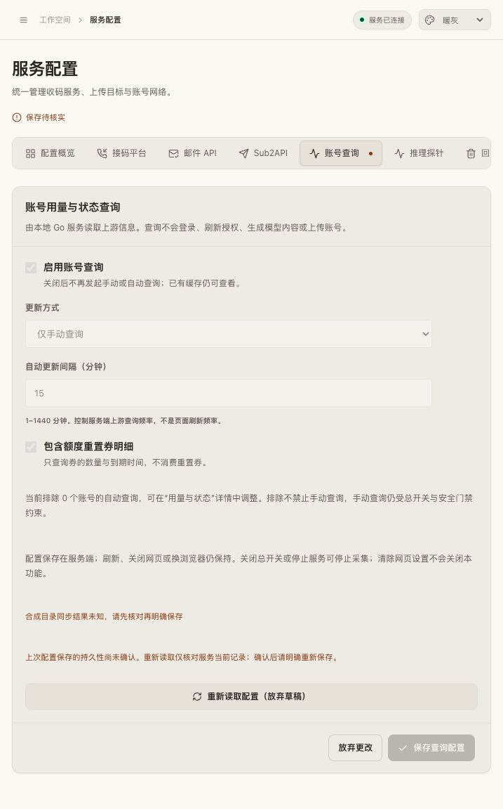

# 2026-11-10 维护审查唯一台账

> 下列“历史维护记录”为本次全项目任务开始前已有内容，其中测试、部署、PID、摘要均为历史证据，不能作为本轮通过依据。当前进度见文末“全项目模块审查（当前执行）”。

## 历史维护记录

本轮以 `/Users/ceng/Downloads/toSub2-go-port` 的实际工作区为基线，完成三轮审查、实现、行为回归和一次 4401 更新。没有回退到原仓库，没有提交或暂存用户的既有修改，也未改技术栈、依赖版本或持久化 JSON 格式。以下结论只覆盖本轮验证范围，不代表全部商用能力已经验收。

**第一轮：实际基线与问题定位**

Git 为 `main`，HEAD 为 `bb5259c2286556a6b827d2a68341b1f3d4ed43f4`。开始时无暂存变更，默认 `git status --short` 有 733 条状态，逐文件枚举有 568 个未跟踪文件；没有将其视为垃圾。记录了源文件摘要和修改前源码，保留所有原有源码文件。原始全仓 `go test -count=1 ./...` 通过。

| 功能 | 实际入口与依赖方向 | 本轮重点 |
| --- | --- | --- |
| 控制台、CLI、Windows 服务、JS worker | `cmd/tosub2` 装配 → jobs/application → protocol/transport、credentials/store | 入口职责、账号锁、输入、收尾 |
| 任务调度与恢复 | jobs 管理队列、运行状态、操作意图、查询租约及私有结果引用 | 取消、持久化错误、历史结果保护 |
| 登录、OAuth、2FA、刷新、补保存 | protocol + 当次 CookieJar；application 继续拥有后续工作流 | 顺序、内存进度、禁止远端重放 |
| HTTP 与后台功能 | console → jobs、accountinsight、accountquality/application、recyclebin、Sub2API、SMS | 路由契约、公开投影、关闭依赖 |
| 浏览器 | React JSX Hook → 本地 HTTP API；Go esbuild + web/vendor → 两份 dist → Go embed | token/请求隔离、配置 revision、未知结果 |
| 构建发布 | Makefile → shell 脚本 → Go 构建；CI 三系统及最低 Go 版本任务 | 产物一致性、未跟踪文件、候选隔离 |

确认的缺陷均通过合成行为复现，而非根据函数名或长度判断：控制台串行关闭延迟无关组件取消；关闭超时遗漏错误及巡检完成信号；任务关闭超时掩盖元数据写入失败；Insights token 切换接受旧配置和响应；较低 revision 的明确读回错误解除冲突保护；未知写入后的旧 handler 在重渲染前可再次 PUT；前端构建第二个目标准备失败时已经替换第一个目标。第三轮另复现了 Insights 关闭未等待已准入配置写入的问题。

维护性问题与上述缺陷分开处理：大闭包混合凭据、输入与协议职责；公开任务投影埋在总路由文件；内存进度函数保留永远返回 nil 的错误契约；历史 README 未说明版本边界。并未据此改造所有模块或清理所有历史恢复代码。

**第二轮：职责拆分与有依据的清理**

| 文件 | 最终职责及改变 |
| --- | --- |
| `cmd/tosub2/main.go`、`job_runner.go` | 生命周期与当次执行分开；构造器装配依赖，继续复用原 application 工作流；原检查顺序、账号锁范围、释放及观察事件 defer 顺序保留 |
| `cmd/tosub2/job_credentials.go` | 凭据加载与绑定核对、输入回填、pending 材料保留、可靠保存与读回、成功发布 |
| `cmd/tosub2/job_input.go` | 当次邮箱轮询、输入别名消费、等待事件、取消与认证需求记录 |
| `internal/console/lifecycle.go`、`monitor.go` | 独立组件并发关闭，共享期限并保留分组件错误；巡检超时后保留所有权，关闭后拒绝重新启动 |
| `internal/console/job_projection.go` | 公开任务、选择摘要、操作名称与操作可用性投影原样迁移；未统一不同接口的响应格式 |
| `internal/jobs/manager.go` | 超时返回同时保留本次初始元数据提交错误，不改变调度、去重或业务结果分类 |
| `internal/accountinsight/service.go` | 关闭等待已持有写锁的配置提交及后台循环；调用期限耗尽时明确返回，后续 Close 仍可等待 |
| `internal/protocol/flow.go`、`bps.go` | `save` 更名为 `recordProgress`，表达仅更新内存；OAuth state、PKCE、client、redirect 和交互阶段不变 |
| `web/src/hooks/accountInsights.js` | token 代际隔离，包括 A→B→A；旧收尾不释放新锁；较低 revision 不解除冲突；同步 authority 防止未知写入后再次提交 |
| `web/src/lib/insightRefresh.js` | 行与详情的目标资格统计提为纯函数，保留未知、历史、冷却及身份判定 |
| `cmd/build-web`、CI、构建脚本 | 双目标先准备再替换、普通失败回滚、失败回滚材料保留；`-check` 对比源码和两份产物；CI 检查未提交生成文件；候选输出支持独立目录 |

删除依据：`Server.ListenAndServe` 在全仓及平台入口没有调用，且另建一套 HTTP Server 配置；移除该无调用入口。`Flow.save` 实际永不失败，删除 26 个不可达错误分支及一处无作用赋值，保留所有正常进度转换。合并重复 bootstrap 注释，改正 Persist/resuming 旧说明。README-legacy 标为历史 Node/Python 版并指向当前 Go 文档；没有删历史资料、许可证、构建标签或解释业务约束的注释。

前端生成 JS 从工作区原 `index-595f63ed9f7f.js` 更新为 `index-adeffff2297d.js`，两份 HTML 同步；CSS `index-d25a532c64ee.css` 和第三方声明内容不变。旧哈希 JS 由重新构建替换，未将任何未跟踪源码当垃圾删除。新增/变化产物仍未暂存，后续提交必须包含它们；本轮没有宣称远端 CI 已执行。

**第三轮：兼容、异常与并发复审**

独立交叉对照修改前实际源码，复查凭据覆盖优先级、pending 材料与 operation ID、输入消费键顺序、邮箱时间界限、锁及 defer 顺序。复审发现手动探针完成时仍需保存历史，因此保留“先手动探针收尾，再关闭质量服务”的依赖，其他独立组件可并行关闭。Insights 写屏障释放 `mu` 后等待 `writeMu`，再释放写锁等后台退出，未反转现有提交锁顺序。回收站仍可通过原 hook 完成已准入的本地清理。

保留并通过现有与新增行为夹具验证的边界：

- 登录 Cookie 仅在当次内存 CookieJar；旧登录会话不读取、不恢复、不输出；Checkpoint 仍拒绝序列化。没有删除废弃输入的拒绝保护。
- 正常登录、密码/邮箱/TOTP/手机号、ChatGPT/BPS 授权、刷新及输入取消保持；2FA 明确成功不额外 GET，未知仅有限只读核实，修改请求不盲目重发。
- OAuth token、轮换 refresh grant、已确认且完整绑定的 2FA 仅走零网络补保存；不伪造 verified、committed 或确认标记。
- 同意图去重、多轮明确重置、账号互斥、跨进程租约、未知及未提交保护、回收站与查询/探针互斥继续生效；JSON 无迁移或清空。
- 前端保留接口超时预算、最近有效读取、草稿冲突、取消/失败/未知区分；未抽象一套强行统一所有 Hook 的框架。
- 传输有限重试、一次性代码导航与写请求禁止隐式重放、上下文取消、JS 消息/时间/内存限制、进程隔离与闭集脱敏诊断未降低。

**实际验证**

| 验证 | 结果 |
| --- | --- |
| 修改前 `go test -count=1 ./...` | 通过 |
| 修改后 `go test -count=1 ./...` | 通过，118.70 秒 |
| `go test -count=1 -race ./...` | 通过，133.21 秒 |
| `go vet ./...`、`go build ./...` | 通过 |
| `TOSUB2_LEGACY_RUNTIME_TEST=1 go test -count=1 -race ./internal/jshost ./internal/legacyruntime ./cmd/tosub2` | 通过，49.96 秒 |
| gofmt、shell 语法、`git diff --check` | 通过 |
| Go esbuild 构建及 `go run ./cmd/build-web -check` | 通过；两份产物与当前源码一致 |
| 构建失败、第二目标安装失败、回滚失败、额外/过期/缺失产物检测 | 行为测试通过；失败回滚保留可恢复旧产物 |
| macOS Keychain 合成凭据往返、历史导入、跨进程更新读取 | 显式启用真实 Keychain 测试并通过，未访问真实账号凭据 |
| 五分钟巡检与在途关闭 | race 通过，实测间隔 5m0.013s |
| 65 秒 HTTP 与 31 秒 native/fingerprint 请求预算 | race 通过，无缩短生产预算代替测试 |
| darwin/arm64、darwin/amd64、linux/amd64、windows/amd64 | CGO 禁用构建通过，全部输出到临时目录 |
| Linux arm64 独立生产二进制认证夹具 | scratch 容器、network=none、只读根、非 root、无宿主数据挂载；四种合成登录/拒绝/重发路径通过，同程序 worker 且私有输入已清理 |
| 实际浏览器合成数据 | 409 草稿保留与明确重读、未知保存锁定、跨页面保留未知保护通过；仅两次显式配置 PUT，无自动重发、查询/模型探针 POST；浏览器错误 0 |

额外生产二进制夹具最初在 macOS 调用，被其明确的 Linux 环境要求拒绝；没有把这次失败算成通过。随后在上述正确隔离环境中执行通过。全仓测试中的子进程辅助入口按设计单独 skip，由所属父测试启动；可选长时和 Keychain 项已另行显式运行。`TestPublicSDKInitialization` 因未提供 `TOSUB2_PUBLIC_SDK_FIXTURE` 未运行，未主动抓取线上 SDK。Windows DPAPI、DACL、SCM 服务生命周期仍未在本机实际验收，交叉编译不替代它们；最低 Go 1.26 工具链与远端 CI 本轮也未独立运行。

浏览器实测五槽均为 4×14 px、无边框包裹卡片；通过绿色，其余实际未通过记录黄色，空槽保留空白样式。合成历史中四次糖果探针加一次绘图只显示四条真实糖果记录和一个空槽；HTTP 200 但解析缺失的详情仍写“结果未知”，不描述为通过。

**4401 交付**

工作区旧 `bin/tosub2` 未覆盖。候选与交叉构建的 darwin/arm64 程序摘要相同：`fa66e94cb4c906d54e1a2095d69d85a373e13ecac5b3820cae6c81360db7117c`。运行目录为 `/Users/ceng/Library/Application Support/toSub2-local/6428e6fb3abbc4ae-legacy`，不与工作区产物混同。

完成所有修改、测试和复审后，仅切换一次：PID `59438` → `58319`。切换前再次确认账号活动/队列、手动和后台探针、查询活动/队列、巡检与回收站均空闲；临时暂停原已启用巡检，未取消账号任务。复用原 launchd plist 原始字节启动，验收后恢复原巡检配置。

切换前后均为 12 个账号、6 个回收站条目，账号身份及状态摘要一致；427 份账号相关文件（含受保护凭据及历史资料）摘要不变，未复制这些文件。查询/探针/回收站配置摘要、巡检配置字段摘要、launchd、工作区旧二进制及 HAR 摘要均不变。实际 HTTP 提供的 HTML、JS、CSS、第三方声明共四份文件与候选逐字节一致，健康检查通过。原自动化恢复后仍按原配置运行，不将其未来执行描述为永远无后台请求。

只保存旧程序回退副本：`backups/program-before-maintenance-20261110-a7c95zmi/tosub2`，相对于上述运行目录。没有业务凭据/Cookie/旧会话备份，没有触发真实登录、2FA、短信购买、模型探针、刷新或上传来验收。合成页面进程、离线测试容器及其临时镜像已清理。

**剩余优先级和边界**

1. 发布入口仍没有全局维护准入屏障；空闲检查与停止之间不是原子事务。本轮暂停自动来源、再次确认后立即停服，未宣称能阻止未观察到的同时手动提交。后续如需多人持续使用时无竞争更新，应独立设计并验收维护准入与排空协议。
2. 本地磁盘永久阻塞无法由 Go context 强行打断。尤其 jobs 的首次同步元数据写入发生于超时 select 之前；本轮修复错误保留，没有引入丢弃持久化的伪硬超时。需要独立故障注入/文件系统运维验收。
3. 两个 dist 无法跨目录原子提交；异常退出可留下不一致，`-check` 会拒绝发布。并发运行两个构建进程仍缺少互斥，当前应串行构建同一工作区。完整发布流水线及 Windows 原生行为需后续验收。
4. HTTP 文件仍有可按领域继续提取的业务调用，部分其他 Hook 仍有重复请求模板。此次只修证实缺陷和内聚边界，没有强拆所有入口或迁移状态框架。
5. 通用响应上限为零仍代表历史兼容的无限制；已有测试保护该语义。本轮未贸然收紧所有外部响应，需要按具体端点测量后独立处理。长期负载、磁盘故障、线上 SDK 变动和真实上游兼容性不由本地夹具完全证明。

审查原始日志、开始/结束源码摘要、逐文件增量 diff、合成浏览器测量及无秘密部署摘要保存在本机临时目录 `/var/folders/08/gy1fn1f90kd0t95s02d35mk80000gn/T/tosub2-maintenance-20261110-4yswc93d`。该目录不是运行数据备份；最终维护说明以本文件为准。

## 全项目模块审查（当前执行）

本轮以开始执行时实际工作区为唯一代码基线：分支 `main`，HEAD `bb5259c2286556a6b827d2a68341b1f3d4ed43f4`，暂存文件 0，逐文件 Git 状态 797 条。枚举 1290 个非忽略项目文件；源码/脚本/平台基线记录 809 个文件。源码副本、Git 差异与摘要只保存工程文件，不包含运行目录或 HAR 认证材料，证据目录为 `/var/folders/08/gy1fn1f90kd0t95s02d35mk80000gn/T/tosub2-full-review-20261110-vorgljim`。未创建提交、未暂存、未回退任何既有改动。

已复核已有 `job_runner/job_credentials/job_input`、`lifecycle/job_projection`、`credential_updates`、`latestRead`、build-web `-check`、`TOSUB2_BUILD_DIR`；这些属于开始基线，不计为本轮新增成果。

依赖顺序：先 M21 基线及 M04/M05/M20 基础，再 M01/M03/M06，再 M07–11，再 M12–16，最后整合 M02/M17–19/M22 与跨模块回归。独立纵向链路并行审查；公共文件有唯一负责人，主执行者整合复审。

| 模块 | 功能与边界 | 实际入口/调用链 | 上下游 | 发现/处理/验证 | 状态 |
| --- | --- | --- | --- | --- | --- |
| M01 | 启动、CLI、配置与生命周期 | main/cli/service → config/store/jobs → console/lifecycle；运行脚本 | M04/M03/M17/M20 | P1 Windows stop 用 errors.Is(Canceled) 吞掉 joined 保存错误，改为保留全部非 nil 关闭错误；统一 runConsole、readiness、bind/restore 失败回收已复核；本机生命周期验证通过，Windows SCM 原生待环境。 | 受阻 |
| M02 | 账号导入、管理、筛选与导出 | accounts/info → console batch/API → imported/unique_email → credentials/export | M03/M04/M17/M18 | 修复大小写显式清空与 credentialWarning 收据；导入/筛选/跨页选择/资料卡/下载调用链复核，console race 与合成浏览器通过；最终全仓与消费者回归通过。 | 已优化并验证 |
| M03 | 任务调度、操作状态与互斥 | API/runner → jobs admission/manager → accountlock/operation lease | M01/M04/M07–09 | P1 迟到 runner 回调可污染终态/下一操作，绑定执行生命周期；重启/目录发现不再重新执行旧 queued/starting 意图；15种组合和完整 jobs race通过。 | 已优化并验证 |
| M04 | 凭据、私有结果与持久化 | credential_import/job_credentials → credentials/privatestate/privatefile/store | M03/M08/M09 | P1 凭据文件符号链接/非普通文件在密钥读取前拒绝；store 不吞 Windows 目录同步错误；离线导入拒绝歧义并保留原错误。Mac Keychain本轮原生通过；Windows DPAPI/DACL/flush待原生。 | 受阻 |
| M05 | 网络、代理、TLS 与重试 | session/auth runtime → transport → upstream | M06–14 | P1 HTTP Set-Cookie 可覆盖/删除/shadow Secure Cookie，修复持锁覆盖校验；代理/TLS/只读与修改重试/长预算完整race通过。 | 已优化并验证 |
| M06 | Go JS 认证宿主与隔离 | worker dispatch → jshost/legacyruntime → bridge/transport | M01/M05/M07 | P2 worker 超大消息吞错后等到超时，改为封闭 WORKER_PROTOCOL_INVALID；本地宿主扩展race通过，Windows进程树原生未验收。 | 受阻 |
| M07 | 登录、交互与添加密码 | CLI/UI → input API/jobs → job_runner/job_input → flow | M03–06/M10/M11 | P1 空/矛盾200过早保存已验证凭据、歧义错误误作验证码拒绝；增加阶段证据并保留合法旧错误格式。真实HTTP交互链已过，最终全包通过。 | 已优化并验证 |
| M08 | OAuth、刷新与本地补保存 | authorization method → oauth/bps → token checkpoint/saved grant/export | M03–07/M14 | P1 OAuth回调重复字段/坏编码拒绝；BPS显式模型配置保留，跨版本已轮换grant本地收尾兼容已完成，4正例/18篡改拒绝/零网络通过。 | 已优化并验证 |
| M09 | 首次设置、重置 2FA 与后续流程 | totp UI/API → jobs intent → runner/protocol → application workflow | M03–08/M14 | 依11月11日用户明确指示恢复原仓logout端点默认成功兼容，不再强制success:true/对象；重复字段、大数解析、保存错误传播及单次请求边界保留。null后续准入、错误阻断、保存故障及最终整合门禁通过；历史实际退出不改判。 | 已优化并验证 |
| M10 | 邮箱 API、自动取码与覆盖 | mail config → mail_input/job_input → mail/otp → input state | M05/M07/M18 | P1 邮件跨源redirect泄漏自定义私密头/307体，剥离所有配置头并拒绝跨源body重放；同源合法POST保持；mail race通过。 | 已优化并验证 |
| M11 | 短信供应商、租约与订单 | SMS UI/API → sms store/lease → providers → jobs label | M03/M05/M07/M16 | P1 Luban订单大整数精度、SMSBower动作回执绑定和重启未知订单不重放；本地供应商/console/jobs完整race通过。 | 已优化并验证 |
| M12 | 资料、套餐、用量、订阅与到期 | insights UI/API → application/accountinsight → protocol/account_* | M03–05/M08/M18 | 未发现需改领域实现的缺陷；grant版本/来源独立/旧值保留/未知≠0/订阅≠token到期/DST和单次时间基准均有行为夹具，完整业务race通过。 | 已审查无需修改 |
| M13 | 探针、模型、历史与预览 | quality/manual UI/API → application/accountquality → modelprobe/preview | M03–05/M08/M14/M18 | P1手动画图panic边界及资源释放修复；删仅测试调用的重复构造器，改测真实Client请求；评分、门禁、缓存、preview完整race和浏览器通过。 | 已优化并验证 |
| M14 | Sub2API 上传、合并与同步 | upload UI/API/workflow → application/upload → sub2api client/upsert | M03–05/M08/M13 | P1 BPS显式列表被覆盖，改只补缺省/null；精确复用已确认授权、committed读取复用；全批门禁Sub2API零请求/部分收据/未知不重发已验证。 | 已优化并验证 |
| M15 | 巡检与自动修复 | monitor UI/API → console/monitor → sub2api/monitor → jobs auto_repair | M03/M12/M14 | P1 自动回传先持久fence、未知暂停；配置发布与持久化原子；503 uncertain与前端读回屏障已修，最终普通/race及503读回屏障通过。 | 已优化并验证 |
| M16 | 回收站、恢复与关联清理 | trash UI/API → recyclebin/jobs → credentials/results/query/probe/SMS cleanup | M03/M04/M11–15 | 复核trash→取消/等待释放→tombstone→关联清理→恢复只可见；普通失败/未知/purge_pending与隔离测试通过，领域无需重构。 | 已审查无需修改 |
| M17 | HTTP、安全与响应契约 | console Handler/middleware → handlers → public projection/download | 所有业务模块/M18 | P1 null/别名歧义写入拒绝；schema内校验、opaque业务字段保留且UseNumber；Host/Origin/token/方法/下载和公开投影复核，最终集成通过。 | 已优化并验证 |
| M18 | 前端架构、异步与交互 | main → hooks/lib/components → local APIs | M02/M07–17 | P1同render双提交、A→B→A旧回调、切账号首render秘密/模型目录泄漏修复；复用latestRead；合成浏览器宽窄/主题/草稿/预览/日志通过。 | 已优化并验证 |
| M19 | 日志、诊断与错误模型 | logging/observations/runtime/probe → jobs archive/API → logs UI | M03/M05–18 | P1任意mailRequestHeaders未整体脱敏修复；HTTP观察不当成功证据、错误包装、归档分页和纯文本展示复核；logging/console race通过。 | 已优化并验证 |
| M20 | 构建、发布、平台与 CI | build-web/scripts/Makefile/Docker/deploy/CI → dist/embed/executable | M01/M06/M18/M21 | P1同工作区构建与check/Go embed读取并发竞争，正式native/cross全程OS锁、私有源码资源快照、全目标成功才发布和失败回滚已实现并验证；本地/Windows验证脚本接入正式独立构建，Docker默认cache/overlay构建已修；Windows原生/远端CI未执行；4401已统一更新并核验。 | 受阻 |
| M21 | 测试、夹具与质量门禁 | Go behavior fixtures/ui-fixture/race/fuzz/verify/platform tests | M01–20 | 补HTTP导入→真实Sentinel/OAuth→input去重→保存/download→本地Sub2API链；先红后绿保护新增缺陷；修复跨工具链共享锁测试污染；最终统一门禁通过，条件测试分别记账。 | 已优化并验证 |
| M22 | 文档、注释、无用代码与依赖 | README/docs/go.mod/vendor licenses/script docs | M01–21 | 复核当前README/部署/BPS/运行文档与历史记录、vendor来源/许可证/依赖；不重写历史证据；本轮删除仅无生产调用或违背旧意图不重放的分支。 | 已优化并验证 |

全部模块已有具体调用链、关键分支、处理及本轮验证依据；当前16个“已优化并验证”、2个“已审查无需修改”、4个“受阻”。M09依11月11日用户选择调整为原仓端点兼容并完成本地重新验收；Windows原生平台验收与发布外部条件仍受阻。本轮仅报告阶段完成，不能宣称全项目模块验收全部完成。具体缺口及下一步见最终交付记录和退出专项。M12/M16无需领域改动，仍回归其共享存储、锁及前端消费者；不是仅浏览文件。

### 本轮执行记录

- 基线清点已完成；并行任务各自审查完整纵向消费者，禁止调用真实账号登录、2FA、刷新、探针、短信购买或上传。
- 4401在完成可执行模块、最终整合验证与候选准备后，等待用户明确确认手动/CLI新提交已暂停，再统一切换一次。执行中实际账号数曾由11变为12，最终以维护窗口重新读取值验收；没有取消新账号任务。部署细节见最终交付记录。

### 各模块纵向审查与处理依据

以下记录分批审查中的具体证据；最终冻结版本的统一门禁表优先于分批耗时，不将中途通过当作最后版本通过。平台及外部环境未执行项单列。

#### M01：启动、CLI、配置与服务生命周期

入口/链路为 main 先 WorkerMain 分派，再 config.Parse、离线凭据导入、Windows SCM、CLI、runConsole；控制台与 Windows 服务共用 runConsole。runConsole 先 store/监听端口、Manager Restore、Console 依赖，再安装策略/启动后台服务并宣布 ready；根取消传播 HTTP BaseContext、Manager、邮件/短信/查询/探针/巡检/回收站。console/lifecycle 是已存在基线，不计本轮新架构。CLI 没有 UI/API 环节；Windows 控制流复用服务编排，不能另建第二套行为。

已确认行为：命令参数覆盖环境变量、worker 不进入控制台、help/离线导入不启动服务；非法显式端口/并发额度/代理/SDK来源报错；合法显式零值代理预算与短信超时保留 Set 标记。旧 envInt 对空/坏值/零回默认、旧短信非正值的人工回退是明确兼容分支，不因统一解析擅自改变。bind 失败非零退出；restore 失败保留原 metadata 并关 listener；ready 在初始化完成后触发。独立组件并行关闭，手动绘图在依赖 quality service 关闭前完成；HTTP停止后等待组件/Manager提交，错误用 Join 保留。重复Close取消幂等、必要等待可以再次执行。

P1：Windows service 在停止时用 errors.Is(err, context.Canceled) 将包含磁盘保存错误的 joined error 误当正常停止。本轮改为只把 nil 当成功；正常取消由共用 runConsole 收尾返回nil，任何持久化错误仍作为 SCM failure。新增 TestWindowsServiceStopPreservesJoinedPersistenceFailure；本机无法执行原生 SCM，已列环境阻碍，不能以cross build宣称通过。

验证与下游：本轮 entry-import-race、config/console/jobs模块回归；TestConsoleProcessBindFailureIsNonzero、TestConsoleFailedRestorePreservesMetadataAndClosesListener、TestConsoleCancellationWaitsForMetadataAndClosesHTTP、TestConsoleShutdownCancelsForegroundSub2APIRequest、CloseContext 的超时与多错误/依赖顺序测试。长预算/五分钟巡检为独立 opt-in 真等待测试，最终版本结果另列。没有为测试缩短生产时间预算或把历史PID当本轮状态。

#### M02 账号导入、管理、筛选与导出

- 入口/链路：App 单账号表单、批量导入、筛选与跨页勾选 → POST `/api/jobs`、`/api/jobs/batch`、`/api/jobs/query`、GET jobs → `createRequest.inputValues` / `batch_parser` → Manager `ImportOrUpdateByEmail` / unique-email → 元数据与凭据库；资料卡 GET account-info → vault + 当前业务状态；授权下载与源资料 export-source → 受保护授权读取/显式源字段投影 → 浏览器 blob 下载。账号生命周期/凭据底层由 M03/M04 所有者复审。
- 主文件：`internal/console/server.go`, `batch_parser.go`, `batch_outcome.go`, `account_info.go`, `job_projection.go`; `web/src/main.jsx`, `components/accounts.jsx`, `account-info-dialog.jsx`, `lib/console.js`, `hooks/serverState.js`。
- 已确认合理行为：导入不隐式授权；邮箱 case folding 唯一性、更新已有账号而非新建重复账号；缺失秘密字段保留既有资料，显式空值清空；parser 对多种分隔符、含分隔符密码、URL/TOTP/邮件请求体采取有据识别并拒绝歧义，不重写已有合法输入语法；筛选后 selection index 含跨页可选项，UI 以 id Set 保留选择；每条导入/操作独立收据，失败不掩盖先前成功；公共账号/selection 不带密码、TOTP、Cookie 等私有字段；资料卡只在授权端点读取，默认遮蔽秘密；下载投影剔除认证会话且保留合法授权业务字段与精度。
- 已证实缺陷 P1/P2：typed decoder 大小写不敏感而 provided-map 只认规范拼写，`PASSWORD:""` 等被误当“缺失”，无法按请求清空；导入成功 UI 泛称已保存，在 credential store 降级警告时容易被理解为私有资料已可靠保存；资料卡跨 token/id 复用组件时可能保留显示状态。
- 本轮处理：provided-map 对 password/totpSecret/mailApiUrl/mailRequestBody/proxyUrl 用 EqualFold 归一；batch receipt 添加独立 warnings，成功但存在 credentialWarning 时 UI 明示私有保存未保证、保留原始输入及弹窗、不自动重试/授权；资料卡按 token+job.id 加 key，使身份切换卸载私有状态。未改变现有 Linux/不可用安全存储的受限内存语义。
- 不改动理由：`exportSource` 特意保留原 Input 的 mail body 和既有 no-vault/历史源资料 fallback，已有源码/行为契约保护；资料卡与源导出的使用目的不同，未机械统一；未知字段未被批量删除。
- 本轮验证：`TestAccountImportCaseInsensitiveExplicitClearsMatchTypedDecoding`（缺失保留、uppercase 明确清空、全空 credential record 删除）；`TestBatchImportReceiptSeparatesAccountCommitFromCredentialWarning`（故障 credential store、metadata 已提交、warning、无秘密、无授权队列）；`TestFrontendBatchImportCredentialWarningRetainsDraftAndDoesNotClaimSavedSecrets`；现有 imported/batch/parser/account-info/export/pagination/selection 相关测试随 console 完整套件回归。新增缺陷测试先在原实现失败，再修复通过。
- 状态：代码/定向验证完成；完整 race 与统一浏览器验收结果见主执行记录。无真实账号导入/数据改动。

#### M03：调用链、合理实现和职责

- 入口为 console 任务/输入/取消/切换操作、CLI runner 和 monitor 申请的操作；核心链为 Manager.Submit/QueueOperation → 持久准入 → pending/scheduler → 同账号 emailUse → run → application wrapper/命令runner → 领域状态/私有结果 → Job投影和订阅事件。account_query 为查询/探针/上传提供账号快照准入；account_operation_lease 与 accountlock 为真实远端/本地凭据操作提供跨进程互斥。
- 文件归属：`internal/jobs/manager.go,admission.go,operation_state.go,restore.go,discovery.go,account_query.go,input_candidate.go,switch_operation.go,removed_operation.go,oauth_result.go,authorization_method.go,credential_updates.go,refresh_recovery.go`；TOTP专用状态归M09，导入/唯一邮箱归M02，自动修复归M15，删除/trash归M16，日志归M19。`internal/accountlock/*`和`cmd/tosub2/account_operation_lease.go`是M03共享基础。
- scheduler 全局锁只负责队列/运行所有权，账号规范化防同邮箱并行；外部账号文件锁使用稳定inode，进程退出由OS释放、不unlink在用锁。Unix/Windows独立文件仅改变OS锁原语。账号查询被操作取消后仍须等Release，版本/代理/输入变更使旧结果失效，不能靠取消就早放租约。
- 准入先提交元数据再发布队列，失败回滚当前对象和输入。不确定持久化保持专用错误。输入候选的比较与移除在同锁内；准备输入后取消/切新提示不能消费旧输入；不会为统一输入损伤密码空格。
- 修复1的不变量：runner callback 只有当前调用存活且ctx有效时能发布；return与终态提交共享锁切断执行权。callback捕获原Job ID，不能被runner改写ID。保留公开Manager.Emit给非runner元数据消费者，避免笼统封死合法更新。新测试覆盖完成后、下一次操作中、取消后仍清理中的迟到事件。
- 修复2的不变量：磁盘资料不是再次执行远端操作的授权。删除restore和discovery构造旧pending队列的分支及其sort/import/wake；恢复状态为interrupted，同时保留缺失凭据reauth_required诊断、私有grant本地收尾、2FA未知隔离和RecoveryPaused。删除无用restoreOperationState的grantAvailable参数并更新单个直接测试调用。
- 测试 `TestRestartRetainsAccountsWithoutExecutingOldIntents` 用 queued/starting/interrupted × full/relogin/refresh/add-password/setup-2fa，提交新的无关barrier验证调度器真正运行过，断言旧runner零调用，再显式发起新的relogin且仅一次。旧恢复测试原先预期自动排队已调整为保留账号/中断/零队列；删除取消测试额外比较操作前后磁盘字节，继续保护无副作用。
- 其他实际验证包括 `TestAdmissionFailureDoesNotPublishOrMutateExistingAccount`、`TestNewAdmissionFailureLeavesNoRunnableJobOrCredential`、账号查询释放/取消/删除/代理版本测试、AccountLock跨进程退出与权限/symlink测试。最新full jobs race包含业务代理新AutoRepair fence；console full race曾通过112.803s（后续主整合须重验）。

#### M04：凭据库、私有结果与持久化

入口：交互/离线导入→operationCredentials和Manager按操作ID更新→credentials.Store；已取得grant/已确认激活密钥→privatestate的purpose/email/root/path绑定→privatefile durable write；普通Job metadata→store原子提交。账号资料/源资料导出及应用committed授权读取是下游消费者，公共列表仅投影存在性。Linux保持现有内存降级及warning，不伪称安全落盘；需要可靠保存的2FA等修改在网络前拒绝不可用vault。

已确认行为：macOS隔离Keychain service冻结，旧namespace不自动合流；Windows CurrentUser DPAPI、创建即私有DACL及读回校验；POSIX 0700/0600，应用私有目录与任意导出父目录职责不同，不chmod用户共享祖先。私有状态AAD和hash/account隔离；temp写/文件Sync/close/replace/父目录Sync/读回按顺序完成，目录同步失败标可见但持久性未知，不能声称旧值还在或已可靠保存。pending材料受operation/factor/邮箱绑定，credential_updates对新操作和版本复核，旧任务不能覆盖新密码/seed。缺失字段不等于清空，密钥不可用无明文回落。既有拆分保留，不重复新增包装。

本轮问题：P1 credentials existingFile跟随symlink或允许目录进入Keychain读取；现先Lstat确认regular，读句柄与原路径SameFile核对，保留旧加密envelope兼容。新增file_boundary测试对Load/Save和symlink/directory断言密钥读取0次。P1 store在Windows原无条件忽略目录同步，现复用privatefile.SyncDirectory并保留store.ErrDurabilityUncertain；真实Windows文件系统是否支持flush必须原生验收。P2离线导入输出失败覆盖原取消/导入错误，现errors.Join保留原因，输出writer的私密错误不外泄；合法JSON拒绝重复字段，纯文本合法花括号邮箱保持。

验证：foundation/storage race通过；TestDurableWriteFailureBeforeAndAfterReplacement、TestDurableWriteFlushesNewParentEntries、TestDurableWriteRetriesUncertainParentCreation、TestDurableRemoveRetryConfirmsAnUncertainAbsence、TestDirectorySyncFailureReportsAlreadyReplacedFile、Registry symlink/root隔离、credential并发更新与离线导入读回/失败/源不变。改后本机原生 TestMacOSKeychainIntegration、TestMacOSKeychainLegacyImportIntegration、TestNativeCredentialStoreSurvivesProcessRestart全部通过1.374s，仅合成账户且清理。Windows DPAPI/DACL/目录flush与跨进程原生行为未执行；同用户恶意父目录替换不是现有应用目录检查能彻底隔离的威胁模型，未宣称消除了所有TOCTOU。没有改真实账号数据，也没有备份旧会话。

#### M05：传输和会话链

- `internal/transport`全部生产文件：http/http_retry/read_retry/tlsclient/fingerprint/curl_compatible/connect/socks/proxy/dial_scope/response_limit/diagnostics/cookie；消费者为protocol.Client、legacyruntime.Client、cmd session_transport/authentication_runtime/network_retry，以及邮件、资料查询、探针和Sub2API各自预算。
- 复核 native HTTP 与fhttp/TLS实现：均关闭库隐式重定向和第二CookieJar；响应头与有界内容收据可以在后续读/记录失败时保留；body回收与取消延伸到TLS和代理隧道；HTTP2取消不能关闭别的流。Request.Timeout优先保留调用方合法长预算；不统一裁成30秒。
- GET/明确只读POST拥有有界重试；远端修改仅在证实尚未进入可发送HTTP的连接阶段时可重试。joined error中任何不安全/永久分支不能被另一个临时错误覆盖。已发送写入、one-time callback/code/token导航、明确403/429、HTTP头后截断响应都不能转成换身份/盲重试。
- 代理配置显式值、最大尝试20、SOCKS5本地DNS与SOCKS5h远端DNS、HTTP(S) CONNECT认证隔离均保留。Chrome146 curl兼容仅针对指定profile，不修改共享profile工厂。匿名连通性预检的候选Jar隔离，选择后只采用被选候选的cookie；真实操作始终新Jar。
- Cookie域/publicsuffix/HostOnly、路径排序、Secure/HttpOnly、Max-Age优先和溢出、过期清理、partitioned不误作无分区cookie发送均已复核。Cookie类型显式拒绝JSON序列化/反序列化；无落盘及跨操作恢复。
- 本轮新增HTTP写入Secure保护与已有document.cookie保护共用持锁谓词，防并发check/set间隙；过期Secure不阻挡合法后续Cookie。Cookie只是当前操作的内存权威来源，没有增加新持久化。
- 关键测试已在全包race覆盖：真实TLS握手中断、发送后断连不重放、长于30秒预算、压缩/响应大小、HTTP2多流隔离、代理/连接取消、profile403/429、cookie jar注入拒绝、候选Jar隔离。

#### M06：同程序JS宿主

- 链：cmd同程序`--auth-js-worker`分派 → legacyruntime独立进程输入/NDJSON和网络桥 → jshost单goroutine事件循环 → realm/frame/WebWorker → HTTP/文档Cookie请求回父进程 → 业务Sentinel/challenge。JS没有直接HTTP客户端或文件系统能力。
- 文件：`internal/legacyruntime/{client,runtime,sentinel,challenge,process_unix,process_windows}.go`、`internal/jshost/*.go`及内嵌`dom.js,network.js,clone.js,storage.js,workers.js,webplatform.js`、`cmd/tosub2/sentinel.go,authentication_runtime.go`。DOM/URL/body/streams/clone/storage仅为认证宿主使用，不是浏览器产品或权限系统。
- 生命周期：父ctx和调用ctx共同取消；client gate串行使用同一身份与Jar；Close禁止新操作，等在途清理后回收连接；进程组/Windows Job控制树回收；私有输入临时文件清除，stderr丢弃远端内容。Run回收全部worker并join读/写/转发goroutine。worker EOF、写失败、panic、宿主缺失能力、脚本异常保留不同封闭诊断，不把SCRIPT_EXCEPTION当业务拒绝或成功。
- 限制：单消息32MiB，32活跃/128累计worker、4096计时器和pending请求、5MiB/origin内存Storage、总deadline、GC预算和采样heap watchdog。采样内存guard不是OS RSS硬限制，文档和注释已明确。Window membrane和origin检查、postMessage targetOrigin、结构化克隆不跨VM共享对象；worker同源/blob源约束；http(s)动态资源，不读任意文件；SDK URL必须与loader配置源一致。
- Cookie通过宿主不可伪造的realm URL桥接，服务器Set-Cookie在Go Jar应用，原始Set-Cookie/HttpOnly永不发送到脚本；DOM local/sessionStorage仅本次host内存，非持久账号恢复。
- 本轮修复worker.forward吞掉scanner错误；本地33MiB消息可复现原超时，修复后封闭错误，无消息内容泄漏。包含取消、嵌套脚本异常、worker listener、FIFO、timer饥饿、frame退役、XHR晚响应、stream body一次消费、二进制传输、跨origin Storage隔离的现有行为夹具继续通过。
- 分批验证覆盖password/email/MFA本地TLS、动态JS、OAuth及新增console-upload贯通链。中途夹具施工及测试namespace冲突曾使整条命令失败；这些失败保留原日志，最终执行状态以文末门禁记录为准。
- 限制：未设置`TOSUB2_PUBLIC_SDK_FIXTURE`，可选公共SDK初始化测试跳过；没有主动访问真实上游，没有声称当前公开SDK/Cloudflare长期兼容；Windows进程树仅源码/交叉构建不能代替原生验收。

#### M07：正常认证与添加密码

- UI/CLI输入 → Manager单次候选/operationInput → Flow新操作 startLoginOperation/新Jar → password/email/MFA/phone → OAuth或安全子操作 → operationCredentials持久更新 → 当前任务结果。`job_runner.go,job_input.go,job_credentials.go,mail_input.go`基线拆分分别拥有编排、输入、凭据写入、邮件轮询职责，未再次复制或增加转发层。
- protocol`flow.go,recovery.go,checkpoint.go,mail_otp.go`包含正常流程/过期分类/拒绝旧checkpoint；OTP/TOTP算法保持原导入合法长度及空白兼容。每次独立操作清除web/checkpoint/verifiedPassword，ResetSession只在当前Jar清除认证cookie并保留设备；旧checkpoint读取和会话导出直接拒绝。
- 交互不变量：自动密码/seed候选一经接受从当次输入移除；刷新展示不能再次提交；明确incorrect code/密码拒绝才提示修正；自动MFA被拒后转人工当次会话，不自动重登；手机号错误只沿已有明确安全分支处理。网络/401权限/429/challenge与业务拒绝不同。
- 新成功证据接受当前Auth/Chat origin、离开原输入页的continuation，或已注册且绑定当前内存state的OAuth回调；保留相对URL、域内未知后续路径、nested external_url和有效page-only回执。外源/非HTTP地址、userinfo/fragment、同一输入页、错误state、空对象/null、success:true但无下一步或success:false/error矛盾都不得触发PasswordVerified/TOTPVerified。18个负例修前错误保存、修后验证回调零次，写请求一次且无额外输入；合法旧回执和真实登录/OAuth/BPS回归通过。
- HTTP失败的解析修复不移除现有短明文/JSON字符串错误契约：新增歧义测试同时复跑`TestLegacyRejectedCredentialResponseShapes`的6种格式×3种凭据、权限错误不变过期、空密码零Sentinel/零POST。最后专项race1.728s通过。
- 添加密码仍保持：新密码完整合法性、原账号当前已验证身份、POST发送后未知不重发、结果私有暂存/安全vault写入和读回、仅匹配当前candidate可恢复；已有合法continuation/external_url回执保留。没有在此改动现有回执兼容。

#### M08：授权结果及本地收尾

- ChatGPT/BPS入口授权方式归一化 → client/redirect/PKCE/state → workspace/手机号必要分支 → 回调捕获不请求loopback → 单次code兑换 → issued grant私有保存 → export → manager ResultSaved和下游上传/查询。refresh单独读取已保存授权，不走登录。
- 文件：`protocol/oauth.go,authorization_method.go,pkce.go,bps.go,oauth_metadata.go,bps_settings.go,token_checkpoint.go,private_state_context.go`；BPS只读access模型资料归M12共同消费者。`jobs/oauth_result.go,authorization_method.go,refresh_recovery.go`和cmd`authorization_method.go,saved_grant.go,refresh_recovery.go`关联操作身份、目标和出错路由。
- 回调严格化：拒绝重复state/code/error/error_description、非法转义、userinfo/fragment，保留合法未知供应商query字段。Flow.isCallback按已注册scheme/host/path识别，同一state校验后才兑换，PKCE由安全随机数生成并S256匹配。
- grant是已实际取得token的严格版本记录，包含email/client/redirect/AuthBase/ChatGPTBase和可选JWT身份校验，无cookie/code/PKCE待登录材料。FinalizeSavedOAuthGrant纯本地，先写和读回最终输出，后删除私有grant；保存失败保留原始已取得材料。新OAuthResultID隔离旧授权结果，不能冒充新操作成功。
- refresh_recovery使用UseNumber保留多账号/大整数/合法未知字段；source/target/hash/account/client绑定，先接受旋转grant再有限本地保存，取消不丢已返回结果；重启重新调用先走local finalize，拒绝源变化而非第二次refresh。`TestRefreshRotationSurvivesOutputFailureAcrossProcesses`、`TestRefreshSameFileCancellationRecoversWithoutReissuingGrant`、`TestRefreshRecoveryRejectsChangedSourceOrBinding`验证真实跨进程临时输出和请求计数。
- `TestIssuedGrantFinalizationIsLocalAndContainsNoLoginProgress`、`TestProductionSavedGrantFinalizesWithoutBrowserProxyOrCredentialService`验证零网络/无需凭据运行时；账号不同/client不同/旧checkpoint/无输出证据拒绝。
- BPS模型与用户远端配置合并冲突已转M14负责人，修复同一实现不复制公共逻辑；主代理完成后更新此模块状态。真正未知字段不会被猜作垃圾删除。未修改存储版本、依赖或真实token。

BPS集成已完成：显式列表包括空数组保留，仅缺失/null补模板。v1 refresh recovery对旧程序已写入但pending未清的九模型输出，仅认可同source/grant/AcceptedAt完整旧结果摘要；保留原文件字节，仅清pending。4个正例先红后绿，18个其他字段变更负例保持拒绝且网络0，定向race7.826s通过。

#### M09：2FA纵向链及后续步骤

- 入口console setup/reset/complete → Manager intent receipt/账号互斥 → cmd job_runner/配置callbacks → protocol当前新登录 → 初始mfa状态 → 必要移除 → 登记材料 → 激活成功证据 → vault保存/读回 → 元数据commit → 可选logout → 新登录OAuth → 可选上传 → 公共projection。
- 文件归属：`protocol/totp*.go`（response/status/state/evidence/receipt/capture/journal/continue/verify/web_authorization/recent_auth等分离职责）、`jobs/totp*.go`（意图防重/隔离/本地完成/归档/导出门禁/工作流）、`cmd/tosub2/totp*.go`、`application/totp_workflow.go`。前端及console handler由其负责人复核。
- 复核原不变量：reset需要可用持久vault；开始远端修改前绑定email/account/operation；pending seed与URI在激活前保存并读回；缺失登记secret/session/factor不得重新enroll掩盖；激活receipt必须完整绑定或者仅原当次session内最多有限只读核实；明确成功不追加GET；取消/明确未发送不做远端核实；旧未验证/旧会话journal隔离不续接。
- 本地complete只接已确认激活且完整绑定材料，且vault pending或已保存seed一致；配置选项不能夹带重登/退出/上传。MarkTOTPResetCommitted是最终元数据提交，失败回滚元数据但保留证据；同账号旧历史已完成操作与后续新的操作身份不混写。archive只允许明确新intent把自己已完成且无会话的journal重新加密归档，验证读回后移除active；旧含session资料不拷贝为新备份。
- 本轮logout成功判定修复保留既有204空响应及success:true+falsey error本地接受规则；200空文本/对象/数组、重复字段、字符串success都为unknown。新测试断言logout/disable/activate各一次，credential_persisted始终true，不因logout未知翻转新密钥。HAR只读查找logout_all记录数为0，不能当真实该接口成功证据。后续沿革复核确认204来自合成夹具，不能称作由真实上游证明的端点契约。
- 重要已有夹具本轮执行：`TestFourIndependentTOTPResetsUseFreshLoginAndDeduplicateIntents`实际连续4轮新登录/重置，同intent回放不重做；`TestTOTPCurrentSessionUnknownMutationReadsWithoutReplay`；`TestTOTPFirstLoginNeverPersistsSession`；`TestTOTPSetupSuccessfulReceiptSavesWithoutConfirmationGET`；`TestTOTPCompletionPreservesLegacyJournalWithoutNetwork`；`TestTOTPWorkflowOrderAndFailureBoundaries`覆盖logout未知/拒绝/取消、后续重登失败/缺新输出、上传失败/未知/读取失败等并保持前置结果。后者部分operation注入为应用编排边界测试，不能冒充完整远端协议链；生产runner和protocol另有真实HTTP/协议夹具补充。
- 回收/查询/上传门禁使用同账号证据；本地complete与归档仍取得普通origin的账号锁；不恢复独立远端2FA recover入口。Windows/macOS真实vault验证由M04单列，不用memory fixture冒充。

#### M10：邮箱与人工覆盖

- 请求配置UI/API保存至凭据 → operationInput.beforeEmailOTP采基线 → protocol发送/重发验证码并记录时间 → mailInput轮询 → mail.Candidate时间/身份去重 → 优先ConsumeInput人工覆盖 → auth验证 → 当前mail状态展示。mail解析也被protocol legacy命名和短信文本提取复用，保留别名wrapper避免多套解析。
- `internal/mail/otp.go`拥有GET/POST、header/body、2MiB响应、每请求/总体重试预算和候选解析；`cmd/tosub2/mail_input.go`拥有poll/manual/pause和10分钟循环；`job_input.go`只编排阶段消费。mail-request-config前端由前端负责人复核。
- 时间逻辑：发送前快照排除旧消息，requestedAt允许原5秒边界但不采用baseline中的旧message身份；无可靠时间低置信候选需两次独立轮询；失败基线不能取未知年龄旧码。明确重发才重置暂停/边界。日期兼容与JSON/HTML/base64/折行格式既有测试保留。
- 手动输入接受即结束本次轮询并取消请求；晚结果仅可能写正交mail事件，runner callback lifetime改进进一步防终态污染。ctx取消与60秒fetch预算/12秒单次请求、有限重试保证可退出；错误分类和日志使用安全文本，不带私有mail URL/body/key/code。
- 本轮跨源修复在301/302/303先正确改GET并去body后评估：GET跨域仍可读取公开目标；所有配置头剥除并恢复普通Accept/User-Agent；307/308私有body不跨域转发而在目标请求零次前terminal失败。同源307仍保留原POST/body/header，避免改变合法接口。
- 本轮mail全包race5.735s通过，相关cmd消费者已在前次全包race和后续cmd扩展（除主新增施工fixture）中执行。测试名：MailBaselineAndMessageIdentity、MailMissingBaselineRejectsUnknownAge、MailFetchDeadlineAndCancellation、MailTimeoutPausesUntilResendAndPreservesManualOverride、MailFetchErrorsRetryAndNeverExposeRequestDetails、MailLowConfidenceRequiresTwoSeparatePolls。

#### M11 短信供应商/租约/订单 — 模块审查结论

入口：UI供应商配置/国家库存→Console SMS API→providers NewHTTPProvider/SMSBower/CustomPool→GetNumber→MarkReady→GetCode轮询→job输入→认证消费反馈→Complete/Release；独立订单/持久化状态在sms_store，回收pause/purge在sms_trash。生产归属：`internal/providers/*.go`、`console/sms*.go`、`jobs/sms_label.go`；UI由前端负责人独立核对。

已确认行为：purchase与setStatus即使HTTP GET也按修改请求、仅证明未发送可重试；只读getSms/getStatus/getPrices/getCountries可有限重试；传输12s且调用方取消优先，body 2MiB，禁止重定向扩散key。API key错误不原样泄漏URL。价格有限正数、国家/服务ID校验；号码/订单以字符串保留数值语义。custom池领取/释放持有池锁并受控持久化，全局池和单账号订单清理范围分离。自动输入与人工覆盖通过generation/cancel防迟到；完成状态依赖认证确实消费，未消费不伪造完成。关停取消轮询不恢复旧登录。

问题处理见本轮1–3。测试：providers全包普通与race；Console SMS全选择普通16.745s、随后业务全console race116.126s。新回执交叉、精度、重启故障夹具与既有sms_flow/deferred/input_lifecycle/zero_settings/trash/restore全部通过。限制：未连接真实供应商，未知订单需人工在平台核实；不自动探测旧订单状态、不购买新号码来验收。

#### M12 资料/套餐/用量/订阅/到期 — 未发现需改领域实现的缺陷

入口：Insights设置/单批刷新/自动循环→console.accountInsightsAPI→accountinsight(Service/runner)→application.LoadAccountInsightGrant→协议固定只读端点；订阅刷新独立application.subscription_refresh→QuerySubscription→jobs.SetSubscription；手动到期console→accountexpiry.ParseManual→jobs局部metadata。生产归属全部accountinsight、accountplan、accountexpiry；protocol/account_insights{,_client,_usage},account_subscription{,_refresh}；application/account_insights,subscription_refresh；console/account_insights,account_info,account_expiry,subscription_refresh及M19观察器。

已确认：所有读取使用已取得且当前有效grant的账户查询租约和跨进程账号锁，拒绝认证wrapper，读取永不登录/刷新token。固定endpoint、single attempt或有界只读重试、整个来源预算和body限制。401/403/429/transport/parse分别报错，HTTP观察仅是收到状态证据。identity/account_id/plan/scope冲突不借用别来源到期；unknown用指针和reported区分未知/0/明确清空；可选来源失败保留主来源或匹配历史，不能把token expiry当subscription expiry。缓存以grant/account版本提交，旧查询不能覆盖新授权；settings revision和persist未知处理现有行为保持。订阅手动刷新与原grant不可变独立。手动时间捕获一个now、浏览器IANA、DST跳过/重复拒绝、短日期不顺延、UTC存储；显式空串可清除，nil/缺字段不可误清。

证据：accountinsight race4.751s、accountplan1.356s、accountexpiry1.392s、application37.630s、console116.126s；协议相关随主验证和本代理BPS以外整包基线通过（最终全协议由主执行者复跑）。关键行为tests：OldGrantResponseCannotCommit、CredentialChangeDuringPersistenceDoesNotPublish、PartialHasIndependentSources、FailedAttemptRetainsLastObservation、PrivateCacheRejectsSymlinkAndBroadPermissions、RefreshAllAccountsForInventoryBeyondQueueCapacity、RefreshAvailabilityConcurrentAllAndSelectedRequestsPreserveSingleFlight、QuerySubscriptionRetainsPlanWhenExpiryQueryFails、InsightAccountsBindsOnlyExactWorkspace、InsightUsageNullUnknownAndMalformedValues、InsightResetCreditsUnknownZeroAliasesAndPrivateIDs、AccountInsightGrantRejectsPendingUnsafeOrReplacedFiles。没有为文件长度重拆协议与service。

#### M13 探针/模型/历史/预览 — 模块审查结论

入口：GET模型目录/显式糖果refresh/手动Pelican→console.account_quality*→application.AccountQualityController→accountquality policy/flight→modelprobe客户端；自动上传先申请UploadSession→BeforeAuthorizationSync gate；历史/HTTP展示读snapshot，预览前端单独sandbox/CSP。归属全部accountquality/modelprobe、application/account_quality{,_manual,_models,_observation},console/account_quality*；protocol/account_models与suggestions共用M12只读grant。

正确行为：模型目录不代表可调用权限，suggestion与live分开，disabled不被suggestion复活；所选单次model/reasoning不回写global revision。scored请求绑定模型与rule/options/身份，不接受空200、矛盾JSON、不完整SSE、错误模型完成事件；HTTP结果不能充当糖果通过。缓存有效性同时看新授权、代理/TLS、settings、TTL、当次失败；历史通过不能覆盖当前失败。history只保留5条真实完成记录，取消/准入失败不填槽；Pelican绘图与糖果评分严格分离。取消保留grant至回收完成，迟到绘图不公开，关闭等待inflight。上传前门禁对全批预检、绑定exact授权；未通过时Sub2API请求为零，可能已经发生的探针请求单独计数。

本轮4/5；modelprobe全包普通0.497s与race3.011s，accountquality race9.801，application37.630，console116.126。重点真实行为断言：UploadGateChecksWholeBatchBeforeAnyRemoteRequest、AccountQualityDefaultOffMakesNoProbeButHoldsUploadReservation、StrictUploadReviewSessionHoldsOSLockUntilCleanup、AccountQualityModelsHonorCancellationAndAccountMutations、ManualProbeDeduplicatesHoldsGrantAndKeepsAutomaticScoreSeparate、ManualDrawingBudgetIsIndependentOfCandySettings、ManualProbeHistoryWriteFailureDoesNotChangeSuccessOrRetry、ManualProbePanicFinalizesAndReleasesAccount、TrashWaitsForActiveReleaseAndFencesRefresh。五条细槽视觉设计未改；UI浏览器证据待主执行者合并。

#### M14 Sub2API上传/合并 — 模块审查结论

入口：单批手动upload API、正常授权/2FA后workflow upload、monitor retry transfer；共用ParseUploadSettings→BuildUploadPayload/decodeOAuthUpload→BeforeAuthorizationSync→进程gate+分页查找→完整detail→OAuth字段merge→Update或BatchCreate→可选error生命周期→SafeError/PublicUploadResult/后续workflow状态。归属sub2api除monitor调度部分全部生产文件、application/upload/relogin_upload、jobs/authorization_sync和console上传消费者（共享server.go由主代理复审）。

已确认：backend+规范化email/platform/type等身份匹配；完整分页不能因一页缺失直接创建；完整detail身份再验，未知字段和大整数UseNumber保留；更新仅credentials/extra，不覆盖分组/代理/计费/自定义name。工作空间/client变化清旧grant相关metadata，不拼旧refresh；同workspace兼容缺省字段与显式null语义有独立测试。BPS显式模型修复见6。请求无redirect，key仅header，可能到达的修改不重试；创建结果需可靠counts/receipt，矛盾ids unknown，部分成功不能全成功；成功PUT+后续失败保留已确认更新而不重登。只本地补保存不在本模块发网络。共享committed reader见10，精确已保存grant复用见8。

证据：sub2api普通基线+本轮定向和race12.254s；protocol/cmd BPS/Refresh/ProviderChange race1.609/6.353s；application全部race37.630s。HTTP细粒度 tests UploadExistingAccountUpdatesAuthorizationAndTimezone、UploadCreatesOnlyAbsentAccountsAndDeduplicates、UploadFailedUpdateStopsCreationAndIsNeverRetried、UploadCreationNeedsConfirmedOutcome、UploadCreationConflictingIdentityEvidenceIsUnknown、MutationRedirectIsUnknownAndNeverFollowed、AuthorizationWorkspaceChangeDoesNotRetainAnotherRefreshGrant、UploadAndMonitorPreserveBPSConfigurationAcrossAuthorizationUpdates、SyncAccountCredentialsReusesOnlyExactGrantAndPreservesDisabled。无真实上传。

#### M15 号池巡检/修复 — 模块审查结论

入口：monitor周期/wake/手动check→MonitorService.Check→list error accounts→group+plan+eligibility+cooldown/permanent decision→QueueAutoRepair→正常fresh login→saved输出→RetryPending/syncRepairOutput；配置API→configureMonitorContext→SecureVault+Configure→scheduler policy；暂停数量与pending projection→UI。归属sub2api/monitor、console/monitor/repair_eligibility/monitor_manual_upload/sub2api_retry、jobs/auto_repair。

正确行为：单check running guard，配置运行时拒绝并发；saveMu→mu顺序统一；周期取消不失去原enabled策略；后台/手动登录同账号query/account gate；原套餐排除以任一已知来源否决、unknown明确策略、不能绕过；queue前后再检policy；自动授权已成功后只处理输出，不能重做登录；永久跳过只有新成功授权证据才清；手动上传必须backend一致且确认所有pending ID才清理；restored/trash暂停不开放自动运行。

本轮7–10修复。Begin fence故障测试（普通拒绝/目录持久性未知）保证零远端；并发cancel在clear-error之后，重check不重复PUT/clear/error，不访问下个ID；server+manager restart保持pending/paused、login=0、修改不重放。具体tests AutoRepairTransferFencePersistsBeforeRemoteWork、AutoRepairTransferFenceWriteFailureDoesNotAdmit、MonitorCanceledTransferPausesWithoutReplayingConfirmedSteps、MonitorPendingPartialUploadPausesUnconfirmedTransfer、MonitorPartialTransferStaysPausedAfterManagerAndServerRestart、MonitorConfigurePublishesOnlyMatchingPersistedPolicy、SyncAccountCredentialsReusesOnlyExactGrantAndPreservesDisabled。jobs6.053/console22.936/sub2api1.739普通选择通过；随后全部jobs/console/sub2api race通过117.082/116.126/12.254。

最后集成已修复：Configure已替换但持久性未知时，也必须发布next/wake后再返回原unknown错误，真实scheduler以一小时旧周期注入故障验证立即重排、配置一次/远端写零。server.go将privatefile.ErrDurabilityUncertain映射503+uncertain:true/outcome:unknown；main.saveSub2ApiSettings增加同步verification barrier，未知后关闭/重开仍不得自动再保存，明确读回GET核实完整策略后才释放；定向race通过。有意保守限制：自动回传开始前持久fence覆盖本轮整个同步尝试，包括其后读取/preflight失败；出现中断需明确人工核对再上传，以防旧格式无发送证据导致自动重放。原完整远端grant/extra精确匹配时可在显式请求中省去重复PUT；不自动再确认未知SMS或登录流程。

#### M16 回收站/恢复/清理 — 未发现需改领域实现的缺陷（除M15消费者保持RecoveryPaused拒绝）

入口：trash UI/API→trashActionGate→jobs.TrashAccounts→取消在途query/runner、pause SMS/quality→持久trash；RestoreTrash只恢复可见性；PurgeTrash先持久purging tombstone→局部cache/history/SMS hook→账号目录→vault→移除tombstone；recyclebin.Service retention轮询复用PurgeTrash。生产归属全部recyclebin、jobs/trash/delete、console/account_trash/sms_trash、accountinsight cleanup/purge、accountquality cleanup。

正确行为：同email多历史任务统一关联，m.deleting/importing和query cancellation+等待释放阻断晚写；trash commit普通失败回滚、durability未知保留不乱恢复；RecoveryPaused/AutoRepairSyncPaused随trash保留，恢复绝不安装旧SMS/认证上下文。不可逆删除先tombstone；任何阶段错误保留purging及safe error，可幂等重试不可Restore。扫描历史目录核验safeID、metadata、email归属，对外hook前再以manager锁检查owner；只清选中账户cache与sms records，不碰全局custom pool或其他账号。policy默认只在文件不存在，schema/revision缺省不激活自动删；retention 0关闭未发起purge，但已irreversible继续；每轮最多20，UTC elapsed days，关停等待admitted cleanup。DeleteAccounts仅旧兼容测试引用，无生产HTTP入口；保留该兼容API，不能误删为“看似旧代码”。

证据：recyclebin全race1.710s，accountinsight/quality/application/jobs/console全race都过。关键测试 TrashRetainsEmailHistoryArtifactsCredentialsAndRestartIsolation、TrashRestoreStaysPausedAcrossRestartAndKeepsPrivateResults、TrashCanceledRequestAndPauseFailurePreserveQueue、PurgeAccountIDsProtectsActiveSelectionAndOnlyRemovesSelectedCache、PurgeAccountIDsFailureAndCancellationPreserveRetryState、PurgeAccountIDsRejectsReplacedRootAndNonregularCache、RetentionRejectsIncompleteStoredPolicyBeforeCleanup、RetentionCloseWaitsForAdmittedOperations、MovingAccountToTrashCancelsManualProbeAndHidesItsOutput；实际测试使用t.TempDir/fake vault，未清真实账号。

#### M17 HTTP API、安全边界与响应契约

- 入口/链路：`Server.Handler → handle` 首先 Host/Origin/Fetch Metadata → 进程 token（bootstrap/health 特例）→ API method dispatch → decodeJSON/领域校验 → manager/application service → public projection/closed receipts；静态资源由 embed FS 提供。领域 route 的策略/准入由相应业务模块复核，本次复核统一边界及其实际消费者。
- 主文件：`server.go`, `origin.go`, `removed_authentication_inputs.go`, `job_projection.go`, 各领域 handler dispatch；消费者覆盖 Account/Insights/Quality/Trash/SMS/Sub2API/TOTP API。
- 已确认合理行为：本地控制台定位，bootstrap 的 token 不作为公网身份系统；loopback/configured host/端口/Origin 同源与 DNS rebinding 防护；所有 API no-store；敏感私有下载使用授权且文件路径/文件名受限；错误方法先拒绝，provider option GET/OPTIONS 不访问供应商；2MiB JSON body 上限、单 JSON 值、exact 重复字段拒绝；removed session/Cookie/checkpoint/remote recovery inputs 按 presence 拒绝；map/typed 请求分别有业务参数验证，保留既有状态码兼容。
- 已证实缺陷 P1：JSON `null` 能被解到零值 mail config 并产生配置写入；嵌套 `method`+`Method` 或 `config`+`Config` / HTTP header case aliases 按 JSON 顺序覆盖，顶层旧 alias guard 不够。
- 本轮处理：decodeJSON 强制顶层 object，复用既有 exact-duplicate validator；按目标 Go schema 递归校验 typed envelope/config/header 对象与数组中的 Unicode simple-fold alias（与 encoding/json 匹配），在 typed/map 解码和副作用前拒绝；interface/RawMessage 下的 opaque 业务文档不被大小写折叠。单一旧版 case-insensitive 字段仍接受；不猜测/替换普通业务值。
- 本轮验证：`TestMailConfigurationRejectsAmbiguousOrNonObjectRequestsWithoutMutation`（null/数组/bool、嵌套配置及 header alias、响应无秘密、原配置无变化）和 `TestRequestJSONRetainsSingleCaseInsensitiveFieldAndUnknownValues`；原有 removed authentication/input/origin/method/private export/批量响应测试回归。新增测试先红后绿。
- 架构判断：本轮没有为拆文件而拆文件或加万能 handler，保留统一鉴权/解析边界；领域 handler 的职责与公开投影已有基线合理，修的是边界真实差异。
- 状态：代码及定向验证完成，完整回归待主集成；不扩展公网部署/权限系统。

#### M18 前端公共架构、异步状态和交互

- 范围清点：`web/src/main.jsx` 页面装配和动作；全部 hooks（accountInsights/Quality/Subscription/Trash/jobLogs/notice/removalFocus/serverState/totpSetup）；全部 lib（console/accountHTTP/Expiration/Insights/Quality/Subscription/Trash/authorizationMethod/dialogFocus/insightRefresh/jobPresentation/latestRead/pelicanPreview/polling/totpIntent）；全部组件及 CSS（账户表/套餐/到期/资料/用量/指标/探针/手动绘图/模型选择/预览/日志/回收站/设置/流程弹窗/基础 UI/shell/主题布局）。业务 UI 对应 M02/M07–M16，规则所有权仍在各业务模块。
- 已确认合理行为：原 Insights generation、unknown-write barrier、latestRead budget、polling pause/stop/AbortController 清理、quality/trash scope、subscription request binding、日志分页 read-generation、notice timers 和 focus restoration 都有实际职责；各业务的 unknown/read-failed/canceled 不被公共工具强制统一；配置草稿不被轮询覆盖、revision 冲突保持核实；只读列表/状态/模型目录不触发登录/refresh/inference；TOTP 本地完成只发 {}；选项持久化不发业务请求；批量部分成功保留失败/未知选择；preview 使用 opaque sandbox iframe+CSP，不启用 same-origin/弹窗/下载能力；五个等高探针细条/真实记录绿或黄/空槽保留，未重设计。
- 已证实缺陷：React state 不能承担“同一渲染周期”的同步准入，旧 handler 在未知写入后和重渲染前仍能重发；password/cancel/delete 先 await confirm 后置 busy 导致并行确认；旧 private seed 在身份改变首渲染仍可显示；manual probe retained start handler 可在 unknown 后或换账号后启动；模型目录 session 改变的首渲染仍暴露旧选项；latestRead Hook retained handler 读取新的 currentScope，token A→B→A 可复活旧闭包。
- 本轮处理：
  - accountQuality/accountTrash settings unknown barrier 增加同步 ref，保留各自 readback/durability 语义。
  - App batchActionRef、独立 mail/sub2 write ref、monitorCheck ref：上传/下载/导出/批量 TOTP/重登/密码/回收/取消同步互斥；危险确认前取得准入，关闭设置检查同步写入 ref。
  - JobRow 以 token/job 身份 generation+pending 拒绝重复 input/resend/cancel/retry/regenerate/add-password/SMS 请求，确认返回后复核身份；迟到结果不清空新输入/新 error；输入 draft 按当前身份/阶段/operation 显示，旧 token A→B→A handler 不复活。
  - TOTP seed state 绑定不可复用 scope，首渲染立即遮蔽旧身份秘密；旧重试处理器/迟到读不采用。资料卡 identity key 见 M02。
  - manual probe 使用 scope、verification ref 和 currentRecord 做同步检查，保留 unknown 后只读核实，未变更评分/预览规则。
  - expiration editor 的 verificationRequired 同步 ref 防止 unknown 保存通过 retained handler 重发。
  - useProbeModels state 绑定 scope（account+manualSession），切换立即清空当前可选目录，捕获当次 API 防止 microtask 使用新 token API 配旧 id，旧 reload handler 拒绝。
  - useLatestRead 保留既有能力，Hook 增加不可复用 scope 与 active/unmount guard，两处 SMS/Sub2 options scope 加 token，拒绝 retained handler 在 A→B→A 后发送旧读取。
- 本轮新增/扩展验证：`frontend_settings_admission_test.go` 覆盖 Quality/Trash unknown pre-render、App mail/Sub2 同步提交和 stale close、upload/password 双发、JobRow 重发/取号/添加密码双发与 token A→B→A、latestRead retained scope；`frontend_manual_probe_test.go` unknown retained start+旧账号回调；`frontend_totp_read_test.go` 新身份首渲染 seed；`frontend_probe_model_select_test.go` session 首渲染/A→B→A；expiration interaction unknown retained save；import warning UI。以上都通过原实现红测证实，而非镜像函数名。
- 不修改理由：已有 CSS 布局、五细条设计、dark/light 颜色和组件边界不需要无收益重写；未更换框架、依赖或引入全局状态库。原 baseline latestRead 不重复创建同等 helper。
- 浏览器验收建议（全部使用合成 ui-fixture）：宽屏/窄屏、浅/深色账号列表和五细条；账号资料打开/显示/关闭后重新打开遮蔽；设置编辑保存/切页/返回；探针弹窗模型选择键盘 Escape/Arrow/Enter、手动绘图隔离预览；回收站详情/日志分页/确认后焦点。强制 token A→B→A/晚响应/未知写入由 Sobek 行为夹具精确控制请求次序，浏览器手动无法可靠制造此竞态。
- 状态：逻辑与定向验证完成，完整 race 和主执行浏览器验收尚需记入最终状态。未宣称真实上游兼容/长期运行已验证。

最后集成：Monitor设置未知保存也纳入同步barrier；显式核对GET、无自动POST、不完整响应不得释放。真实浏览器使用合成ui-fixture验证1440×960暖灰、390×844深色，五等高14px槽/透明无边框、资料隐藏和Escape恢复焦点、草稿切页保护、绘图不改变糖果失败、preview sandbox/CSP、历史日志500→620条分页。一般界面检查浏览器console错误0；恶意合成预览另行实测脚本执行、parent.document/localStorage读取均SecurityError、fetch被connect-src拒绝且服务端canary请求0，见browser-sandbox证据。A→B→A等精确竞态仍由实际JS/Sobek夹具控制，不冒称DOM端到端。

#### M19 日志、诊断、HTTP 观察与错误模型

- 入口/链路：slog → logging redact attr/value/text → stderr/job log；authentication runner `account_request_observation` → manager BeginAccountRequest+recorder generation → typed observation history → console public projection → frontend accountHTTP/usage indicator；job log archive → authorized live/archive log endpoint → hook 分页/历史暂停轮询 → 纯文本展示。领域 runtime/modelprobe error 分类由对应模块复核。
- 主文件：`internal/logging/logging.go`, `redact.go`; `cmd/tosub2/account_request_observation.go`; `internal/jobs/account_request.go`, `log_archive.go`（审查只读，底层由 jobs 所有者负责）；`web/src/hooks/jobLogs.js`, `lib/accountHTTP.js`, `components/job-logs.jsx`, request/metric UI。
- 已确认合理行为：logging 按 normalized sensitive key 容器整体脱敏；多行/转义 JSON/未终结私有对象保护；URL/JWT/OTP/known secrets 分层处理；SafeError 先脱敏后截断、原 error 不被改写；observation 只接受 account origins，不记录 mail/SMS/sentinel/Sub2API 管理结果；HTTP 200 不单独证明业务成功，最终 error 与状态 trail 分离、取消不 commit success，panic 重抛保持行为，持久化失败仅 warning 且不触发远端重做；日志归档分页有 cursor 前进断言、旧 response 丢弃、历史读取暂停 current poll、关窗释放 timer；UI 纯文本不执行日志 HTML。
- 已证实缺陷 P1：`mailRequestHeaders` 容器未被 SensitiveKey 识别，未知自定义 header 名（如 X-Mail-Access）可经 JSON/slog 泄漏邮件密钥。
- 本轮处理：将 normalized `mailrequestheaders` 归入敏感容器；不尝试维护所有供应商 header 名名单；无关 stage 等诊断字段继续保留。
- 本轮验证：`TestMailRequestHeadersArePrivateRegardlessOfHeaderName` 覆盖 camel/snake/dash/case、JSON/slog/group、自定义名值、原对象不变，先红后绿；`go test -count=1 -race ./internal/logging` 已通过；cmd account_request_observation 未作代码改动，需在主 cmd/toSub2 与最终全仓验证执行其行为测试。
- 状态：logging 变更已优化并验证；API/UI 消费者随 console 完整回归；无删除日志/真实数据。

#### M20：构建、发布、平台与CI

入口为cmd/build-web（Go esbuild+web/vendor）、正式build/build-cross脚本、Makefile、Dockerfile、平台deploy和本地生命周期脚本、CI。两份dist对应开发/嵌入服务，-check从源码重新构建并比对内容，不以历史产物代替；TOSUB2_BUILD_DIR是已有基线，候选始终独立临时目录。正式native/cross和macOS本地首次/强制重建统一调用build-web -build-go，frontend生成、实际源码/嵌入资源私有副本、Go编译、NOTICE和候选发布全程共用OS锁。

已确认行为：build-web两份目录先stage再切换，普通失败回滚；强制中断仍可能留下目录组合，-check必须发现，不能宣称两个目录原子事务。脚本拥有路径/label/uid/marker检查和生命周期锁；不按进程名杀其他实例，不把未跟踪文件当垃圾；clean需显式yes且仅自有路径，本轮未运行clean。Docker生产Go版本1.27.3、nonroot10001、静态程序/健康检查；容器脚本只挂合成test binaries、network none、read-only root、无宿主凭据。CI先-check再检查dist Git状态，能发现漏提交生成文件；Go1.26.0最低版本与主工具链分别验证。

本轮P1：同workspace build/check会并发替换生成目录；增加跨进程OS文件锁，稳定inode不unlink，强杀释放，非regular锁拒绝。复审发现仅锁前端仍留go build读取embed的间隙，因此正式程序构建也必须共用该锁，并用私有源码/资源快照避免持锁父进程强杀后孤儿编译读取后续替换资源。编译候选先stage再发布，不覆盖无关旧程序。本轮真实Go编译、持锁期间build/check/第二完整构建拒绝、强杀owner后孤儿不发布、编译失败保旧、发布失败回滚和回滚失败保材料的测试均通过；裸go build与并发编辑源码不受这一正式入口保证。

本轮实际Docker构建额外发现COPY进来的旧embed dist位于overlay低层，rename返回EXDEV；`.dockerignore`排除该生成目录，由容器构建在同层重新生成，完整镜像重建通过。只读根下默认用户cache不可写也由真实accountlock.Acquire独立驱动复现，Docker固定`XDG_CACHE_HOME=/data/.cache`，相同环境修后取得和释放锁通过；永久镜像回归直接使用默认环境，不能用TestMain的临时namespace替代。

部署边界：旧4401无原子维护准入接口；查到空闲→停止之间仍有提交竞争。脚本锁只协调脚本，不覆盖浏览器/CLI/后台入口。应准备候选与程序回退、核对数据/配置/HTTP资源摘要，确认停止来源后统一切换；不得擅自取消新账号任务、不得改变原巡检策略。Windows原生服务/ACL/worker、远端CI与真实上游不由cross编译或本地夹具替代。

#### M21：测试体系、夹具与质量门禁

全仓测试按生产模块和其消费者执行。新增测试优先复现真实风险：回调晚到、重启零执行、歧义成功、订单回执、持久化未知、HTTP重定向、并发构建，以及实际请求数/状态/文件/锁释放。旧源码契约测试只在保护接口/秘密/preview边界时保留；删除唯一重复probeRequest测试入口，改测生产Client实际请求。没有删失败测试、扩大容差或缩短生产预算求绿。

新增HTTP纵向夹具复用已有真实本地TLS/Sentinel/OAuth，而非另写假登录状态机：HTTP导入→重新登录→OTP200/重复409→保存→public无秘密→授权download→quality默认关闭→本地Sub2API GET/POST各一次。开启门禁的probe请求和Sub2API零请求由独立消费者夹具断言。三轮以上重置、旋转grant跨进程恢复、late事件、trash/lease/monitor竞争使用原有可靠行为夹具与本轮补充。故障注入使用临时目录和合成账户，不碰真实数据。十条验收分别标明真实HTTP、编排注入、Sobek、浏览器，不能混称单一全协议E2E。

最终整合曾同时执行生产工具链与最低工具链全仓，暴露测试使用相同合成邮箱和用户全局账号锁的隔离缺陷；两次失败完整保留，未记为通过。新增仅测试引用的`internal/testsupport`，每个测试进程建立私有cache namespace，子进程继承以保持真实跨进程互斥，独立执行隔离；原生credentials suite保持真实用户环境。生产依赖图不含该包，生产锁仍是用户全局。容器console夹具改用真实随机listener的Host/Port及同源Origin，不放宽生产Host校验。

最终门禁由scripts/verify.sh统一执行format/diff、全仓普通/race/vet、扩展runtime race与独立临时构建；新增/后续改动使证据过期时仅更新受影响检查。另执行最低Go、平台编译、原生Keychain、长请求/周期、必要fuzz和浏览器。所有有条件项按通过/失败/跳过/环境不支持/未执行列出，整个包PASS不等于每个opt-in都运行。

#### M22：文档、注释、无用代码与依赖

扫描包含README/当前功能文档、部署/平台脚本、所有生产文件、测试/夹具/CI、go.mod/go.sum、vendor来源及许可证；完整归属索引在下。历史日期报告、UI截图、HAR分析、engine-probe小模块和golden旧checkpoint只作为历史/负向兼容夹具，不用作运行代码或验收结果。没有读取HAR中的认证值，更没有导入其材料。

修改当前文档以匹配旧意图重启不重放、SMS未知完成/释放不重发、巡检暂停规则、BPS显式模型保留、完整构建锁及部署竞争边界；旧维护报告明确加历史标识，唯一当前台账持续更新。注释保留并发、依赖顺序、持久化未知与兼容解释；修正Config秘密字段注释及runConsole旧恢复表述。依赖未升级，技术栈不变；go mod verify通过，vendor sources.json的69个上游文件SHA核对全部匹配，版权/第三方NOTICE保留。

本轮删除有调用依据：无生产消费者的重复modelprobe构造器（测试改为真实Client）；恢复/目录发现的旧自动队列分支、已无意义的参数及sort/wake；短信重启时重新发送未知finalization的分派包装。它们分别导致测试与生产偏离或违反本次明确不重放旧意图约束。未批量删除legacy/session/pending命名、历史资料、业务文件、许可证或依赖；未将新报告堆叠成每次小改独立文档。

### 十条跨模块验收

以下均使用本地合成资料；测试名称对应实际调用与副作用断言，最终执行状态见统一门禁。不是将一次全仓通过等同于单一浏览器端到端或真实上游验收。

| 链路 | 可观察行为与具体依据 | 覆盖边界 |
| --- | --- | --- |
| 1 导入→登录→输入→OAuth→保存→门禁→上传→展示 | `TestLegacyRuntimeProductionLoginAndResume/new-email-console-upload`：真实HTTP导入为imported，显式relogin，OTP首次200/重复409；Sentinel、PKCE/code兑换各按实际次数；文件含已取得grant、无checkpoint；公开投影无canary，授权下载有grant；关闭门禁时Sub2API GET accounts/POST batch各1次。`TestUploadGateChecksWholeBatchBeforeAnyRemoteRequest`另验开启门禁整批拒绝时Sub2API=0，探针计数独立。 | API+实际runner贯通；浏览器显示、开启门禁由独立消费者夹具连接，不称同一个浏览器全链。 |
| 2 2FA激活→保存→logout→新授权→上传 | `TestTOTPResetProductionRunner`检查实际HTTP顺序、材料/操作绑定与落盘；`TestTOTPWorkflowOrderAndFailureBoundaries`注入logout unknown/rejected/timeout/cancel、重登失败/缺结果、上传失败，已保存新密钥与前置成功不倒退；领域重启与前端投影夹具连接结果。 | 完整后续失败矩阵为编排注入+实际协议分项组合，不声称每个分支均完整协议E2E。 |
| 3 已取得OAuth token→最终文件失败→本地补保存 | `TestSavedOAuthGrantOutputFailureOrCancellationPreservesIssuedResult`保留已取得结果；`TestProductionSavedGrantFinalizesWithoutBrowserProxyOrCredentialService`在Auth/Chat不可连接、无效TLS profile、凭据服务调用0时仍完成，账号不符拒绝并留材料。 | 零网络由实际生产路径绕过和不可用依赖仍成功证明；未虚构全局socket计数器。 |
| 4 已轮换refresh grant→保存失败→跨进程补保存 | `TestRefreshRotationSurvivesOutputFailureAcrossProcesses`：`/oauth/token`严格1次，首进程制造输出冲突，第二进程只补保存；新grant正确，源多账号文档/无关旧checkpoint字节不变，recovery清除。BPS v1兼容另有4正例/18篡改拒绝且请求0。 | 实际跨进程、文件和计数验证，不重新消费refresh token。 |
| 5 查询/探针/上传/重置/回收/巡检竞争 | `TestStrictUploadReviewSessionHoldsOSLockUntilCleanup`锁占有至cleanup、cancel后不早释放、重复cleanup幂等；quality trash/restore与refresh夹具验证取消、grant和排队不重放；runner late-event、auto-repair fence/手动竞争检查旧结果拒绝及失败零写请求。 | 相邻依赖竞争组合，非六业务全排列压力测试。 |
| 6 批量部分成功/失败/未知 | HTTP metadata路径故障使`TestBatchSubmissionPersistenceFailureDoesNotClaimQueued`返回failed且不入队；`TestBatchImportFailureRetainsCompletedReceipt`前项保留；Sub2API recovery failure保存已完成项且停止后续；前端保留失败/未知选择和草稿。 | 部分unknown receipt为投影单测，不能冒充实际目录fsync故障；存储故障另由privatefile测试保护。 |
| 7 关停→重启 | `TestRestartRetainsAccountsWithoutExecutingOldIntents`覆盖queued/starting/interrupted×5操作，启动仅执行新barrier，旧账号须新意图才执行；关闭超时同时保留持久化错误；SMS未知complete/release及TOTP旧工作流零重放。 | 原生Mac Keychain另验；Windows行为单列受阻。 |
| 8 切页/账号/token A→B→A/草稿/unknown | 实际JS+Sobek受控Promise验证旧handler、旧read/write/收尾不能影响新scope，首render隐藏旧seed/model，重渲染前重复提交请求数1；monitor unknown跨关窗仍写屏障，显式GET核对才解除。真实IAB补宽窄屏、主题、Escape焦点、秘密重开遮罩、切页草稿确认。 | 精确并发由Sobek控制，IAB不是所有竞态全自动重放。 |
| 9 同意图防重与多轮新重置 | `TestFourIndependentTOTPResetsUseFreshLoginAndDeduplicateIntents`连续4轮真实生产runner+本地HTTP；每轮同intent提交2次，但login/disable/enroll/activate/infoRead各等于轮数；新operation/seed绑定可靠保存、pending=false；Replay不增加任何远端计数。 | 已确认成功不再追加同操作确认GET，旧授权不充当新结果。 |
| 10 公开API/日志/下载/preview | authmaterial污染文档在download/raw/saved upload/sync均拒绝，源字节不改、远端0；日志订阅与落盘canary脱敏。真实IAB恶意合成preview显示script executed、parent.document和localStorage均SecurityError、fetch被connect-src阻止；独立canary端点计数0。 | iframe仅allow-scripts、无same-origin/downloads/popups；该能力检查不等于所有浏览器漏洞证明。 |

浏览器证据位于本轮证据目录：`browser-checks.json`、`browser-wide.jpg`、`browser-narrow-dark.jpg`、`browser-preview-narrow.jpg`、`browser-sandbox.jpg`、`browser-sandbox-network.json`。实际五槽均14px等高、绿通过/黄已有未通过、空槽留白、外层透明无边框；四条糖果记录加一次绘图仍只呈现四条糖果记录。一般页面console错误0；恶意preview产生预期CSP拒绝，不能计为普通页面异常。

### 最终整合验证与阶段交付

本节为本轮实际执行结果，覆盖冻结的Go/React生产实现。最终统一脚本成功后，仅本地/Windows构建脚本、测试支持及文档继续收口；受影响的本地脚本普通/race/最低Go测试、vet、格式、前端一致性和候选构建另行重跑，Windows PowerShell改动仅静态复审，明确留作原生验收缺口。

| 检查 | 结果 | 本轮证据与限制 |
| --- | --- | --- |
| `go test -count=1 ./...` | 通过 | `verify-isolated-final.log`；不是历史基线测试 |
| `go test -count=1 -race ./...` | 通过 | 同上，完整消费者回归 |
| `go vet ./...` | 通过 | 统一脚本及最终收口再次执行 |
| `TOSUB2_LEGACY_RUNTIME_TEST=1 go test -count=1 -race ./internal/jshost ./internal/legacyruntime ./cmd/tosub2` | 通过 | 同上；cmd 52.760s，包含本地TLS/JS/OAuth/API贯通夹具 |
| `GOTOOLCHAIN=go1.26.0 go test -count=1 ./...` | 通过 | `minimum-go-isolated-final.log`；与当前工具链同时运行，测试cache隔离后没有共享锁污染；仅兼容验证，生产仍Go1.27.3 |
| 最后本地脚本变化 | 通过 | `scripts-release-final-normal.log`55.140s、race58.641s、最低Go54.907s；失败/缺产物/缺NOTICE保留旧程序与不启动，无Go已有程序兼容 |
| gofmt、shell语法、`git diff --check` | 通过 | 最终收口再次执行；无格式输出 |
| `go run ./cmd/build-web -check` | 通过 | 两份dist逐文件SHA匹配；JS `index-461477e19572.js`、CSS `index-d25a532c64ee.css` |
| 正式native/cross候选 | 通过 | 独立`candidate/`：darwin arm64/amd64、linux amd64、windows amd64；工作区旧bin不覆盖。最终native重复构建SHA一致 |
| Windows全包测试二进制交叉编译 | 通过 | `windows-tests-isolated-final.log`；不能替代任何Windows原生通过 |
| Docker当前源码镜像 | 通过 | `container-build-cache-fix.log`；修复embed低层rename EXDEV及默认cache不可写；镜像`tosub2-go:review-final-20261110`，manifest list `22ad11d309ebd44b899ef4110de6fb0e9c54f59f7dacbfb92899d09cd9795655` |
| Linux arm64容器四套静态夹具 | 通过 | `container-cache-final.log`；network=none、read-only root、uid10001、无宿主凭据；JS/bridge、真实runner五场景、默认账号锁均运行，无选中项skip；无race仪器 |
| 独立生产程序容器认证 | 通过 | `production-container-final.log`：4个实际CLI密码/邮箱/MFA拒绝/重发场景，同程序worker且输入文件清理；不是test binary冒充生产程序；console HTTP链另由上述runner模式验证 |
| macOS原生Keychain | 通过 | `native-keychain-final.log`：合成往返、legacy离线导入、独立进程读取3项；当前用户真实Keychain，专属测试namespace并清理 |
| 31秒请求、65秒HTTP、真实5分钟巡检 | 通过 | `long-transport.log`31.419s、`long-monitor-http-final.log`365.650s；未缩短生产预算制造通过 |
| Fuzz smoke | 通过 | insights 30,685、upload 189,997、probe SSE 108,538次，各5秒；日志fuzz-*.log，短时覆盖不代表穷举 |
| 实际浏览器合成验收 | 通过 | 1440×960/390×844、暖灰/深色、秘密遮罩、焦点、草稿、日志分页、5细条及恶意preview；详见十链表和截图 |
| go mod/vendor许可与来源 | 通过 | `go mod verify`；69个vendor来源SHA一致，NOTICE/版权保留，无依赖升级 |
| 首次并行全仓/最低Go、首次容器验证 | 失败后修复 | 原`verify-final.log`/`minimum-go-final.log`/`container-fixtures-final.log`保留，不冒充通过。默认测试锁共享、容器fixture Host/缓存导致失败；修后对应完整检查通过。Docker EXDEV及默认cache另有先失败后通过日志 |
| 可选公开SDK初始化 | 跳过 | 未提供`TOSUB2_PUBLIC_SDK_FIXTURE`；没有主动抓取线上SDK。父测试专用子进程入口的常规skip不等于遗漏其父测试 |
| Windows DPAPI/DACL/SCM/worker原生、PowerShell运行 | 环境不支持 | 本机macOS无Windows或pwsh；交叉编译与静态审查不替代原生验收 |
| 远端CI、可选联网漏洞数据库扫描 | 未执行 | 未推送/提交这份工作区，不能把旧远端commit的结果算本轮；未将可选数据库检查写为通过 |
| 真实账号/上游兼容与长期负载 | 未执行 | 按任务禁止未触发真实登录、2FA、刷新、探针、短信购买或上传；本地夹具不证明线上兼容或长期稳定 |

工作区：全部809个开始时记录的工程文件仍存在，原未跟踪内容保留；没有reset/clean/整文件回退、提交或暂存。仅正式构建替换自己的生成hash资源。删除依据为无生产调用的重复probe构造器、违反旧意图不重放的恢复调度分支与短信未知finalization重发包装；没有删除依赖、许可证、历史资料或解释兼容/安全/并发的注释。

候选：`/var/folders/08/gy1fn1f90kd0t95s02d35mk80000gn/T/tosub2-full-review-20261110-vorgljim/candidate/tosub2`，SHA256 `8f29029d5cf57bfeef206055d948b054f82d0ff228fe4238db2d3f1ebf1f9dde`。实际启动空合成目录，health正常、账号0，HTTP HTML/JS/CSS与当前dist逐字节一致，SIGTERM退出0；最终重新构建摘要相同。浏览器合成服务和临时容器已停止/清理；不清理真实账号资料。

4401：**已统一更新一次并完成核验**。用户明确确认已暂停手动/CLI新提交后，重新读取全部可见在途状态：账号、查询、糖果/手动探针无活动或排队，短信无活跃状态，回收站空闲；自动查询本就关闭，未修改其设置。仅POST巡检`enabled:false`，成功读回并核对其余策略不变，再经原生命周期脚本优雅停止；未取消账号任务。

实际运行路径仍为`/Users/ceng/Library/Application Support/toSub2-local/6428e6fb3abbc4ae-legacy/bin/tosub2`，PID93194→59378，SHA256由`2e9e9ab840fd5582121084db26a6015807f618f2a667f4fb8d5ec5b53d8bcd61`变为候选`8f29029d5cf57bfeef206055d948b054f82d0ff228fe4238db2d3f1ebf1f9dde`。复用原launchd plist原始文件启动，其摘要未变。健康检查通过，实际HTTP的HTML、JS、CSS、第三方声明4份文件均与当前dist逐字节相同。

切换前后账号12、回收站8，账号身份/操作状态摘要与回收站条目摘要一致；查询、探针、回收站完整配置摘要不变。维护窗口记录581份data文件摘要，579份在重启前后字节一致，无新增文件；仅`job-meta.json`和`sub2api-monitor.json`随正常停止/恢复及配置持久化重写（分别含`updated_at`/`updatedAt`），因此没有宣称全部数据字节不变。凭据、授权输出及其他账号文件摘要未变；没有备份或导出其内容。

健康、资源及资料核对后仅恢复巡检原`enabled:true`，包括其开关、间隔、冷却、分组、排除策略、时区及已配置凭据状态的完整公开策略摘要与切换前相同；恢复会唤醒原自动巡检，属于恢复已有配置，并非真实账号验收。未主动执行真实登录、2FA、token刷新、模型探针、短信购买或上传测试。旧程序回退副本保留在`backups/program-before-full-review-20261110-r3phc34f/tosub2`，仅备份程序/存在的NOTICE，没有Cookie、会话或账号资料备份。

部署证据：本轮临时证据目录中的`deployment-window.json`、`deployment-prepared.json`、`runtime-after-deployment.json`。该窗口依赖用户暂停提交及后台状态检查，不是新增原子维护准入机制；独立HTTP读、回收站周期与空闲检查仍不能被描述为原子排空。没有为部署扩展自动化范围或修改原策略。

当前缺口与下一步：

- M01受阻：统一生命周期、绑定失败、取消/关闭错误保留已在本机通过；Windows SCM停止回报/原生控制流程仍需Windows运行`scripts/test-windows.ps1`及目标服务验收。
- M04受阻：Mac Keychain/临时文件故障/隔离已通过；Windows DPAPI、DACL、目录flush仍缺原生环境，不能声称跨平台持久化全部验收。
- M06受阻：Mac扩展race与Linux同程序worker已通过；Windows Job/进程树回收尚需原生运行。公开SDK可选项跳过和线上兼容另作为明确验证边界。
- M20受阻：构建、候选、Docker及4401实际切换、HTTP资源、关键配置和数据摘要已验证；Windows PowerShell/原生发布和远端CI仍未执行。下一步须在Windows原生环境执行现有验收脚本，并对审核后的对应提交运行远端CI；不能用本机部署或交叉编译替代这些证据。

剩余工程边界：多个目录/多个目标的发布不具备崩溃时跨目录原子性，`-check`与重新构建负责检测；本地磁盘永久阻塞不能被context强制中断；宿主内存采样不是OS RSS硬限制；同用户恶意目录替换不由应用层检查彻底解决；传输通用上限0的历史兼容未盲目收紧。未通过降低隔离、重试未知修改、复用Cookie或恢复旧会话掩盖这些限制。

本轮达到的是所有模块已有具体审查、已证实问题的本地修复和可复现回归覆盖；4401切换已完成，但仍有上述平台受阻模块，不能报告“全项目模块审查与优化全部完成”，也不宣称全面达到商用标准。

### 退出设备未知结果专项复核（2026-11-10 12:20 UTC操作）

用户提供的日志为`operationAt=2026-11-10T12:20:14.429183Z`、`stage=totp_logout_unknown`，最终信息“新2FA已保存；退出所有设备未完成…停止重新授权和上传”。本次针对M09/M19及其M03/M07/M14消费者继续审查，不重置先前工作区基线，也不改真实账号资料来重做操作。

已确认事实：只读核对本机结构化HTTP观察，退出请求确为HTTP200，业务观察为failed；此前日志已到`totp_reset_complete`，任务持久状态保留activated、credential_persisted、activation_verified及commit。整体operationStatus=failed表示所选后续流程未完成，不表示新2FA失效。该账号随后已有独立重登操作，不能通过修补旧任务或重放旧logout来覆盖新的状态。旧版没有保留退出响应的安全形态，故无法从本次历史记录追溯原body究竟为空、空对象、其它JSON或HTML；没有据此猜测成功。

HAR只读复核：`/Users/ceng/Downloads/chatgpt.com.har`共963条entry，实际`/backend-api/accounts/logout_all`请求0，退出相关请求/重定向0。静态设置脚本entry944包含`safePost('/accounts/logout_all')`后执行本地logout的顺序，调用点不检查返回payload；此HAR没有可确认的safePost实现及该端点实际响应，不能证明200空对象或其它猜测schema是成功。未导入Cookie/token或执行其中URL，未输出秘密，文件SHA在本次证据目录留存并核对未变。

本次改进：

- 对2xx未确认结果输出HTTP状态与固定原因：空响应、空JSON对象、无效/歧义JSON、非对象、缺少success=true、success类型错误/false、error字段或成功/错误矛盾、HTML/挑战。禁止把原响应、未知字段名/值、URL、任意header或异常内容写入诊断。
- 收到HTTP响应但读取/处理失败时保留HTTP数字，并保持unknown；500类改写为“服务端异常”，避免把未知结果说成明确拒绝。
- 本地复现HTTP202及206携带success:true原来被认作完成；修为unknown，分别说明“仅接受”和“部分响应”，不轮询/重发。原204空响应和明确success:true、falsey error兼容继续保留。
- 请求仍在新密钥可靠保存/读回/commit后才发送，未知时停止后续重登和上传；当前旧记录不改判成功，没有新增退出恢复入口、GET探活、Cookie复用或远端重试。

保护测试：协议新增15类诊断/状态组合及挑战夹具，断言已保存因子、HTTP数字/原因、不含私密canary、logout/enroll/activate各1次、终态再调用零网络；修前失败记录`protocol-before.log`，修后定向race通过12.847s。真实生产runner新增HTTP200空对象与未知私密字段两个场景，修前因诊断缺失失败，修后race通过3.118s；从协议到manager事件、HTTP观察、metadata/public/journal/error核对前置成功与无秘密。既有工作流失败矩阵继续验证后续请求为零。没有UI结构变化，复用现有日志纯文本展示及部分完成投影。

整合验证额外复现M21夹具时序问题：`TestChallengeFatalExecutionPhases/initial_script`期待2次HTTP而偶发只派发1次。原`fetch()`在await请求体后才入队，同步cookie屏障不能保证它已经派发，脚本立即throw可能先结束worker。生产宿主没有为追求计数继续执行已退出脚本的请求。仅测试改用同步入队的脚本元素加载再经cookie屏障，保留请求恰好2次、异常phase、脱敏、一次消费及私有输入清理全部断言；未扩大超时/容差。原测试-count=50复现故障，修改后三阶段-count=30及-race -count=10通过；首次整合失败保留在verify.log，不算通过。

本次证据目录：`/var/folders/08/gy1fn1f90kd0t95s02d35mk80000gn/T/tosub2-logout-review-20261110-griw4kc6`。本次最终`sh -x ./scripts/verify.sh`退出0，记录于`verify-final.log`：全仓`go test -count=1 ./...`、`go test -count=1 -race ./...`、`go vet ./...`、扩展`TOSUB2_LEGACY_RUNTIME_TEST=1 go test -count=1 -race ./internal/jshost ./internal/legacyruntime ./cmd/tosub2`及独立目录正式构建均通过。随后`go run ./cmd/build-web -check`、`git diff --check`、Go格式检查通过；HAR摘要未变。前次失败的`verify.log`仍保留，未混作成功证据；此前全项目验证属于前一冻结版本。

工作区专项修改已完成，既有未提交内容保留，无暂存/提交。候选`candidate/tosub2`的SHA256为`8a75b8d478d02c10ad72679a9a5f5cf3a4f219350aba58217d322b535f6025fb`；空合成数据目录启动、health、实际HTTP HTML/JS/CSS及SIGTERM退出0均通过。Darwin arm64/amd64、Linux amd64、Windows amd64交叉构建通过。本次无前端改动，未新增浏览器人工检查；未执行真实账号退出/登录等上游验收，不能宣称历史退出已成功或实际上游兼容问题已经消失。Windows原生、远端CI等先前环境限制保持不变。

本次4401更新已于2026-11-10 21:23:12（Asia/Shanghai）完成。用户明确确认本次手动/CLI新提交暂停后，重新核验各类在途工作为空，临时暂停原巡检，优雅停止旧实例，安装上述冻结候选并沿用原launchd配置启动；检查完成后恢复原巡检全部公开策略，仍开启、周期5分钟。新PID为18475，实际运行路径为`/Users/ceng/Library/Application Support/toSub2-local/6428e6fb3abbc4ae-legacy/bin/tosub2`，程序SHA256与候选完全一致，health正常。未取消新账号任务或重放历史退出/重置。仅程序回退副本位于`/Users/ceng/Library/Application Support/toSub2-local/6428e6fb3abbc4ae-legacy/backups/program-before-logout-review-20261110-g50hkz33`，包含旧程序及许可证，不含账号资料、Cookie或认证会话。

部署前后核验：13账号身份/操作状态摘要、8条回收站记录摘要、查询/探针/回收站配置及暂停后的巡检策略全部一致；603个数据文件中601个摘要未变，只有`job-meta.json`及`sub2api-monitor.json`在正常状态持久化中变化，无新增文件。实际HTTP四份资源（HTML、JS、CSS及许可证）逐字节匹配工作区dist，启动配置摘要未变。完整过程见`deployment-window.json`，最终实例结果见`deployment-final.json`；部署后`build-web -check`和`git diff --check`通过，生产源码与最终测试冻结摘要一致。

部署辅助脚本复审修正了“验证通过”阶段过早落盘问题，只有账号/回收站/配置/巡检策略全部一致才允许恢复巡检；短信就绪检查改为保守终态白名单，未知或可能仍有供应商收尾的状态阻止停机。本地模拟覆盖四类摘要不符时不进入下一阶段及实际短信状态，结果见`deployment-script-check.json`，未发真实业务请求。旧实例无原子准入屏障，本次窗口依靠用户暂停提交、暂停原巡检和重复空闲核验；没有新增全局维护准入，不能宣称彻底排除回收站定时入口和独立HTTP请求的竞争。

### 退出回执类型与数值解析续查（2026-11-10 13:46 UTC操作）

用户新日志的操作时间为`2026-11-10T13:46:28.383886Z`，退出记录为HTTP200、“JSON不是对象”，仍保留新2FA已保存、停止后续重新授权/上传。该文案原来合并了两种情况：真实顶层非对象，以及合法对象内数字超出float64范围导致`json.Unmarshal(map[string]any)`失败。先前仅由这条文案推断“必然非对象”不准确，不能进一步猜测历史正文是null或true。

本次已证实的P2缺陷：合成响应`{"success":true,"vendor":{"count":1e400}}`本有已接受的明确成功字段，却被不相关字段的数值转换阻断并误报为非对象。协议与真实runner均先红复现。修为通过既有有效性/重复字段/深度校验后，用UseNumber解码并区分真实JSON类型；未知数值字段无需转浮点，`error`独立保留既有JavaScript数值真假语义（非零/上溢为真、零/负零/下溢为假）。只接受原有对象成功条件，没有放开null、顶层true/false、数组、字符串、数字、字符串内嵌对象或模糊success。诊断为固定类型名与布尔常量，不记录私密字符串、数值、字段名、正文、URL或任意头。

HAR静态链本次已完整追到，纠正上一专项“尚未找到safePost实现”的当时限制：entry944 `FBm3.c → HFSu.b`，entry615 `safePost → makeRequest("post") → GDNt.post`返回body，entry616 `post → sendRequest → fetchJson → fetch`仅拒绝非2xx和正文读取/JSON解析失败；其解析器204直接返回null，其余非空正文仅JSON.parse，空200也返回null。entry944退出调用方丢弃body，随后entry614 `NOPk.g`只处理遥测/sessionStorage/log flush，没有退出核实；onSuccess再核对前后身份并本地登出。因此网页客户端不要求对象或success:true，但它的宽泛接受行为不能单独证明服务端实际退出成功。HAR实际logout请求仍为0，文件摘要未变。只读分析公开静态代码，未执行HAR脚本/URL、导入认证材料或请求真实退出。

沿革复核：logout_all于`defaa24`的Go迁移中新增，更早Node实现无此端点；204及success对象来自本地兼容规则/合成夹具，没有该HAR的真实回执依据。已修正源码和本台账相关“明确端点契约”“原版Node”表述；保留现有204兼容，不借本次扩张成功或删除功能。传输层从读取正文到判定器传递原始字节，没有对象转标量、JSON解包或null归一化。

证据目录：`/var/folders/08/gy1fn1f90kd0t95s02d35mk80000gn/T/tosub2-logout-shape-20261110-i02m0ifu`。`har-static-contract.json`记录16个静态链节点的0-based entry/字符偏移与公开短摘录；`protocol-before.log`、`runner-before.log`保留修前失败。协议专项race通过14.750s；完整真实runner场景race通过40.862s。最终`sh -x ./scripts/verify.sh`退出0（`verify-final.log`）：全仓普通/race、vet、扩展JS宿主/legacyruntime/cmd认证夹具及独立目录正式构建全部通过，扩展cmd 58.943s。随后前端`-check`、格式/差异检查通过。四平台交叉构建通过；候选在空合成目录启动健康、HTTP资源匹配、SIGTERM退出0。无前端源码变化，无新增浏览器验收或真实账号业务验收；本轮未执行Windows原生/远端CI，前次结果不代替本次。

工作区解析修复和候选已完成，既有未提交修改保留，无暂存/提交。候选`candidate/tosub2` SHA256为`f778fdeda27e919f527f4b80e0de61bf7f266d81bc4363b5c9a56732bb55c02e`。用户明确确认本次手动/CLI新提交暂停后，4401已于2026-11-10 22:50:34（Asia/Shanghai）完成一次切换：重新核对账号/查询/探针/短信/回收站/巡检无在途工作，暂停原巡检、优雅停止旧实例、安装候选并复用原launchd配置启动。新PID53686，实际路径仍为`/Users/ceng/Library/Application Support/toSub2-local/6428e6fb3abbc4ae-legacy/bin/tosub2`，运行程序SHA与本次候选完全一致。仅程序回退副本保留在`/Users/ceng/Library/Application Support/toSub2-local/6428e6fb3abbc4ae-legacy/backups/program-before-logout-shape-20261110-2x27jzlj`，不含账号资料或认证会话。

本次部署核验：health正常，实际HTTP四份资源逐字节匹配dist；13个账号身份/操作状态摘要及7条回收站条目摘要在切换前后一致，查询/探针/回收站配置和launchd文件摘要不变。593个数据文件中591个摘要未变，无新增文件；仅`job-meta.json`、`sub2api-monitor.json`随关闭/启动及策略持久化重写。原巡检完整公开策略摘要恢复一致，仍开启且周期5分钟。没有取消新账号任务、重放历史退出/重置或做真实业务验收。过程与最终实例结果分别见`deployment-window.json`、`deployment-final.json`；部署后前端`-check`和`git diff --check`通过，生产/测试源码仍匹配最终验证冻结摘要。此维护窗口依赖用户暂停提交及前后状态检查，没有新增原子准入屏障，不能称为彻底排除所有独立请求与后台入口的竞争。

剩余受阻项：用户明确仅保留日志，没有现成原始响应。这次真实HTTP200究竟是哪一种JSON形态、远端是否已经完成退出仍不可追溯确定；也没有精确上游成功契约。只读元数据核对该操作的activation_verified/commit均为true，退出观察HTTP200，running阶段事件和failed工作流结算属于同一操作，不能由两条日志推断重复请求。M09据此改为受阻，并保留已完成的本地修复/行为验证。不会将历史任务改判成功、恢复旧认证会话、追加探活GET或重发logout/reset，也不要求用户为了验收再做一次真实重置。

### 按原仓恢复退出端点兼容（2026-11-11）

用户在核对原实现后明确要求“直接参考原项目的，因为原项目是按照抓包写的”。本节记录此最新决定，替代前两个专项对退出响应强制对象/success:true及202/206拒绝的方案；此前调查与测试记录保留为当时证据，不代表当前策略。已在线只读确认原仓main为`bb5259c2286556a6b827d2a68341b1f3d4ed43f4`，对照其`internal/protocol/totp_reset.go`第480–518行及falsey error测试实施，仅改变该端点，不回退整个仓库或其他安全操作。

当前实现：收到完整2xx且无传输错误时，排除HTML/挑战及明确错误后按原仓判成功。正文以`{`/`[`开头才解析；对象中仅布尔`success:false`或truthy `error`阻止成功；空正文、null、标量、数组、空对象和未知字段不再因缺少success:true被拦。202/206沿用原仓2xx规则，非容器普通文本也沿用其兼容。保留当前重复JSON字段/深度拒绝与UseNumber，未知大数字不影响对象判断；恢复原仓对`<!doctype`/`<html`/`<script`正文前缀的检查（不依赖Content-Type）。失败原因仍为固定词表，不保留原正文/任意字段/秘密。

请求、存储与后续边界不变：先激活和可靠保存新密钥，再持久化退出意图并发送POST；已发送或结果未知不重试，不增加确认GET，不恢复认证会话。成功结果先保存后发成功事件，保存失败传播原错误并保持前置新密钥成功。此变更只影响以后执行的操作，历史unknown任务不重写、不重放。原仓行为匹配是本轮验收目标，真实远端设备撤销效果未用账号操作验收。

证据目录：`/var/folders/08/gy1fn1f90kd0t95s02d35mk80000gn/T/tosub2-logout-original-20261111-7vr9re3y`。修改前生产源码及原仓文件、摘要分别留存；原未提交/未跟踪内容保留，无暂存或提交。协议与runner兼容预期先红（`protocol-before.log`7.319s、`runner-before.log`8.140s），变更后协议race16.576s、完整真实runner及工作流失败矩阵race24.167s通过。null夹具真实执行重置HTTP→凭据提交→退出，随后以注入回调验证relogin→upload准入；error夹具后续回调为零且步骤skipped，未将此回调验收冒称完整上游重登/上传。保留请求顺序/次数、新密钥不回退和元数据/公开结果/journal/日志无私密canary断言。

额外logout结果保存故障注入race4.465s通过：收到200 null后写结果失败，errors.Is保持原错误、成功事件0、保存失败事件1、退出POST1；已持久的新密钥仍在，磁盘保留发送意图和unknown，重复执行零网络。

最终`sh -x ./scripts/verify.sh`退出0，`verify-final.log`记录本轮全仓`go test -count=1 ./...`、全仓race、vet、扩展`TOSUB2_LEGACY_RUNTIME_TEST=1`的jshost/legacyruntime/cmd race及独立正式构建全部通过（扩展cmd62.661s）。随后`build-web -check`、`git diff --check`、gofmt通过。Darwin arm64/amd64、Linux amd64、Windows amd64候选构建通过；原生候选空合成目录启动、health、HTTP HTML/JS/CSS匹配及SIGTERM退出0。无前端源码变化，无新增浏览器验收；未执行真实账号退出/重置/重登/上传，也未重复Windows原生或远端CI验证。使用说明已同步该端点兼容规则，未删依赖或更改其他成功判定。

工作区、候选与4401更新均已完成。`candidate/tosub2` SHA256为`19a8487f35308a238c20ef45db50ea89a8e9d2981ee854d8290523c0f6a36f15`。用户明确确认当前手动/CLI新提交暂停后，再次核对账号、查询、糖果/手动探针、短信、回收站和巡检无在途工作，临时暂停原巡检，优雅停止旧实例并沿用原launchd配置启动候选，于2026-11-11 10:39:44（Asia/Shanghai）完成本次统一切换及策略恢复。新PID6979，实际路径仍为`/Users/ceng/Library/Application Support/toSub2-local/6428e6fb3abbc4ae-legacy/bin/tosub2`，程序SHA与候选完全一致。仅程序回退副本保留在`/Users/ceng/Library/Application Support/toSub2-local/6428e6fb3abbc4ae-legacy/backups/program-before-logout-original-20261111-w02wkr88`，不含真实账号资料或认证会话。

部署核验：health正常，实际HTTP四份资源逐字节匹配当前dist；切换前后14个账号身份/状态摘要及8条回收站记录摘要一致，查询/探针/回收站设置与launchd摘要未变。740个数据文件中738个摘要不变，只有`job-meta.json`与`sub2api-monitor.json`随生命周期和策略持久化变化，无新增文件；没有宣称全部数据字节不变。原巡检完整公开策略摘要恢复一致，仍开启、周期5分钟。过程和最终实例证据分别为`deployment-window.json`与`deployment-final.json`，部署后前端`-check`和`git diff --check`通过，生产/测试源码与最终验证冻结摘要一致。没有取消新任务、重放历史操作或使用真实账号验收。此次窗口仍依赖用户暂停提交与前后状态检查，没有新增原子准入屏障，不能称为排除全部并发入口。

### 生产文件归属索引

按当前非忽略文件枚举，以下 320 个项目自有生产/入口/平台/构建/合成UI入口和测试支持文件均有主归属；业务消费者仍按纵向链路复核，主归属不等于排除其他模块责任。所有 `_test.go`、测试夹具归 M21 并随对应生产模块验证；`go.mod/go.sum`、README 与当前文档归 M22；日期型审查、HAR 分析及 `docs/pure-go-runtime/ui` 为历史证据（M22），不计本轮验证。`web/vendor` 69 个上游文件按 sources.json 校验及许可证核对，归 M20/M22，不重构第三方代码；两份 dist 为 M20 生成产物，Go embed 消费。忽略的 bin/runtime/data/tmp 是运行或构建资料，不作为待删除源码。

| 主归属 | 实际文件 |
| --- | --- |
| M01 | `cmd/tosub2/cli.go` `cmd/tosub2/main.go` `cmd/tosub2/service_other.go` `cmd/tosub2/service_windows.go` `internal/config/cli.go` `internal/config/config.go` `internal/config/credential_import.go` `internal/console/lifecycle.go` `scripts/local-legacy-macos.sh` `scripts/local-macos.sh` `scripts/run-development.sh` `scripts/run-production.sh` |
| M02 | `internal/console/account_info.go` `internal/console/batch_parser.go` `internal/console/discovery.go` `internal/jobs/imported.go` `internal/jobs/unique_email.go` `web/src/components/account-info-dialog.jsx` `web/src/components/accounts.jsx` |
| M03 | `cmd/tosub2/account_operation_lease.go` `internal/accountlock/accountlock.go` `internal/accountlock/accountlock_unix.go` `internal/accountlock/accountlock_windows.go` `internal/jobs/admission.go` `internal/jobs/discovery.go` `internal/jobs/input_candidate.go` `internal/jobs/manager.go` `internal/jobs/operation_state.go` `internal/jobs/removed_operation.go` `internal/jobs/restore.go` `internal/jobs/security.go` `internal/jobs/switch_operation.go` |
| M04 | `cmd/tosub2/credential_import.go` `cmd/tosub2/job_credentials.go` `internal/credentials/context.go` `internal/credentials/dpapi_other.go` `internal/credentials/dpapi_windows.go` `internal/credentials/legacy_import.go` `internal/credentials/legacy_import_unix.go` `internal/credentials/legacy_import_windows.go` `internal/credentials/legacy_truncated.go` `internal/credentials/memory.go` `internal/credentials/state_protector.go` `internal/credentials/store.go` `internal/jobs/credential_updates.go` `internal/privatefile/durable.go` `internal/privatefile/durable_unix.go` `internal/privatefile/durable_windows.go` `internal/privatefile/privatefile.go` `internal/privatefile/privatefile_unix.go` `internal/privatefile/privatefile_windows.go` `internal/privatestate/store.go` `internal/store/store.go` `scripts/session-cleanup/main.go` |
| M05 | `cmd/tosub2/authentication_runtime.go` `cmd/tosub2/network_retry.go` `cmd/tosub2/session_transport.go` `internal/transport/connect.go` `internal/transport/cookie.go` `internal/transport/curl_compatible.go` `internal/transport/diagnostics.go` `internal/transport/dial_scope.go` `internal/transport/fingerprint.go` `internal/transport/http.go` `internal/transport/http_retry.go` `internal/transport/proxy.go` `internal/transport/read_retry.go` `internal/transport/response_limit.go` `internal/transport/socks.go` `internal/transport/tlsclient.go` |
| M06 | `cmd/tosub2/sentinel.go` `internal/jshost/clone.js` `internal/jshost/dom.js` `internal/jshost/network.js` `internal/jshost/protocol.go` `internal/jshost/runtime.go` `internal/jshost/sources.go` `internal/jshost/storage.go` `internal/jshost/storage.js` `internal/jshost/webplatform.go` `internal/jshost/webplatform.js` `internal/jshost/windows.go` `internal/jshost/workers.go` `internal/jshost/workers.js` `internal/legacyruntime/challenge.go` `internal/legacyruntime/client.go` `internal/legacyruntime/process_unix.go` `internal/legacyruntime/process_windows.go` `internal/legacyruntime/runtime.go` `internal/legacyruntime/sentinel.go` |
| M07 | `cmd/tosub2/job_runner.go` `internal/protocol/checkpoint.go` `internal/protocol/client.go` `internal/protocol/flow.go` `internal/protocol/private_state_context.go` `internal/protocol/recovery.go` |
| M08 | `cmd/tosub2/authorization_method.go` `cmd/tosub2/refresh_recovery.go` `cmd/tosub2/saved_grant.go` `internal/jobs/authorization_method.go` `internal/jobs/oauth_result.go` `internal/jobs/refresh_recovery.go` `internal/protocol/authorization_method.go` `internal/protocol/bps.go` `internal/protocol/bps_access.go` `internal/protocol/bps_settings.go` `internal/protocol/oauth.go` `internal/protocol/oauth_metadata.go` `internal/protocol/pkce.go` `internal/protocol/token_checkpoint.go` `web/src/components/authorization-method.jsx` `web/src/lib/authorizationMethod.js` |
| M09 | `cmd/tosub2/totp_reset.go` `cmd/tosub2/totp_workflow.go` `internal/application/totp_workflow.go` `internal/console/totp_actions.go` `internal/console/totp_upload_config.go` `internal/jobs/totp_archive.go` `internal/jobs/totp_completion.go` `internal/jobs/totp_export.go` `internal/jobs/totp_intent.go` `internal/jobs/totp_reset.go` `internal/jobs/totp_reset_diagnostic.go` `internal/jobs/totp_workflow.go` `internal/protocol/totp.go` `internal/protocol/totp_receipt_projection.go` `internal/protocol/totp_recent_auth_response.go` `internal/protocol/totp_reset.go` `internal/protocol/totp_reset_capture.go` `internal/protocol/totp_reset_continue.go` `internal/protocol/totp_reset_evidence.go` `internal/protocol/totp_reset_journal.go` `internal/protocol/totp_reset_receipt.go` `internal/protocol/totp_reset_state.go` `internal/protocol/totp_reset_verify.go` `internal/protocol/totp_response.go` `internal/protocol/totp_setup_response.go` `internal/protocol/totp_status.go` `internal/protocol/totp_web_authorization.go` `web/src/hooks/totpSetup.js` `web/src/lib/totpIntent.js` |
| M10 | `cmd/tosub2/job_input.go` `cmd/tosub2/mail_input.go` `internal/mail/otp.go` `internal/protocol/mail_otp.go` |
| M11 | `internal/console/sms.go` `internal/console/sms_store.go` `internal/console/sms_trash.go` `internal/jobs/sms_label.go` `internal/providers/luban.go` `internal/providers/sms.go` `internal/providers/state.go` |
| M12 | `internal/accountexpiry/parse.go` `internal/accountinsight/cleanup.go` `internal/accountinsight/observations.go` `internal/accountinsight/projection.go` `internal/accountinsight/purge.go` `internal/accountinsight/runner.go` `internal/accountinsight/service.go` `internal/accountinsight/types.go` `internal/accountplan/plan.go` `internal/accountplan/policy.go` `internal/application/account_insights.go` `internal/application/subscription_refresh.go` `internal/console/account_expiry.go` `internal/console/account_insights.go` `internal/console/subscription_refresh.go` `internal/jobs/account_query.go` `internal/jobs/expiry.go` `internal/jobs/plan.go` `internal/jobs/subscription.go` `internal/protocol/account_insights.go` `internal/protocol/account_insights_client.go` `internal/protocol/account_insights_usage.go` `internal/protocol/account_model_suggestions.go` `internal/protocol/account_models.go` `internal/protocol/account_subscription.go` `internal/protocol/account_subscription_refresh.go` `web/src/components/PlanBadge.jsx` `web/src/components/account-expiration.jsx` `web/src/components/account-insight-details.jsx` `web/src/components/account-insights.css` `web/src/components/account-insights.jsx` `web/src/components/account-metric-state.css` `web/src/components/account-metric-state.jsx` `web/src/components/account-usage.css` `web/src/components/account-usage.jsx` `web/src/hooks/accountInsights.js` `web/src/hooks/accountSubscription.js` `web/src/lib/accountExpiration.js` `web/src/lib/accountInsights.js` `web/src/lib/accountSubscription.js` `web/src/lib/insightRefresh.js` |
| M13 | `internal/accountquality/cleanup.go` `internal/accountquality/directory_unix.go` `internal/accountquality/directory_windows.go` `internal/accountquality/history.go` `internal/accountquality/http_observation.go` `internal/accountquality/persistence.go` `internal/accountquality/run_options.go` `internal/accountquality/runner.go` `internal/accountquality/service.go` `internal/accountquality/types.go` `internal/application/account_quality.go` `internal/application/account_quality_manual.go` `internal/application/account_quality_models.go` `internal/application/account_quality_observation.go` `internal/console/account_quality.go` `internal/console/account_quality_manual.go` `internal/console/account_quality_models.go` `internal/console/account_quality_request.go` `internal/modelprobe/client.go` `internal/modelprobe/diagnostic.go` `internal/modelprobe/manual.go` `internal/modelprobe/response.go` `internal/modelprobe/rules.go` `internal/modelprobe/types.go` `web/src/components/account-quality.css` `web/src/components/account-quality.jsx` `web/src/components/manual-probe.jsx` `web/src/components/pelican-preview.jsx` `web/src/components/probe-failure.jsx` `web/src/components/probe-model-select.jsx` `web/src/hooks/accountQuality.js` `web/src/lib/accountQuality.js` `web/src/lib/pelicanPreview.js` |
| M14 | `cmd/tosub2/relogin_upload.go` `internal/application/relogin_upload.go` `internal/application/upload.go` `internal/console/monitor_manual_upload.go` `internal/console/relogin_options.go` `internal/console/sub2api_retry.go` `internal/jobs/authorization_sync.go` `internal/jobs/relogin_upload.go` `internal/sub2api/authorization_gate.go` `internal/sub2api/client.go` `internal/sub2api/oauth_metadata.go` `internal/sub2api/plans.go` `internal/sub2api/timezone.go` `internal/sub2api/upload.go` `internal/sub2api/upload_outcome.go` `internal/sub2api/upload_recovery.go` `internal/sub2api/upload_settings.go` `internal/sub2api/upsert.go` |
| M15 | `internal/console/monitor.go` `internal/console/repair_eligibility.go` `internal/jobs/auto_repair.go` `internal/sub2api/monitor.go` |
| M16 | `internal/console/account_trash.go` `internal/jobs/delete.go` `internal/jobs/trash.go` `internal/recyclebin/service.go` `web/src/components/account-trash.css` `web/src/components/account-trash.jsx` `web/src/components/trash-details.jsx` `web/src/components/trash-records.jsx` `web/src/hooks/accountTrash.js` `web/src/lib/accountTrash.js` |
| M17 | `internal/authmaterial/export.go` `internal/console/batch_outcome.go` `internal/console/job_projection.go` `internal/console/origin.go` `internal/console/removed_authentication_inputs.go` `internal/console/server.go` |
| M18 | `web/index.html` `web/src/components/MonitorResultNotice.jsx` `web/src/components/SettingsDialogs.jsx` `web/src/components/account-actions.css` `web/src/components/account-indicators.css` `web/src/components/account-operation.jsx` `web/src/components/relogin-action-dialog.jsx` `web/src/components/shell.jsx` `web/src/components/ui.jsx` `web/src/hooks/notice.js` `web/src/hooks/removalFocus.js` `web/src/hooks/serverState.js` `web/src/lib/console.js` `web/src/lib/dialogFocus.js` `web/src/lib/jobPresentation.js` `web/src/lib/latestRead.js` `web/src/lib/polling.js` `web/src/main.jsx` `web/src/styles.css` |
| M19 | `cmd/tosub2/account_request_observation.go` `internal/application/account_request_observations.go` `internal/jobs/account_request.go` `internal/jobs/log_archive.go` `internal/logging/logging.go` `internal/logging/redact.go` `web/src/components/job-logs.css` `web/src/components/job-logs.jsx` `web/src/hooks/jobLogs.js` `web/src/lib/accountHTTP.js` |
| M20 | `.dockerignore` `.github/workflows/go.yml` `.gitignore` `Dockerfile` `Makefile` `cmd/build-web/lock.go` `cmd/build-web/lock_unix.go` `cmd/build-web/lock_windows.go` `cmd/build-web/main.go` `cmd/build-web/program.go` `compose.yaml` `deploy/com.tosub2.console.plist` `deploy/install-service.ps1` `deploy/install-task.ps1` `deploy/tosub2.service` `scripts/build-cross.sh` `scripts/build-frontend.sh` `scripts/build.sh` `scripts/test-container.sh` `scripts/test-windows.ps1` `scripts/verify.sh` |
| M21 | `internal/testsupport/cache.go`（仅测试引用，不在生产依赖图） `internal/console/testdata/ui-fixture/account_insights.go` `internal/console/testdata/ui-fixture/account_quality.go` `internal/console/testdata/ui-fixture/account_table.go` `internal/console/testdata/ui-fixture/main.go` `internal/console/testdata/ui-fixture/trash.go` |
