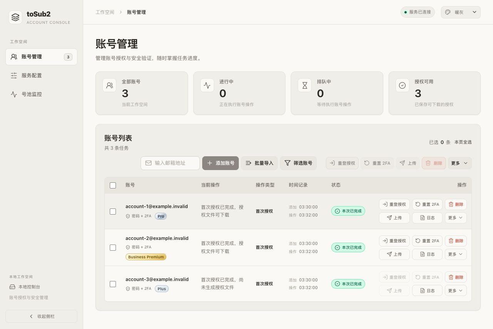
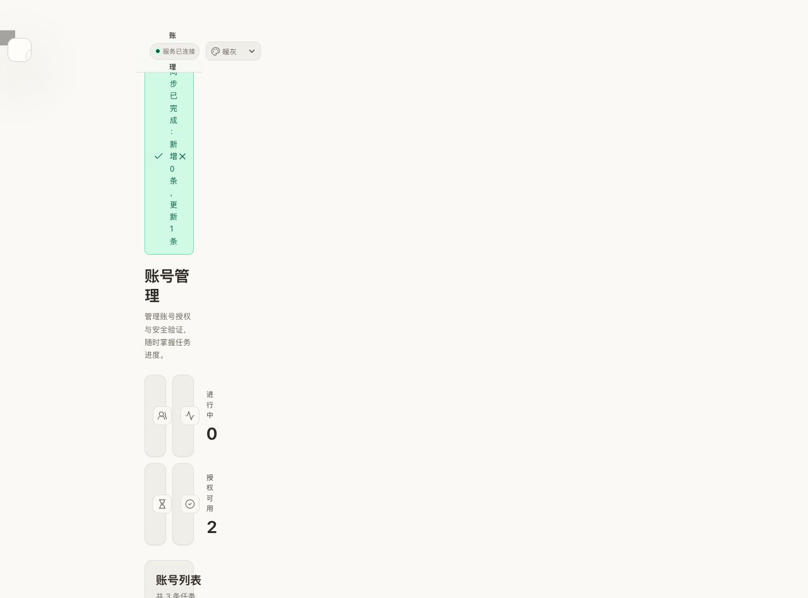

# 账号快捷操作与资料卡

2026-10-12，账号操作采用两行三列：第一行为「重登授权」「重置 2FA」「删除」，第二行为「上传」「日志」「更多」。按钮统一图标、文字、边框及底色，下载移入更多菜单。顶部选择数量、本页全选、添加、导入和筛选控件整体靠右，批量按钮位于最右侧，与添加/导入组留出 24px 间距；移除独立工具条，桌面添加/导入与批量操作同行，手机宽度自动换行。账号列仍只显示邮箱、登录方式和套餐，无按钮或垂直分割线。

## 重登后自动上传

单行与批量重登使用相同确认窗口，支持「成功后自动上传 Sub2API」开关。选择保存在当前浏览器的 `tosub2.relogin-workflow-preferences-v1`，清除网页配置时一并删除；只有确认后才执行。未配置 Sub2API 时开关不可用，提供配置入口。

调用 `/api/jobs/:id/relogin` 或 `/api/jobs/relogin-batch`，提交 `uploadAfterRelogin` 和本次使用的 `sub2apiConfig`。管理员密钥仅用于本次流程，不保存到任务持久化数据。重登与上传共用账号执行锁，必须先保存本次生成的新授权，才会上传；已有 Sub2API 账号更新凭证并保持原有配置。

同步结果独立于授权结果：上传失败或结果不确定时，新授权仍可下载，页面显示同步提醒。重启不会自动重复上传；已保存授权但上传尚未执行时显示「同步未执行」。手动上传在当前任务或 2FA 流程未结束、恢复未完成时禁用。

## 账号信息与删除

更多操作中的「查看账号信息」通过受控制台 token 保护、不缓存的 `GET /api/jobs/:id/account-info` 读取当前安全存储资料。展示邮箱、密码、2FA、邮件接口及折叠的代理与收码配置。密码、密钥和接口配置默认不写入 DOM，显式显示或复制后才使用；刷新重新遮盖，关闭取消请求并清空已读取内容。未提交密码、待确认密钥及 OAuth token 不返回。

删除使用现有 `/api/jobs/delete-batch`。删除范围是账号邮箱：同邮箱历史记录、共享密码和 2FA、授权文件一并清理。确认窗口说明范围，前端同步移除同邮箱记录和选择状态；Sub2API 中的账号另行管理。

## 重置 2FA 后导出的结论

`TestTOTPResetExportAndAccountInfoUseCommittedFactorAfterCompletionAndRestore` 实际执行合成重置提交与恢复，比较原始信息导出和账号卡返回值：

- 新密钥成功保存并提交后，当前行、同邮箱历史行及重启恢复后的导出均为新密钥。
- 新密钥已提交、后续退出所有设备失败时，仍返回新密钥。
- 旧因子停用前失败时，保留有效旧密钥。
- 正在重置、旧密钥已失效或恢复未确认时，返回 409，禁止输出旧密钥。

## 验证范围

全仓 Go 测试与 vet、重登/自动上传定向 race 检查通过。Sobek 前端逻辑测试覆盖授权与同步分离、重启未上传及 14 种上传门禁状态。

Go 隔离 fixture 验证单行与批量重登请求含自动上传选项、批量 2FA 资格与跳过提示、直接上传、账号信息遮盖/显示/刷新/关闭、恢复 409、删除取消与合成账号删除、选项刷新保留。1280px 桌面表格完整显示操作，390px 账号卡及 320px 重登窗口无页面横向溢出；手机表格只在容器内滚动。隔离页无 console error/warn。

真实账号仅作只读检查，不执行真实重登、2FA、退出设备、上传或删除。构建与运行保持纯 Go，无 Node/Python/浏览器自动化运行依赖。已有备份保留。

已部署至 <http://127.0.0.1:4401/>。运行程序及 HTML、JS、CSS 与本次构建逐字节一致。重启前后 5 份凭据和授权文件哈希不变，两个真实账号保持完成、授权可用，无运行和排队任务，巡检保持关闭。实际页面显示新按钮且无 console error/warn。隔离页、配置、服务和临时文件已清理。

后续按钮排版调整仅涉及前端：Go 构建、格式检查、1610px/1280px 桌面及手机布局通过；合成账号验证更多菜单下载、批量选择、日志展开与关闭，确认下载不再占用行内位置。

行内六个按钮进一步统一默认底色与轻边框，行列间距调整为 6px。重登授权与其他普通操作使用相同文字颜色和字重；删除保留红色文字与图标。日志展开、更多菜单打开共用高亮样式，避免重登按钮默认呈现选中状态；沿用主题变量适配暖灰、纯白与深色。

列顺序进一步整理为「账号、当前操作、操作类型、时间记录、状态、操作」（另有选择框列）。首次授权、重登授权等操作类型独立显示；当前操作承载进度、结果和提醒；时间记录只保留添加与操作时间。状态列紧邻右侧按钮，日志展开与空列表统一七列，手机空列表隐藏规则同步更新。

以下预览使用合成账号：

