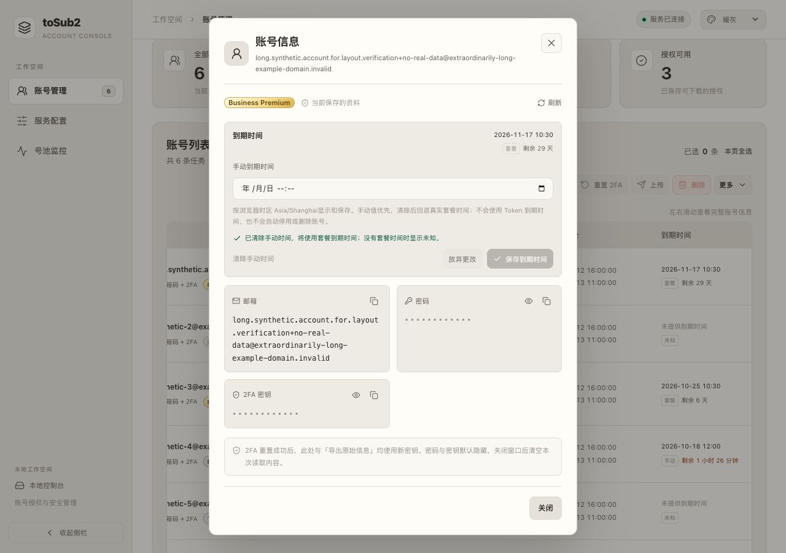
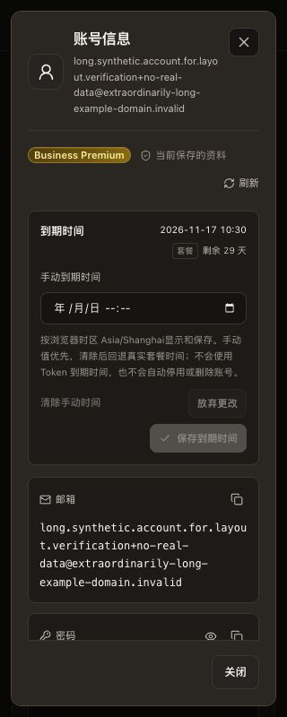
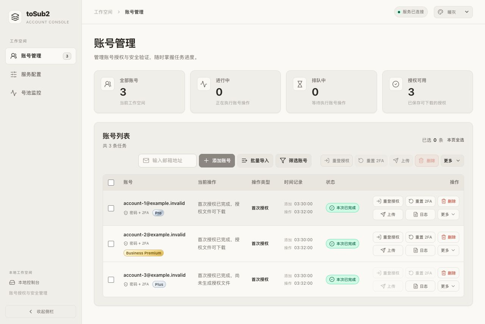
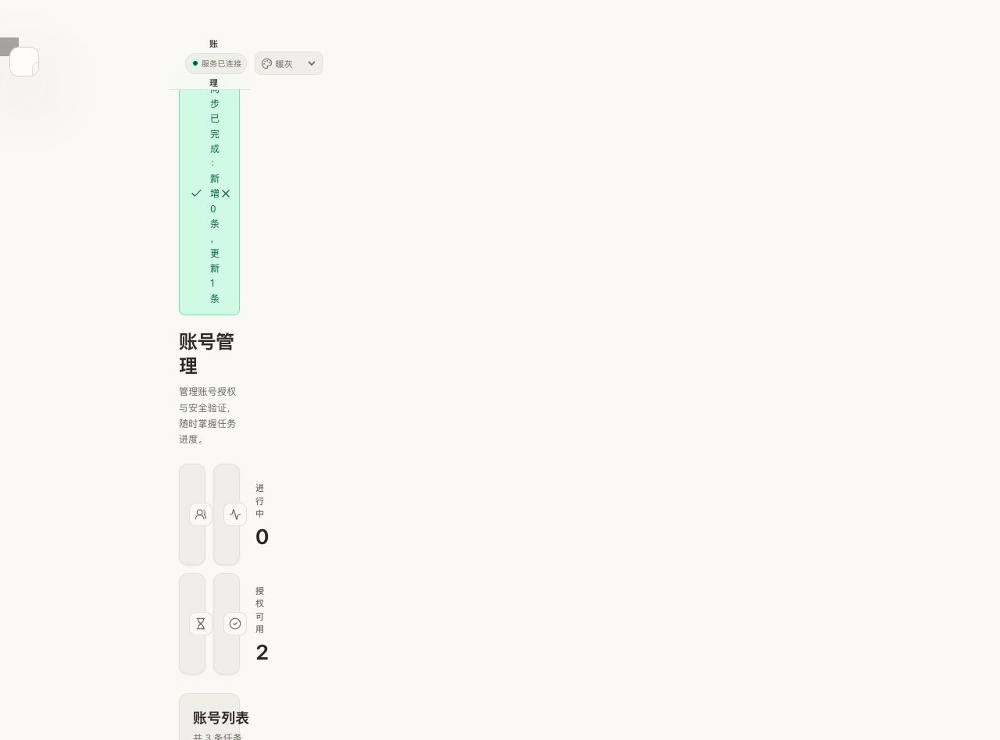

# 账号快捷操作与资料卡

2026-10-12，账号操作采用两行三列：第一行为「重登授权」「重置 2FA」「删除」，第二行为「上传」「日志」「更多」。按钮统一图标、文字、边框及底色，下载移入更多菜单。顶部选择数量、本页全选、添加、导入和筛选控件整体靠右，批量按钮位于最右侧，与添加/导入组留出 24px 间距；移除独立工具条，桌面添加/导入与批量操作同行，手机宽度自动换行。账号列仍只显示邮箱、登录方式和套餐，无按钮或垂直分割线。

## 重登后自动上传

单行与批量重登使用相同确认窗口，支持「成功后自动上传 Sub2API」开关。选择保存在当前浏览器的 `tosub2.relogin-workflow-preferences-v1`，清除网页配置时一并删除；只有确认后才执行。未配置 Sub2API 时开关不可用，提供配置入口。

调用 `/api/jobs/:id/relogin` 或 `/api/jobs/relogin-batch`，提交 `uploadAfterRelogin` 和本次使用的 `sub2apiConfig`。管理员密钥仅用于本次流程，不保存到任务持久化数据。重登与上传共用账号执行锁，必须先保存本次生成的新授权，才会上传；已有 Sub2API 账号更新凭证并保持原有配置。

同步结果独立于授权结果：上传失败或结果不确定时，新授权仍可下载，页面显示同步提醒。重启不会自动重复上传；已保存授权但上传尚未执行时显示「同步未执行」。手动上传在当前任务或 2FA 流程未结束、恢复未完成时禁用。

## 账号信息与删除

更多操作中的「查看账号信息」通过受控制台 token 保护、不缓存的 `GET /api/jobs/:id/account-info` 读取当前安全存储资料。展示邮箱、密码、2FA、邮件接口及折叠的代理与收码配置。密码、密钥和接口配置默认不写入 DOM，显式显示或复制后才使用；刷新重新遮盖，关闭取消请求并清空已读取内容。未提交密码、待确认密钥及 OAuth token 不返回。

删除使用现有 `/api/jobs/delete-batch`。删除范围是账号邮箱：同邮箱历史记录、共享密码和 2FA、授权文件一并清理。确认窗口说明范围，前端同步移除同邮箱记录和选择状态；Sub2API 中的账号另行管理。

## 账号到期时间

2026-10-18 新增本地到期管理。账号表格显示完整日期时间、剩余时间／已到期和「手动」「套餐」来源；没有可用日期时显示未知。账号信息中可保存手动时间，或通过「清除手动时间」回退套餐日期。日期是本地使用提醒，不会自动踢出 Team 成员、停用、删除或上传账号，也不改变授权、恢复及套餐排除规则。

导入使用 `----` 显式分隔，在末尾 2FA 后追加日期：

```text
邮箱----密码----2FA----16.30
邮箱----密码----2FA----7-18 08:00
邮箱----密码----2FA----7-18 8:00
邮箱----密码----2FA----2026-12-31 16:30
邮箱----密码----2FA----2026-12-31T16:30:00+08:00
邮箱----密码----邮件收码URL----2FA----16.30
```

`16.30` 与 `16:30` 均表示导入当天 16:30，不是 16 小时 30 分钟后；当天已过去的时间不会顺延到明天。`7-18 08:00` 与 `7-18 8:00` 均表示导入当年 7 月 18 日 08:00，年份按浏览器时区确定，即使该日期已经过去也不顺延到明年。未带时区的完整日期支持 `YYYY-MM-DD HH:mm`、`YYYY-MM-DDTHH:mm`，也可包含秒；日期必须真实有效，不能仅填写日期，非闰年的 `2-29 8:00` 会被拒绝。完整 RFC3339 时间可带 `Z` 或 `+08:00` 等明确偏移。

网页发送当前浏览器的 IANA 时区，后端为整批导入捕获同一个时间基准，再按该时区确定「当天」及「当年」；不受同一批处理跨午夜或跨年影响。显示使用浏览器当前时区，服务端保存 UTC 绝对时间，更换浏览器时区不会改变实际到期时刻。旧客户端未发送时区时使用服务本地时区。夏令时切换造成不存在或重复的本地时间会被拒绝，重复时段需填写带明确偏移的完整时间。这里的时区与 Sub2API 请求时区配置相互独立。

POST 邮件收码继续保留原有请求体语义。在「服务配置」中启用 POST 收码时，新增日期应使用五字段格式：

```text
邮箱----密码----POST请求体或编码请求体----2FA----16.30
```

原有四字段 POST 输入的最后一段仍可作为请求体；不要把普通四字段到期格式直接用于 POST 收码模式。普通格式不提供 2FA 时可保留空位，例如 `邮箱----密码--------16.30`。其他原有无日期格式继续使用。

日期优先级与保存边界：

- 有手动时间时始终使用手动时间，即使它比套餐日期更晚或已经到期。
- 没有手动时间时，只使用与账号身份匹配的授权导出中明确给出的 `subscription_expires_at`。这是真实订阅字段的最后已知快照，不是实时查询，也不是 Token 的 `expires_at`；缺少时显示未知。
- 重复导入省略日期会保留已经保存的手动覆盖；清除是单独、显式的操作，不通过省略字段表达。
- 只修改日期不会读写账号凭据、启动认证 worker 或触发重新登录。到期元数据保存到服务端，刷新页面和重启后的恢复不依赖浏览器偏好。
- 无效日期会在导入提交前报出所在行，错误不会回显该行的密码、2FA 或请求体。保存失败／结果未确认时，先刷新账号信息核实，不能将超时当作确定未保存。

新增持久化字段为可选的 `manual_expires_at`、`subscription_expires_at`；旧数据缺失时仍可恢复，订阅日期可从匹配的现有导出读取。降级到不认识这些字段的旧版本前，按 [安全升级步骤](../go-deployment.md#可重复验证与安全升级) 停止操作并保留整个输出目录的私有快照：旧版本可能在下一次写入 metadata 时丢弃新增日期。不要为恢复日期而覆盖之后已经推进的认证 checkpoint 或凭据；重新升级后可核对快照，仅补回需要的手动日期。

### 到期功能验收（2026-10-18）

- `GOTOOLCHAIN=go1.27.2 ./scripts/verify.sh` 通过：格式与差异检查、`go test ./...`、全仓 `go test -race ./...`、`go vet ./...`；启用 `TOSUB2_LEGACY_RUNTIME_TEST=1` 后对 `internal/jshost`、`internal/legacyruntime`、`cmd/tosub2` 显式执行 race 测试；Go esbuild 前端构建和 `CGO_ENABLED=0` 生产构建成功。
- `GOTOOLCHAIN=go1.27.2 ./scripts/build-cross.sh` 通过 macOS arm64/amd64、Linux amd64、Windows amd64 构建。交叉编译不代表对应平台的原生系统功能验收。
- `FuzzParseManual` 连续运行 15 秒、执行 1,738,702 次，通过；该结果是解析边界验证，不构成性能提升结论。独立审查发现的「无效 2FA 与末尾日期被拼进密码」已修复，并加入 HTTP 整批拒绝回归。
- 合成浏览器 fixture 验证手动时间保存后重开／刷新仍保留、清除后回退套餐日期，以及凭据不可读时仍可独立编辑日期。保存结果未知时阻止自动重放，通过只读重读核实后允许显式重新保存相同值；请求处理中禁用关闭和重复提交，Escape 关闭后焦点恢复。
- 已修复 1280px 表格列间碰撞；360px／320px 窄屏无页面横向溢出。长邮箱、深色主题和桌面／手机展示已检查，页面 console error／warn 为空。

本轮没有执行真实账号的登录、2FA 重置、退出设备、上传或删除操作，没有新增依赖。2026-10-18 已更新本地 4401 实例：更新前确认无执行中／排队任务、巡检未在执行；更新后健康检查及实际页面通过，两个账号的稳定状态、巡检配置和五份私有文件指纹一致。巡检保持用户原先的启用配置。

运行二进制与本地产物逐字节一致，SHA-256 为 `b71efff44639ed14d378dc1e23ee4774bbddfd422231fe08b4c6a0ddb9d99064`。在线 HTML、`index-21fefd3f6c9a.js`、`index-19cec36cf663.css` 与两份构建目录逐字节一致；现有浏览器页面刷新后显示到期列且无 console error／warn。原运行二进制及升级前 metadata 保留在本地实例目录下的 `rollback-20261018-account-expiry/`；回退时先停服务，保存最新数据，恢复旧二进制即可，不要用旧 metadata 覆盖之后产生的账号或安全操作。旧版本可能丢弃新增到期字段，降级前应另存最新 metadata。

以下为合成账号截图：





## 重置 2FA 后导出的结论

`TestTOTPResetExportAndAccountInfoUseCommittedFactorAfterCompletionAndRestore` 实际执行合成重置提交与恢复，比较原始信息导出和账号卡返回值：

- 新密钥成功保存并提交后，当前行、同邮箱历史行及重启恢复后的导出均为新密钥。
- 新密钥已提交、后续退出所有设备失败时，仍返回新密钥。
- 旧因子停用前失败时，保留有效旧密钥。
- 正在重置、旧密钥已失效或恢复未确认时，返回 409，禁止输出旧密钥。

## 验证范围

全仓 Go 测试与 vet、重登/自动上传定向 race 检查通过。Sobek 前端逻辑测试覆盖授权与同步分离、重启未上传及 14 种上传门禁状态。

Go 隔离 fixture 验证单行与批量重登请求含自动上传选项、批量 2FA 资格与跳过提示、直接上传、账号信息遮盖/显示/刷新/关闭、恢复 409、删除取消与合成账号删除、选项刷新保留。1280px 桌面表格完整显示操作，390px 账号卡及 320px 重登窗口无页面横向溢出；手机表格只在容器内滚动。隔离页无 console error/warn。

真实账号仅作只读检查，不执行真实重登、2FA、退出设备、上传或删除。构建与运行保持纯 Go，无 Node/Python/浏览器自动化运行依赖。已有备份保留。

已部署至 <http://127.0.0.1:4401/>。运行程序及 HTML、JS、CSS 与本次构建逐字节一致。重启前后 5 份凭据和授权文件哈希不变，两个真实账号保持完成、授权可用，无运行和排队任务，巡检保持关闭。实际页面显示新按钮且无 console error/warn。隔离页、配置、服务和临时文件已清理。

后续按钮排版调整仅涉及前端：Go 构建、格式检查、1610px/1280px 桌面及手机布局通过；合成账号验证更多菜单下载、批量选择、日志展开与关闭，确认下载不再占用行内位置。

行内六个按钮进一步统一默认底色与轻边框，行列间距调整为 6px。重登授权与其他普通操作使用相同文字颜色和字重；删除保留红色文字与图标。日志展开、更多菜单打开共用高亮样式，避免重登按钮默认呈现选中状态；沿用主题变量适配暖灰、纯白与深色。

列顺序进一步整理为「账号、当前操作、操作类型、时间记录、状态、操作」（另有选择框列）。首次授权、重登授权等操作类型独立显示；当前操作承载进度、结果和提醒；时间记录只保留添加与操作时间。状态列紧邻右侧按钮，日志展开与空列表统一七列，手机空列表隐藏规则同步更新。

以下预览使用合成账号：




