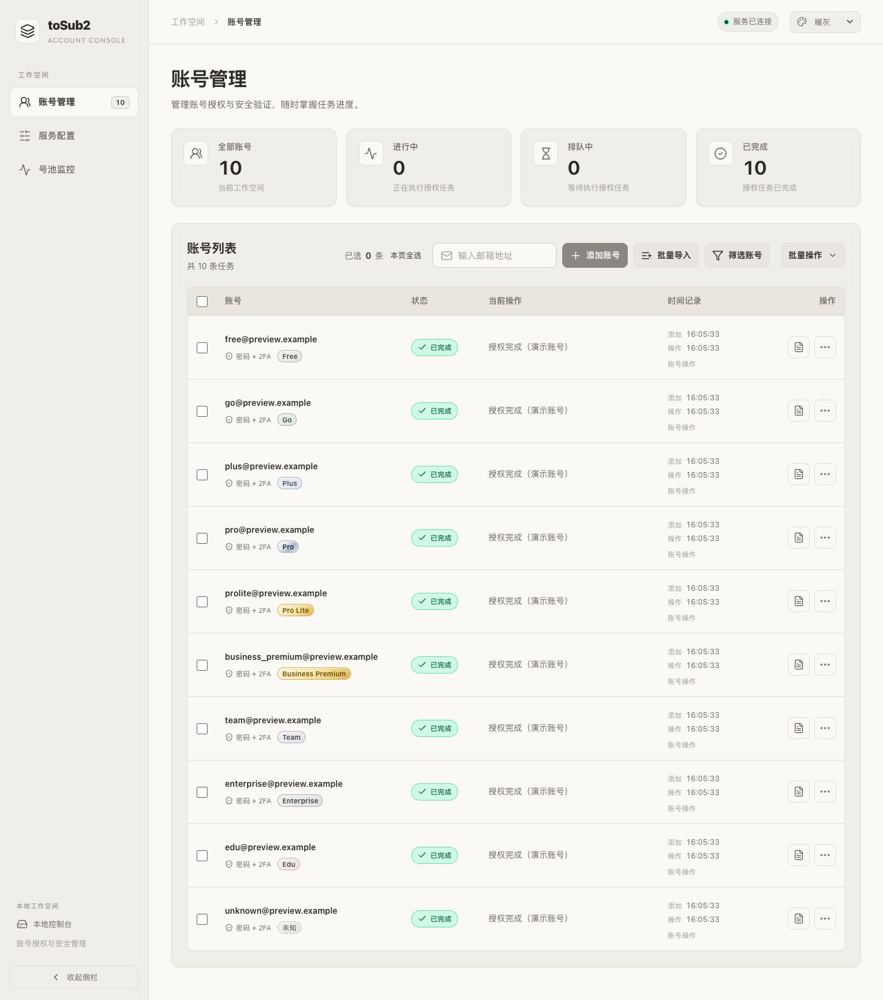
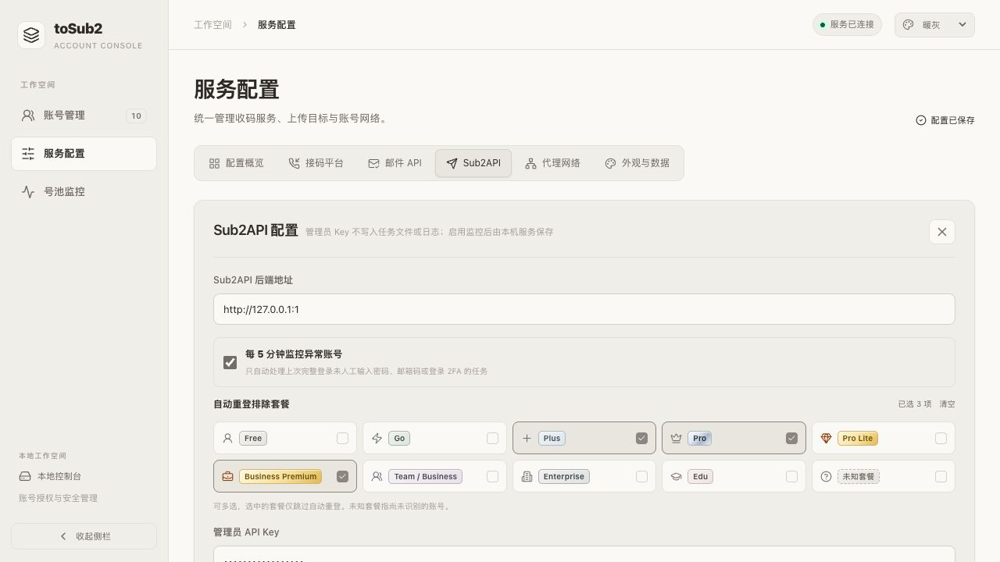
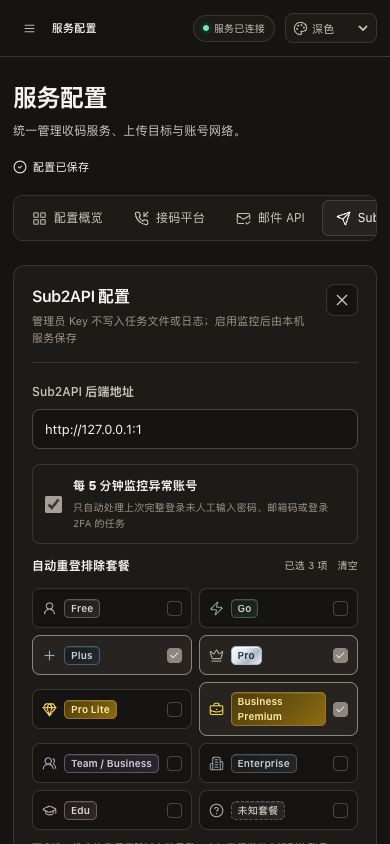
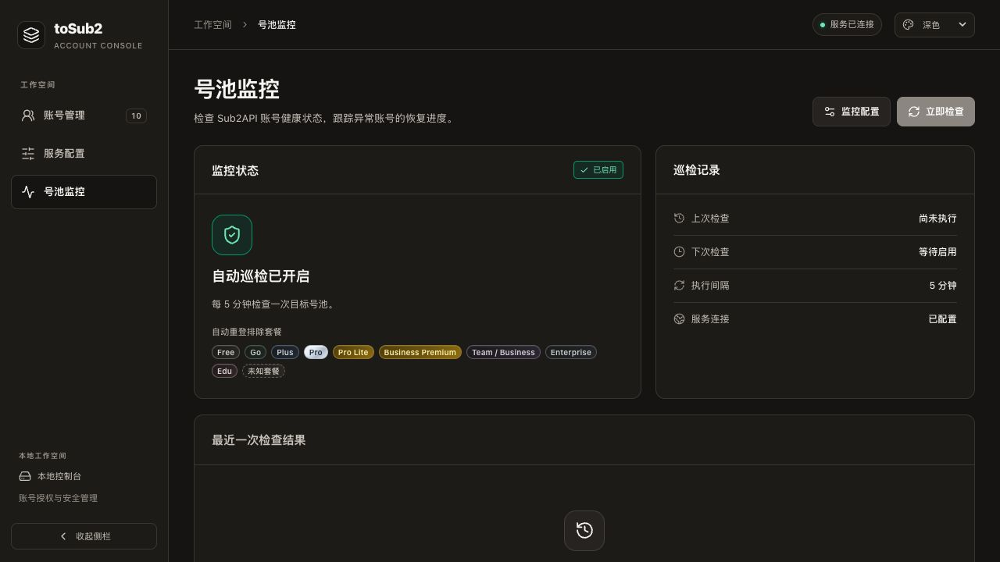

# 套餐显示与自动重登排除

初版 2026-10-12；排除规则更新于 2026-10-20。部署地址：<http://127.0.0.1:4401/>。

2026-10-21 修复套餐到期日期漏读与历史日期串用，支持从已保存授权补读真实订阅字段；详见 [解析规则、验证与回退](subscription-expiry-2026-10-21.md)。套餐排除规则保持本页说明。

16:10 当前样式：全部套餐采用统一的紧凑装饰标签，均有渐变底色、细边框和高光。Free 中性灰、Go 青绿、Plus 浅蓝、Team 淡紫、Enterprise 蓝灰、Edu 淡玫瑰；Pro 保持银色，Pro Lite / Business Premium 保持金色，未知采用中性虚线。账号列表、排除选项及监控规则共用 PlanBadge，账号标签高 18px。普通套餐也有完整装饰，色彩通过主题变量适配暖灰、纯白、深色和系统主题。以下带时间的更新保留此前样式记录。

账号列表在邮箱下的登录方式同排显示套餐，不增加表格列或操作按钮。支持 Free、Go、Plus、Pro、Pro Lite、Business Premium、Team / Business、Enterprise、Edu；缺少可识别信息时显示“未知”。Business、self_serve_business 归入 Team / Business；self_serve_business_prolite 单独识别为 Business Premium，与参考项目保持一致，纠正首次实现中将其归入 Team 的处理。

15:25 更新：对照官方 Management Center `390718ecfec90b674fed474862e497522273e129` 的 `CodexQuotaBody.tsx`、`QuotaBody.module.scss` 和 `planTier.ts`，共用 `PlanBadge` 组件。普通套餐为无框文字，Pro 为银色、Pro Lite / Business Premium 为金色胶囊；字号 10px，高度 14/18px，采用静态渐变。套餐排除项为 30px 点击区域的小胶囊，保留鼠标点击、键盘 Space、焦点轮廓和完整无障碍名称，说明文字缩短。表格邮箱可独占整行，手机多选自动换行。

进入 **服务配置 → Sub2API → 自动重登排除套餐**，勾选希望跳过的套餐并保存。默认不排除；取消全部勾选可清空。未勾选任何选项表示没有套餐排除规则，“未知”表示未能识别套餐，两者含义不同；未知不会当作 Free。Team 与 Business Premium 分开选择。设置保存在服务端，重启后恢复；网页刷新会回填，编辑中的草稿不会被轮询覆盖。号池监控页显示当前规则、最近一次按套餐排除记录数及自动回传暂停数量。

## 套餐来源与范围

- 从已有 `sub2api-import-oauth.json`、`sub2api-data.json` 的账号元数据及 OAuth ID/access token 套餐 claim 中提取；导出需与任务邮箱匹配。公开 API 只返回规范化的 `planType`，不返回 token 或其他私有 claim。
- 恢复任务、发现新输出及保存登录/刷新结果时更新套餐，页面轮询只读缓存。缺少新 claim 时保留此前已知套餐。只包含 session、未包含这些 OAuth 导出的任务可能显示未知。
- 套餐表示最后可用授权/元数据的快照，不是实时订阅查询。显示套餐不会主动登录或访问上游。
- 入队时，任一本地已知套餐或 Sub2API 远端已知套餐命中排除，就跳过该邮箱的自动重登；不再用一个来源覆盖另一个来源的排除证据。启用排除时读取全部 OpenAI 记录，以保护同邮箱下其他号池或正常状态的已排除套餐；自动修复候选仍只包含目标号池的异常记录。
- 队列执行前根据最新本地套餐和当前排除策略再次检查。被排除的队列项不执行登录，账号行显示“自动重登已跳过”及具体原因，已有授权和恢复数据保留，不把跳过当作完成或失败。关闭监控、切换后端或重启旧自动队列也可能导致跳过，因此账号行不会仅凭 `skipped` 推断为套餐排除；巡检统计中的“按套餐跳过”只表示实际套餐排除。
- 自动授权完成后，如果新的本地套餐命中排除，暂停自动回传；新授权与待处理 ID 保留。账号行显示“授权已保存 · 自动回传暂停”，巡检结果单独计数，不能据授权步骤成功认定 Sub2API 同步完成。
- 手动重新登录和手动上传仍允许。暂停自动回传后可在账号行点击“上传”进行手动同步，或取消对应套餐排除并保存，等待下次巡检继续处理。2FA 恢复、安全存储和有效授权文件等原有资格检查继续生效。

接口字段为账号 `planType`、`autoRepairSkippedReason`、`autoRepairPendingAccountIds`，监控配置 `excludedPlanTypes: string[]`，最近结果 `excludedPlan: number` 与 `autoUploadPaused: number`。未传排除配置字段时保留旧值，显式传 `[]` 清空。未启动的套餐跳过使用 `operationStatus: "skipped"`；授权已保存但自动回传暂停时，授权操作仍为 `succeeded`，由非空排除原因和待处理记录共同表达未完成同步。手动同步确认覆盖同一后端的全部待处理账号后清理暂停记录，旧原因不应继续覆盖当前成功状态。

### 排查边界

页面中的当前套餐是最后保存的快照，不能反推更早入队时使用了什么套餐证据。旧版本没有保存历史入队套餐决策时，只能根据已留存的操作类型、日志和当时配置确认执行路径，不能将“当前显示 Free”直接当作“入队时已知 Free”的证明。排除策略的回归使用合成账号和模拟服务验证，不要求真实账号登录或上传。

### 2026-10-20 修复与验证

- 本次明确收紧旧版“远端套餐优先、已授权待回传不受排除”的规则：任一已知来源命中排除就不启动自动重登，新授权命中排除则保留结果并暂停自动回传。未知仍不等于 Free；如果不希望未知账号自动授权，需要同时选择“未知”。明确手动授权及上传保留原有语义。
- 套餐判断集中在 `internal/accountplan/policy.go`，巡检、入队及调度守卫使用同一规则。应用初始化先装配监控策略，再启动任务调度器。
- 新入队记录持久化 `autoRepairQueuedPlanType` 和 `autoRepairQueuedRemotePlanTypes`；日志仅记录归一化套餐，不保存原始远端字段或 token。
- 跳过和回传暂停均保留有效授权。暂停写入失败会回滚；跳过写入失败仍阻止登录并显示存储警告。手动上传必须确认原后端的所有待处理 ID 成功，才清除暂停；远端结果未知、部分失败、陈旧操作及本地保存失败不会误报完整成功。
- 重启后的旧自动队列不能直接继续登录；已有检查点、一次性 grant 或刷新恢复文件继续保留原有手动恢复入口。只完成已保存结果的重试保留原同步目标和授权身份，无需重新登录。
- 使用 Go 1.27.2，`GOTOOLCHAIN=go1.27.2 ./scripts/verify.sh` 通过：格式与差异检查、全仓 `go test ./...`、全仓 race、vet、显式认证 worker／嵌入脚本回归、Go esbuild 前端构建和 `CGO_ENABLED=0` 生产构建。
- `GOTOOLCHAIN=go1.27.2 ./scripts/build-cross.sh` 通过 darwin/arm64、darwin/amd64、linux/amd64 和 windows/amd64 构建。构建通过不代表这些非当前主机平台的原生功能验收。
- 新增合成回归覆盖本地 Free／远端付费冲突、Unknown 边界、排队后配置变化、取消、磁盘失败、已保存授权重启恢复、ChatGPT/BPS 回传暂停与手动恢复，以及真实 React 组件的跳过／暂停展示与操作回调。本次验证没有使用真实账号执行认证或安全操作。
- Chrome 实际验收通过桌面暂停账号行、桌面监控五指标和 390px 监控上下区域，未见重叠或页面水平溢出；390px 跳过页已通过无障碍树确认状态、原因和可用按钮。随后 macOS 锁屏阻断了窄屏操作列截图、DOM 宽度量化及控制台错误归因，这些项目未计为通过。合成测试服务已停止；专用 Chrome 测试窗口和 DevTools 仍待解锁后关闭。
- 2026-10-20 13:47（Asia/Shanghai）更新现有 4401 实例。更新前后均无执行中、排队或待回传任务；16 个账号的重要元数据、33 份私有文件和监控配置核对不变。服务健康、实际进程二进制路径、二进制 SHA-256，以及 HTTP 返回的 HTML/JS/CSS 与本次构建一致；监控 Free 排除仍启用，目标 Free 账号公开资格为不可自动重登，授权次数没有变化。
- 部署二进制 SHA-256：`da30ebf781d83cd67f3e476b7c71cfc5f8858f5b9ac0fda6738ff409cf912a52`。前端资源：`index-e6f1b1575035.js`、`index-acd9def7aed5.css`。
- 运行目录内保留 `rollback-20261020-free-exclusion/tosub2` 作为二进制回退。回退前同样确认无执行／排队任务并停止服务，仅替换二进制再启动；不要用历史 job-meta 快照覆盖之后发生的账号或安全操作。当前策略、账号与凭据目录继续保留。

15:37 布局更新：自动重登排除套餐改为等宽矩形选项，套餐名左对齐、勾选状态固定在右侧；标题同行显示已选数量与清空操作。根据表单容器宽度切为五列、三列或两列，桌面高 38px、手机至少 40px。选中项采用暖灰填充、主色边框及实心勾号，长套餐名称完整显示，继续支持 Tab / Space。套餐识别和后端执行规则未改动。

15:51 图标更新：十种选项分别配有人物、闪电、加号、皇冠、宝石、公文包、团队、楼宇、学位帽及问号图标，并复用列表中的银色 Pro、金色 Pro Lite / Business Premium 标签。图标与名称左对齐，右侧勾选保持独立；桌面选项至少 42px，手机长名称可换行。暖灰、纯白及深色主题保持一致，账号列表样式及后端排除规则不变。

## 验证

- `go test ./internal/accountplan ./internal/protocol ./internal/jobs ./internal/sub2api ./internal/console ./cmd/tosub2` 通过。
- accountplan/jobs/sub2api/console 全包 race 及相关包 `go vet` 通过。随后刷新扁平 claim 修正与 Business 内部标识映射通过定向回归。
- 合成 fixture 验证多选保存、刷新回填、清空、轮询时保留草稿、监控排除统计、长邮箱标签及 390px 手机深色布局。手机套餐选项换行无重叠，文档无横向溢出，页面无 error/warn。
- 模拟浏览器请求仅有配置保存与初始化同步，没有登录、2FA、上传、删除或巡检请求。真实账号仅作部署后的读取检查，没有发起认证或安全操作。
- 仍由 Go esbuild 构建前端，主程序为 Go；没有新增 Node、Python 或浏览器自动化运行依赖。
- 15:25 精简版另通过套餐归一化、输出恢复与排除规则的定向回归；模拟界面验证新套餐选择/保存/刷新、Space 操作、深色银金配色和 390px 宽度。页面无 error/warn，选项均高 30px，文档无横向溢出。实际 4401 的两条已完成账号显示 Business Premium，凭据与授权输出文件哈希不变。
- 15:37 选项布局更新通过 Go 前端/主程序构建、dist 与部署资源比较、格式检查；隔离界面验证 1280px 五列、900px 三列、390px 两列，深色主题、数量更新、清空后保存以及 Space 选择。模拟 POST 正确提交选择数组及空数组，无页面错误。纯前端改动未重复此前后端测试。
- 15:51 图标更新通过 Go 前端/主程序构建、vendor 来源哈希与格式检查、部署资源比较。模拟界面验证十个图标、暖灰与纯白主题、390px 深色两列和长名称换行、Space 选择、保存重开；提交数组为 Plus / Pro / Business Premium，无页面错误。图标标记为装饰用途，原生 checkbox 的完整名称与焦点样式保留。
- 16:10 全套餐装饰标签通过 Go 构建、格式检查和部署资源一致性检查。十个账号套餐的标签均高 18px、有 1px 边框与渐变；暖灰、纯白、深色及 320px/390px 选择器无溢出。Space 和鼠标选择、保存及重开回填正确，监控规则展示同款可换行标签。真实账号只读取部署状态，无认证、安全操作或配置保存。

以下为合成账号和模拟配置：

