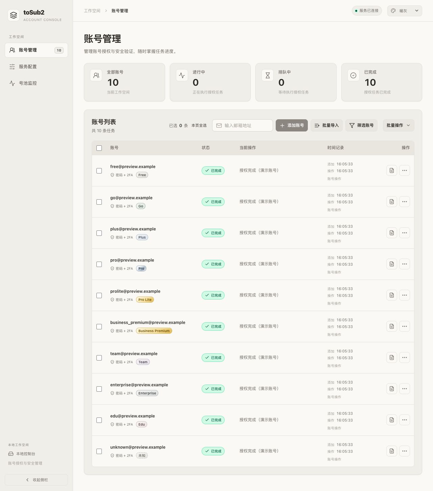
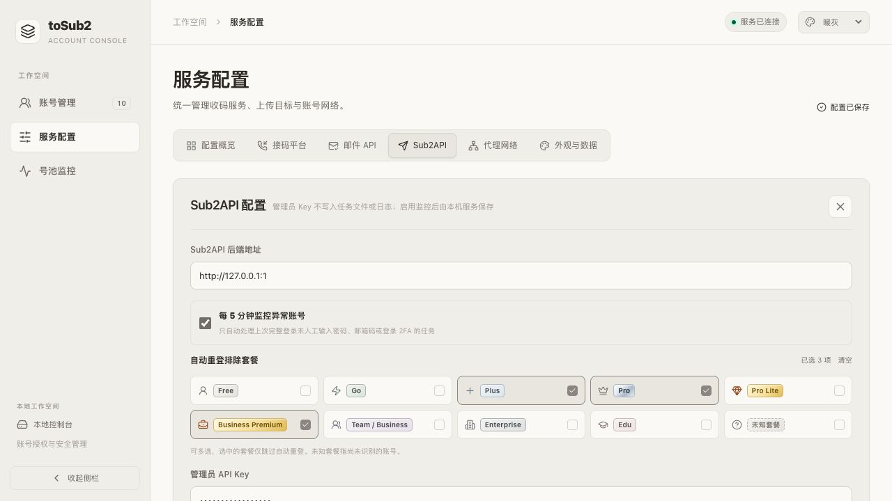
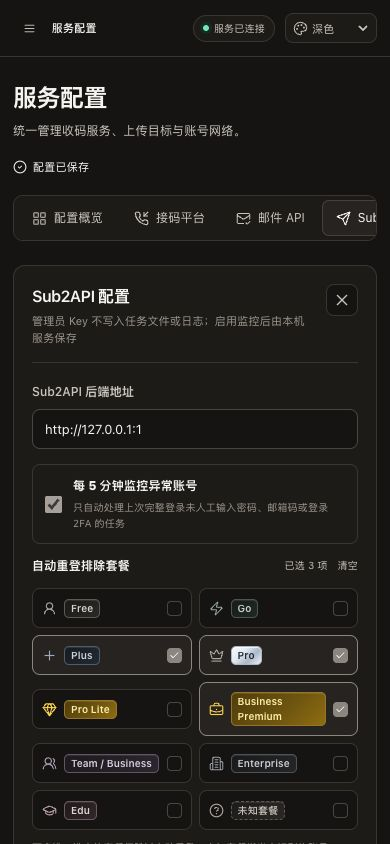
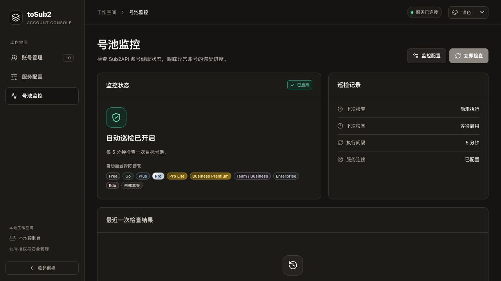

# 套餐显示与自动重登排除

2026-10-12，部署地址：<http://127.0.0.1:4401/>。

16:10 当前样式：全部套餐采用统一的紧凑装饰标签，均有渐变底色、细边框和高光。Free 中性灰、Go 青绿、Plus 浅蓝、Team 淡紫、Enterprise 蓝灰、Edu 淡玫瑰；Pro 保持银色，Pro Lite / Business Premium 保持金色，未知采用中性虚线。账号列表、排除选项及监控规则共用 PlanBadge，账号标签高 18px。普通套餐也有完整装饰，色彩通过主题变量适配暖灰、纯白、深色和系统主题。以下带时间的更新保留此前样式记录。

账号列表在邮箱下的登录方式同排显示套餐，不增加表格列或操作按钮。支持 Free、Go、Plus、Pro、Pro Lite、Business Premium、Team / Business、Enterprise、Edu；缺少可识别信息时显示“未知”。Business、self_serve_business 归入 Team / Business；self_serve_business_prolite 单独识别为 Business Premium，与参考项目保持一致，纠正首次实现中将其归入 Team 的处理。

15:25 更新：对照官方 Management Center `390718ecfec90b674fed474862e497522273e129` 的 `CodexQuotaBody.tsx`、`QuotaBody.module.scss` 和 `planTier.ts`，共用 `PlanBadge` 组件。普通套餐为无框文字，Pro 为银色、Pro Lite / Business Premium 为金色胶囊；字号 10px，高度 14/18px，采用静态渐变。套餐排除项为 30px 点击区域的小胶囊，保留鼠标点击、键盘 Space、焦点轮廓和完整无障碍名称，说明文字缩短。表格邮箱可独占整行，手机多选自动换行。

进入 **服务配置 → Sub2API → 自动重登排除套餐**，勾选希望跳过的套餐并保存。默认不排除；取消全部勾选可清空。选择“未知”才会排除无法识别的账号。Team 与 Business Premium 分开选择。设置保存在服务端，重启后恢复；网页刷新会回填，编辑中的草稿不会被轮询覆盖。号池监控页显示当前规则及最近一次按套餐排除的记录数。

## 套餐来源与范围

- 从已有 `sub2api-import-oauth.json`、`sub2api-data.json` 的账号元数据及 OAuth ID/access token 套餐 claim 中提取；导出需与任务邮箱匹配。公开 API 只返回规范化的 `planType`，不返回 token 或其他私有 claim。
- 恢复任务、发现新输出及保存登录/刷新结果时更新套餐，页面轮询只读缓存。缺少新 claim 时保留此前已知套餐。只包含 session、未包含这些 OAuth 导出的任务可能显示未知。
- 套餐表示最后可用授权/元数据的快照，不是实时订阅查询。显示套餐不会主动登录或访问上游。
- 自动重登优先使用 Sub2API 远端套餐，无法识别时回退到本地套餐。启用排除时读取全部 OpenAI 记录，以保护同邮箱下其他号池或正常状态的已排除套餐；自动修复候选仍只包含目标号池的异常记录。
- 同邮箱任一记录命中排除，则跳过该邮箱整次自动重登。入队前再次检查，不新增冷却或永久封锁。手动重新登录、手动上传及已经登录完成的待回传结果不受套餐排除影响。

接口字段为账号 `planType`、监控配置 `excludedPlanTypes: string[]`、最近结果 `excludedPlan: number`。未传排除字段时保留旧值，显式传 `[]` 清空。

15:37 布局更新：自动重登排除套餐改为等宽矩形选项，套餐名左对齐、勾选状态固定在右侧；标题同行显示已选数量与清空操作。根据表单容器宽度切为五列、三列或两列，桌面高 38px、手机至少 40px。选中项采用暖灰填充、主色边框及实心勾号，长套餐名称完整显示，继续支持 Tab / Space。套餐识别和后端执行规则未改动。

15:51 图标更新：十种选项分别配有人物、闪电、加号、皇冠、宝石、公文包、团队、楼宇、学位帽及问号图标，并复用列表中的银色 Pro、金色 Pro Lite / Business Premium 标签。图标与名称左对齐，右侧勾选保持独立；桌面选项至少 42px，手机长名称可换行。暖灰、纯白及深色主题保持一致，账号列表样式及后端排除规则不变。

## 验证

- `go test ./internal/accountplan ./internal/protocol ./internal/jobs ./internal/sub2api ./internal/console ./cmd/tosub2` 通过。
- accountplan/jobs/sub2api/console 全包 race 及相关包 `go vet` 通过。随后刷新扁平 claim 修正与 Business 内部标识映射通过定向回归。
- 合成 fixture 验证多选保存、刷新回填、清空、轮询时保留草稿、监控排除统计、长邮箱标签及 390px 手机深色布局。手机套餐选项换行无重叠，文档无横向溢出，页面无 error/warn。
- 模拟浏览器请求仅有配置保存与初始化同步，没有登录、2FA、上传、删除或巡检请求。真实账号仅作部署后的读取检查，没有发起认证或安全操作。
- 仍由 Go esbuild 构建前端，主程序为 Go；没有新增 Node、Python 或浏览器自动化运行依赖。
- 15:25 精简版另通过套餐归一化、输出恢复与排除规则的定向回归；模拟界面验证新套餐选择/保存/刷新、Space 操作、深色银金配色和 390px 宽度。页面无 error/warn，选项均高 30px，文档无横向溢出。实际 4401 的两条已完成账号显示 Business Premium，凭据与授权输出文件哈希不变。
- 15:37 选项布局更新通过 Go 前端/主程序构建、dist 与部署资源比较、格式检查；隔离界面验证 1280px 五列、900px 三列、390px 两列，深色主题、数量更新、清空后保存以及 Space 选择。模拟 POST 正确提交选择数组及空数组，无页面错误。纯前端改动未重复此前后端测试。
- 15:51 图标更新通过 Go 前端/主程序构建、vendor 来源哈希与格式检查、部署资源比较。模拟界面验证十个图标、暖灰与纯白主题、390px 深色两列和长名称换行、Space 选择、保存重开；提交数组为 Plus / Pro / Business Premium，无页面错误。图标标记为装饰用途，原生 checkbox 的完整名称与焦点样式保留。
- 16:10 全套餐装饰标签通过 Go 构建、格式检查和部署资源一致性检查。十个账号套餐的标签均高 18px、有 1px 边框与渐变；暖灰、纯白、深色及 320px/390px 选择器无溢出。Space 和鼠标选择、保存及重开回填正确，监控规则展示同款可换行标签。真实账号只读取部署状态，无认证、安全操作或配置保存。

以下为合成账号和模拟配置：

