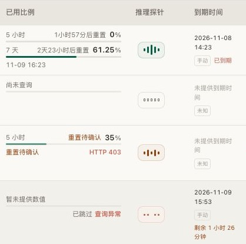

# 账号列表糖果探针视觉重设计

按用户反馈，将“信号”作为视觉参考，重新设计为单个圆角状态标记：内部对称短线形成脉冲轮廓，配合浅底色、细边框与克制的悬停反馈。取代上一版直接递增的手机信号柱。

绿色完整波形表示糖果题通过；琥珀色内凹波形表示答案不符；红色中断线表示检测失败；灰色空心短线表示尚无有效结果。排队使用静态点线，运行使用轻呼吸；减少动画偏好下关闭动画。颜色与形态同时区分状态，未知态使用足够对比度的中性文字色。

可见主体 46×28px，点击区域 54×36px，粗指针设备最小高度 44px。探针列固定为 100px，表格最小宽度由 1348px 降至 1308px；额外空间分配给账号、用量与当前操作。造型不代表分数、强弱或历史次数。

现有糖果结果判定、历史过滤、失败与未知的保护条件不变；点击和键盘 Enter 仍打开详情。未加入新请求、存储或认证机制。

修改位置：`web/src/components/account-quality.jsx`、`web/src/components/account-quality.css`、`web/src/styles.css`，同步更新既有状态组件测试和两份构建资源。

验证：控制台全包测试通过（43.169s），相关定向回归通过（0.905s），`go vet ./internal/console`、前端构建及 diff 检查通过。合成浏览器检查暖灰/深色、1440px桌面与390px窄屏：按钮均未溢出单元格，390px文档无横向溢出，键盘详情入口正常，浏览器无错误，探针请求为零。

部署状态见 [4401 更新记录](local-update-4401-2026-11-09.md)。
