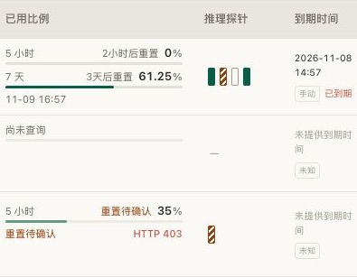

# 每次糖果探针对应一条记录

账号列表改为逐次历史：每根等高短条对应一条真实糖果检测记录，左旧右新。通过为绿色，答案不符为琥珀斜纹，失败为红色，未知或取消为空心条。每条悬停显示该次时间、结果及模型。没有记录时显示横线，不补齐五条，也不再用多根装饰线表达一次结果。

仅使用现有历史中的糖果记录：先过滤类型，按记录标识去重，按完成时间排序，最多显示最近五条；后端只保留五条混合记录，所以实际可见糖果记录可能不足五条，不重建缺失记录。绘图、旧六题成功、排队和运行不会冒充已完成的糖果记录。

历史结果保留当时颜色；当前同步或保存未知用虚线和说明标记，当前运行/排队显示独立文字，不增加历史条。点击或键盘 Enter 打开详情，不触发模型探针。

另外拒绝单题历史中相互矛盾的 score/verdict，避免零分显示通过。旧六题采用原有阈值，其 5/6 normal 仍保留在综合详情中。

修改：`web/src/components/account-quality.jsx`、`account-quality.css`、`web/src/lib/accountQuality.js`，同步更新现有组件和历史测试、嵌入构建。8×20px 短条、5px 间隔，保留 100px 列宽和键盘焦点。

验证覆盖单条/三条/五条数量、顺序与各自结果、去重、空状态、类型过滤、当前未知与历史区分、零模型请求，以及暖灰/深色/390px窄屏和键盘入口。部署结果见 [4401 记录](local-update-4401-2026-11-09.md)。

