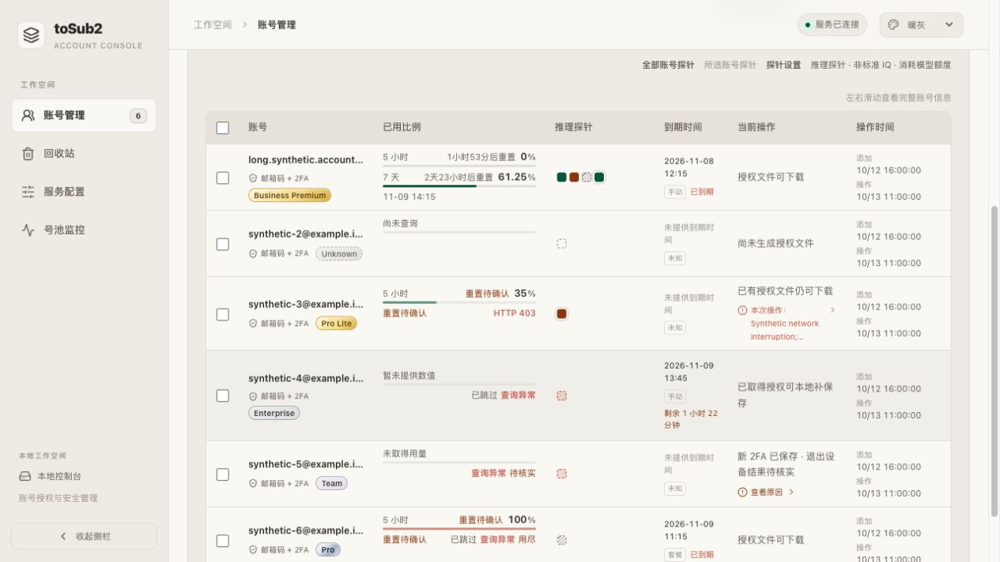
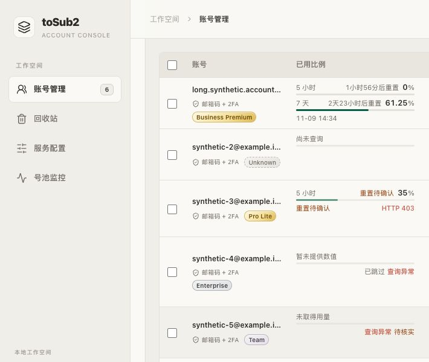

# 账号列表糖果题色格

> 后续按用户反馈，当前实现已改为下文“最终信号式展示”。以下色格方案仅保留为当次修改记录。

按用户最新要求，账号列表仅展示糖果题检测，以 12px 方格代替图标和重复状态文字：

- 一条实际保留的糖果检测记录对应一格，左旧右新。
- 绿色通过，橙色答案不符，红色检测失败，灰色条纹表示结果未确认（包括限流）。
- 尚未检测、等待和当前操作状态使用独立空心格；运行中的格轻微闪动，并尊重减少动态效果设置。
- 旧结果在重新检测、过期或同步异常时淡化，悬停仍能查看准确说明。
- 绘图和旧版多题测量不参与糖果色格，仍保留在详情中。
- 点击或键盘 Enter 只打开详情，不自动检测；详情原功能保留。

后端现有历史仓库只保留最近五条混合探针记录，本次仅显示其中实际保留的糖果记录，不补造或恢复缺失历史。

修改范围：`web/src/components/account-quality.jsx`、`account-quality.css`、`web/src/lib/accountQuality.js`、现有展示测试及构建资源。其他工作区修改保留。

浏览器验证浅色、深色、390px 窄屏和键盘打开详情。合成夹具中无探针 POST，浏览器无错误；每格12px，入口高度32px，未出现列内溢出。

前端构建、控制台全包测试（45.049s）、合成夹具测试（0.425s）、相关静态检查及 Go 构建通过。本次未替换4401运行二进制、未重启服务、未调用真实账号或模型。

## 最终信号式展示

当前账号列表显示一个完整的手机信号式标识：五根细柱按 6、10、14、18、22px 固定递增，总宽32px。统一颜色代表最新糖果题状态：绿为通过，橙为答案不符，红为检测失败，灰为暂无有效结果。运行时轻微呼吸，遵循减少动态效果偏好。

柱数和高度只是固定造型，不表示历史次数、分数或强弱。历史留在悬停说明与详情中，列表不显示额外文字或历史方块。绘图和旧版多题测量不参与判定。

同时收紧历史覆盖当前状态的条件：相同时间需匹配操作状态与标识；结果未知、授权不支持及同步未确认不能被旧通过记录显示成绿色。

相关控制台回归测试通过（1.043s），前端与 Go 构建通过。合成浏览器验证浅色、深色和键盘详情入口，无浏览器错误、无探针 POST；44px入口未发生窄屏列内溢出。本次仍未更新4401运行实例。

后续部署已完成：经用户批准取消等待邮箱验证码的任务后，最终信号式展示已更新至 4401，健康检查及静态资源一致性验证通过。11 个账号保留，39 份凭据、授权及 2FA 结果文件摘要不变。详见[最新部署记录](local-update-4401-2026-11-09.md)。
