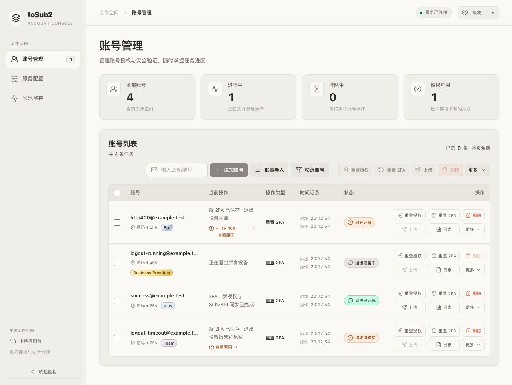
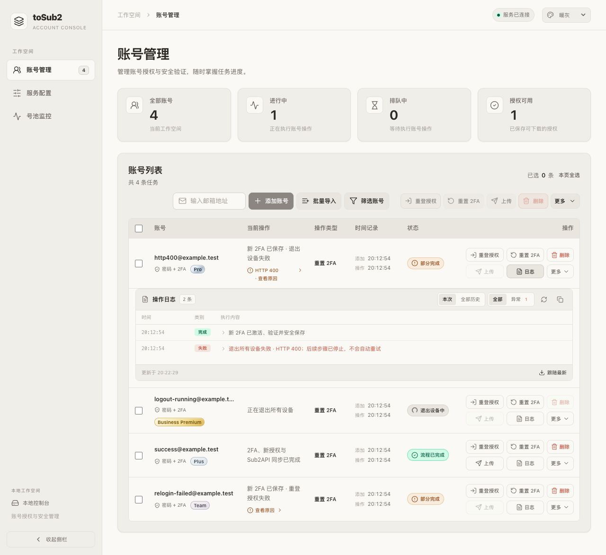

# 账号列表当前操作显示

账号列表的「当前操作」仅显示当前步骤或本次结果，保留错误、部分完成和凭据恢复等必要提醒，不再插入完整 2FA 流程进度卡片。正在重置、退出设备、重新授权或同步时，这一列随实际步骤更新短状态；部分完成时明确保留已保存的新密钥或授权信息。

2FA 操作弹窗继续显示所选执行顺序，详细执行经过可通过账号行「日志」查看。验证码输入、必要的密钥复制和历史提醒折叠区维持原有行为。

本次移除行内专用进度组件及其样式，并调整提交提示指向当前状态和日志，流程执行顺序保持不变。

新密钥已保存后的退出设备、重登或同步失败使用黄色「部分完成」，短摘要明确区分已完成部分和失败步骤，例如「新 2FA 已保存 · 退出设备失败」。结果未确认、取消、中断仍各自显示对应状态，不标记为全部成功。

停止流程的整体错误和当前步骤错误合为一条可展开原因，默认显示 HTTP 状态码和「查看原因」，步骤名称保留在无障碍标签中；展开后保留全部不同的脱敏原因。窄列按完整词组换行，避免「原因」拆成零散文字。凭据恢复和保存警告继续单独显示，避免把关键警告收进普通详情。

## 退出设备 HTTP 400 修复

退出请求保持原版的空 POST 和无 Content-Type。排查发现 fhttp v0.6.9 的 HTTP/2 编码器检查小写 `content-length` 键，而 `Header.Add` 会规范为 `Content-Length`，显式传入长度会与库自动生成的长度头一起发送。已去掉协议层手工长度头，传输层忽略调用方所有大小写的长度头，由实际 body 生成正确长度。

新增原始 HTTP/2 HEADERS/HPACK 回归，覆盖普通与兼容客户端、大小写长度头、nil/空/非空 body，共 12 项；标准 Go 服务会规整重复头，因此本次直接检查线上格式中的头数量。测试和定向 race 均通过。已同时修复响应中 `error: false`、空字符串、0 或 null 被误判为失败，与原版 `Boolean(payload.error)` 一致。

HTTP 拒绝、超时、取消和结果未知分别记录安全的中文原因；远端响应只提取固定白名单错误标识，不保存或公开原始响应正文。工作流保留新 2FA 已保存的事实，退出未确认成功时停止重登与上传，安全请求不自动重放。

旧失败记录没有保存远端响应正文，不能证明重复长度头是此次真实 400 的唯一原因。新请求使用修复后的传输；本次验证使用本机模拟服务和合成账号，没有执行真实重置、退出、重登或上传，未声称已通过真实接口验收。

## 页面验收

隔离 Go fixture 验证 HTTP 400 部分完成、退出设备中、全部成功、退出结果未知及重登失败。错误默认折叠，鼠标和 Enter 可展开/收起，日志入口正常，无网页 error/warn。真实 4401 两条历史任务均显示「部分完成」和「新 2FA 已保存 · 退出设备失败」，无完整流程进度卡。

旧英文退出失败日志转换为中文摘要并保留 HTTP 状态码和不会自动重试提示。退出结果未知且超时或取消时要求先核实设备状态，不再显示普通网络错误的重试建议；新后端中文日志原样显示。新增日志回归通过，合成页面确认 HTTP 400 明确保留在可见日志中。

截图只包含合成账号：

