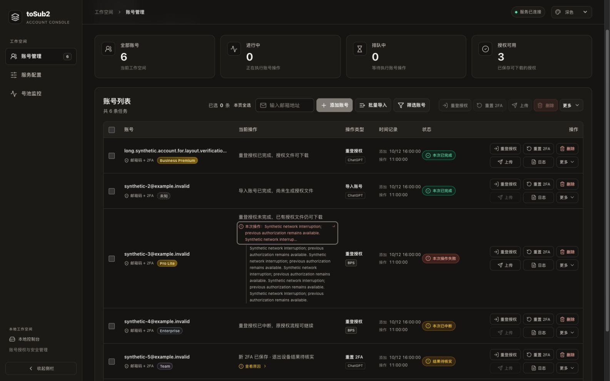
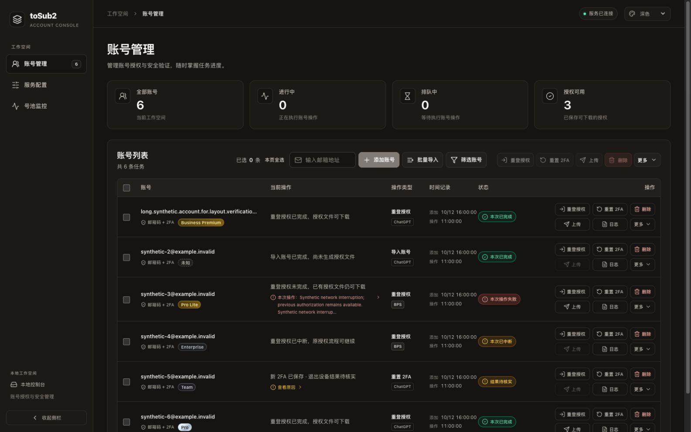
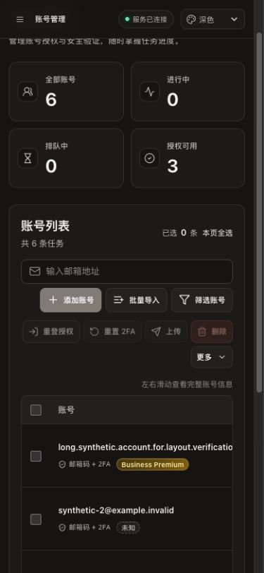
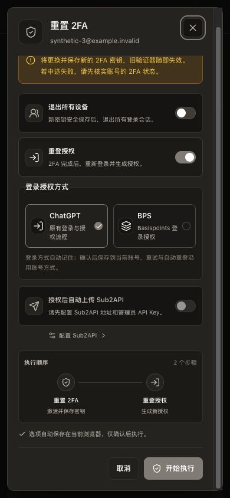
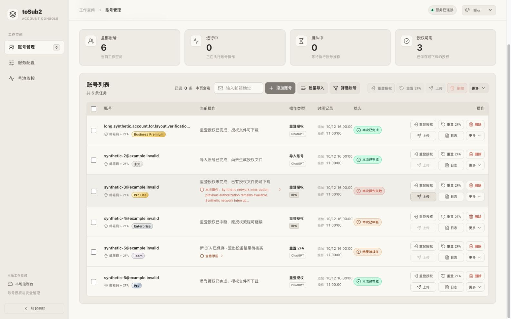

# 前端可靠性与交互验证（2026-10-13）

本轮以当前 Go 版本与受控 `web/vendor` 为基线，保留既有暖灰、纯白、深色、系统主题和 CLIProxyAPI 管理界面的组件风格，没有引入 Node、Python、浏览器安装或浏览器登录依赖。所有截图与实际浏览器操作都来自独立 Go 合成服务，未使用真实账号、凭据、HAR 或 4401 实例。

## 已确认问题与实际修改

| 代码证据 | 实际修改 | 验证 |
| --- | --- | --- |
| 监控使用 `setInterval`，慢响应可叠加；错误被空 `catch` 吞掉 | `lib/polling.js` 统一串行只读轮询；10 秒超时、取消、上限 30 秒退避、隐藏/离线暂停、恢复即时读取；监控错误独立显示 | Go + Sobek 的可控时钟/Promise 回归；浏览器模拟服务 503 后仍保留 6 行，再自动恢复 |
| 账号轮询和启动读取无取消和超时，启动失败需人工刷新 | 账号/监控副作用提取到 `hooks/serverState.js`；启动、账号、监控、日志共用读取生命周期 | 超时后晚到响应、停止后响应、并发刷新合并、监听器与定时器释放回归 |
| 短信/Sub2 配置选项的慢读取可在用户修改草稿或关闭页面后回写；统一 10 秒截止会提前终止既有慢选项读取 | `latestRead.js` 与 `useLatestRead` 将读取绑定到当前草稿和页面；替换时取消旧请求、按服务预算截止且不自动重试 | Go 验证替换后 loading 归属、草稿失效、关闭取消、超时和晚到响应；可控时钟覆盖 Sub2 65 秒与 SMS 20 秒读取 |
| 存储写入吞错，配置页仍显示“配置已保存” | 写入返回成功与否；短信/代理失败不替换旧设置；邮件/Sub2 区分服务已生效与浏览器未保存；主题失败显示提示；无改动状态改为“无待保存更改” | 合成 quota failure 验证返回值与旧值保留；实际主题刷新、清理设置后刷新验证 |
| HTTP 非 JSON 错误掩盖原 HTTP 状态，结构化失败丢失部分结果 | `readResponse` 保留 HTTP 状态和结构化 `error.data`；网络断开时有副作用请求提示结果未知且不重试 | 合成 HTTP 204/403/502/无效 JSON/网络失败；无副作用 POST 查询显式标记 `readOnly` |
| 部分上传和未知结果可能只剩普通错误或“正在同步” | 同时展示确认新增/更新、失败、跳过、未知、未执行；未知结果提示核实远端，避免重复创建 | 实际 React 收到 502 partial + unknown + not_attempted，警告准确且结束旋转；Go 回归保留全部计数 |
| 2FA 单独维护焦点逻辑，通用模态框没有叠层所有权 | 2FA 复用 `DialogFrame`，`dialogFocus.js` 只让顶层处理键盘；滚动锁和焦点按栈恢复 | Go 验证忙碌/嵌套/逆序卸载；实际 2FA Tab 环绕、Escape 与触发器焦点恢复 |
| 长错误增加行高，折叠摘要的 nowrap 可能溢出列 | 长消息可键盘展开全文；套餐/状态允许必要换行；表格按既有列总宽 1246px 排布，溢出提示使用容器宽度并支持键盘聚焦 | 1600px 下表格 1257px、容器 1259px；长错误摘要右界 882 < 单元格右界 894；320px 弹窗宽 296px |

HTTP 重试仅由只读轮询触发。上传、授权、2FA、退出设备、配置保存等请求不会由此机制重复提交。浏览器偏好仍仅用于手动选择；继续任务锁定保存的方式，自动重登仍由服务端账号方式决定。

状态轮询继续使用 10 秒读取截止。交互式选项读取使用独立预算：Sub2 options 为 245 秒，对应服务端顺序读取分组和代理的 240 秒整体预算（每项最多 120 秒）；SMS options 为 25 秒，对应服务端 20 秒整体预算。额外 5 秒用于交付服务端响应，不延长服务端操作时间，也不引入重试。关闭页面、改动草稿或重新读取仍立即取消旧请求。

## 可重复验证

纯 Go 回归与构建：

```sh
go test ./internal/console -run 'TestFrontend|TestAuthorizationPreference|TestMonitorAndUpload' -count=1
go test -race ./internal/console -run 'TestFrontend|TestAuthorizationPreference|TestMonitorAndUpload' -count=1
go run ./cmd/build-web
git diff --check
```

本轮新增 15 个生产 JavaScript 逻辑回归测试，使用已有版本 esbuild 和 Sobek，在可控环境里执行真实源码。其中读取预算回归使用可控时钟快速验证 Sub2/SMS 两种预算，既接收支持的慢响应，又在各自上限终止卡住的请求。它们不等同于浏览器 DOM 测试；实际 React DOM、焦点、样式和刷新行为另用当前系统已有浏览器完成。没有引入新测试运行时或增加依赖版本。

独立界面夹具：

```sh
go run ./cmd/build-web
go run ./internal/console/testdata/ui-fixture -assets web/dist
```

打开终端打印的随机回环端口。该夹具只读取构建资源并使用内存合成账号，没有上游客户端、凭据存储或真实任务执行器。每次启动端口不同，不会覆盖 4401。`GET /__fixture/state` 只显示方法/路径计数。服务中断可用 `POST /__fixture/state?offline=true` 模拟，`offline=false` 恢复；不要将这些命令指向真实服务。

实际浏览器步骤与本轮结果：

1. 在 BPS 合成账号的重登窗口改为 ChatGPT；关闭并打开 2FA，开启重登，确认 ChatGPT 选中；改为 BPS，关闭、刷新、打开另一个账号的重登，确认 BPS 仍选中。通过。
2. 将手动偏好改为 ChatGPT，再打开原 BPS 中断任务的“继续流程”；BPS 选中且两种方式不可切换。通过，未提交授权。
3. 对 2FA 弹窗执行 Tab/Shift+Tab/Escape；验证最后按钮 Tab 回到关闭按钮，关闭后回到对应行触发器。手机菜单 Escape 恢复触发器并解除背景 inert；行菜单 End/Escape 正常。通过。
4. 以 `1600×1000`、`390×844` 和 `320×740` 验证长邮箱、Business Premium、长错误和弹窗。页面无横向溢出，表格在自身容器滚动；完整错误可用 Enter 展开。通过。
5. 使用夹具地址和明确的合成 Key 保存 Sub2 设置；点击模拟上传，显示“更新 1、未知 1、未执行 1”和核实提醒。通过；这验证 UI 合约，不代表真实远端上传。
6. 模拟服务 503，账号旧数据保留、顶部显示同步中断；恢复服务后账号和监控分别恢复，错误消失。通过。浏览器 navigator offline/visibilitychange 事件另由纯 Go 可控回归覆盖。
7. 深色主题刷新后保留；清除网页设置后恢复暖灰，刷新仍暖灰。通过。真实浏览器存储策略拒绝未在本次环境中切换，失败反馈由合成存储回归验证。
8. 检查浏览器 console：无 warn/error。夹具请求统计确认未提交真实/模拟登录、2FA 重置或退出设备。最后清理该随机端口的网页设置、关闭页面、恢复视口并停止夹具。

## 清理依据与边界

- 移除 main/job-logs 中被统一读取调度替代的重复轮询和清理代码；保留它们原有刷新频率、结果与业务判断。
- 移除 2FA 的重复焦点陷阱，因相同责任已由通用对话框及可独立测试的焦点作用域承担。
- 合并移动端重复的表格滚动提示 CSS；保留既有主题、列宽比例、主要按钮层级、全部操作与许可证。
- 哈希变化的旧前端资源由既有 Go 构建命令替换，两份 dist 同步更新。没有删除业务流程、异常恢复、测试或第三方代码。
- 本轮未宣称性能提升，也没有以单次耗时作为性能结论。纯 Go 自动化可覆盖 JavaScript 逻辑，但实际浏览器验收目前仍是可重复的人工/代理操作步骤，尚未变成无浏览器依赖的 DOM 回归套件。
- 配置选项读取的草稿失效、取消、超时和响应竞态由 Go + Sobek 的确定性回归验证；本次没有另做真实浏览器的慢选项服务交互。

## 合成截图










