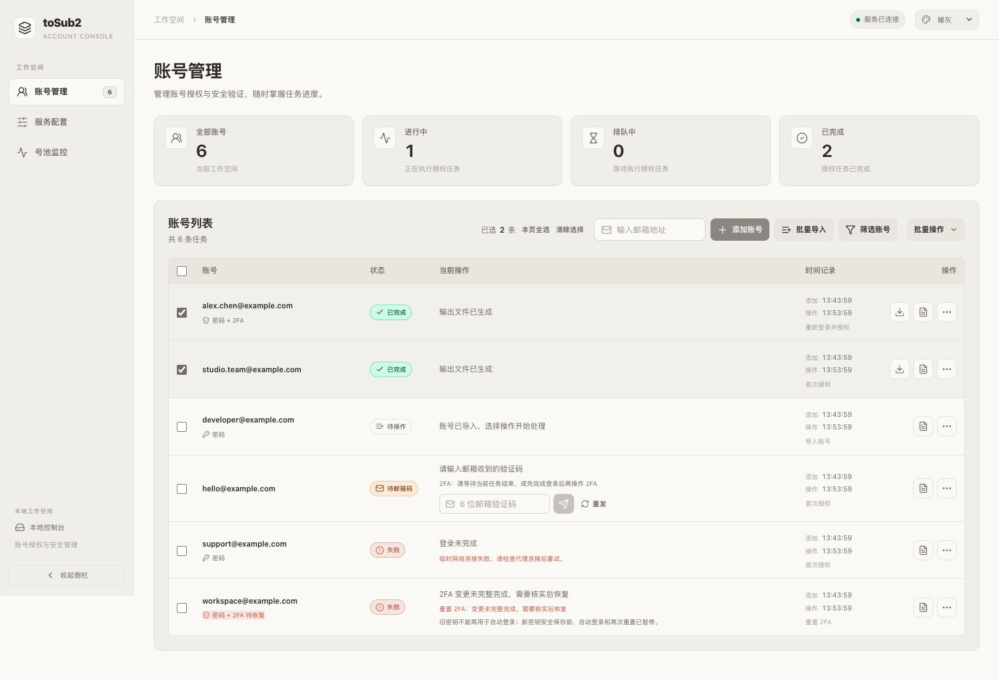
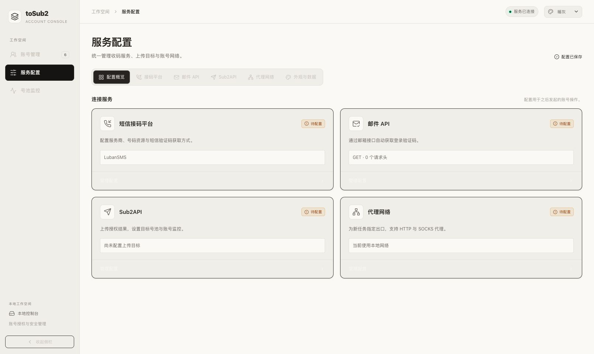
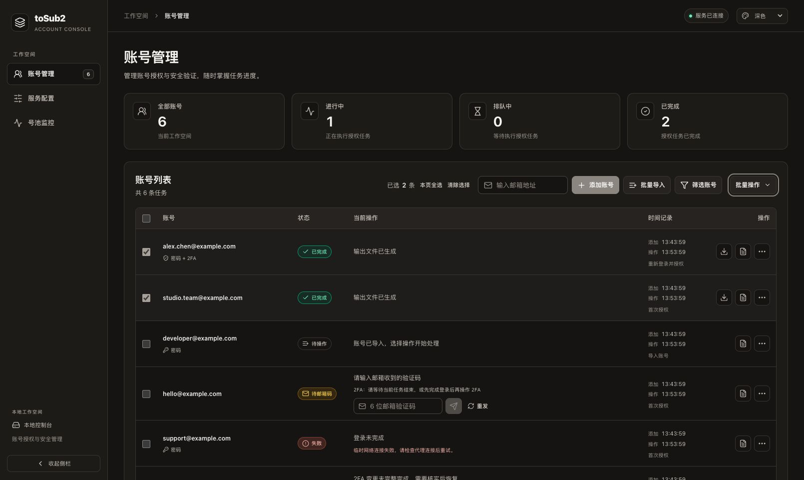
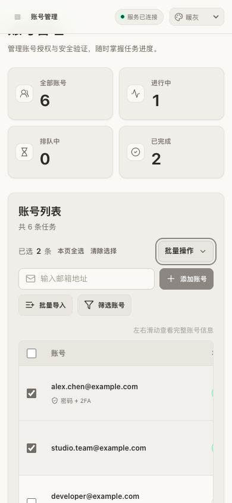
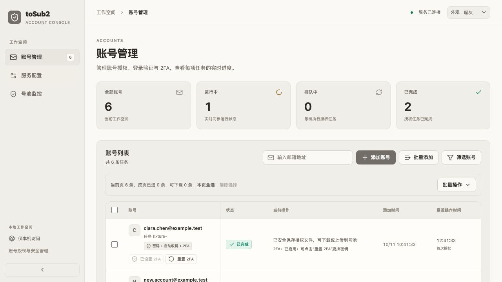
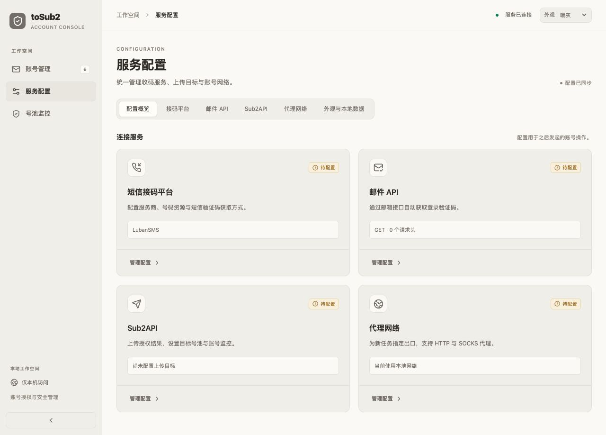
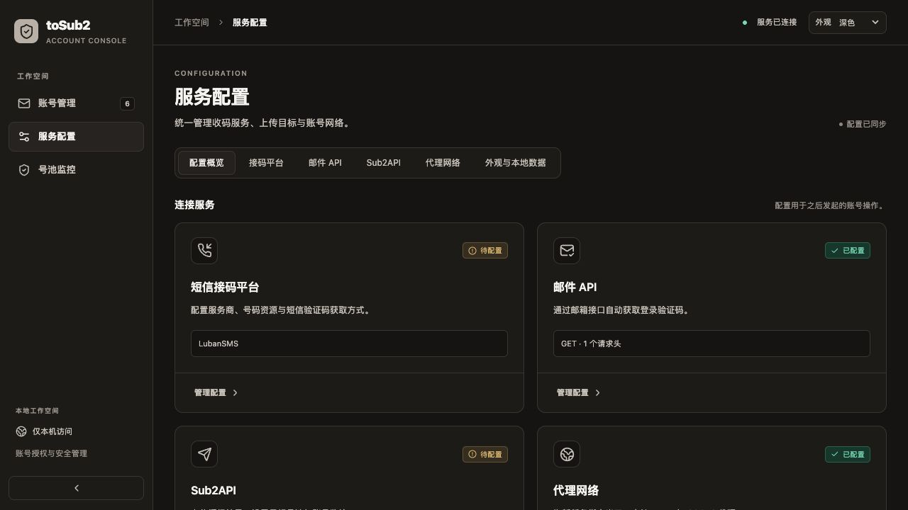
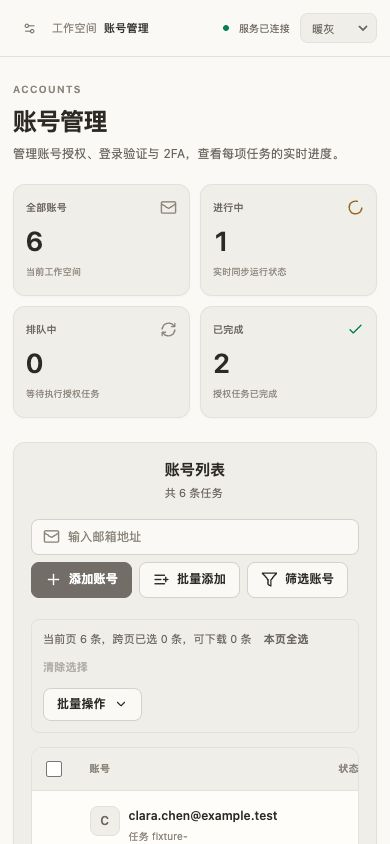

# 控制台前端重构

2026-10-12，已部署到 <http://127.0.0.1:4401/>。

## 参考与实现

当前状态与日志审查的修复、界面和验证记录见 [状态与日志统一](status-and-logs.md)。

当前单行与批量快捷按钮、重登自动上传及账号资料卡的实现和验证见 [账号快捷操作与资料卡](account-actions.md)。

参考项目 `/Users/ceng/Downloads/CLIProxyAPI-main` 通过配置加载官方 [CLI Proxy API Management Center](https://github.com/router-for-me/Cli-Proxy-API-Management-Center)。本次读取该前端的 `390718ecfec90b674fed474862e497522273e129` 版本，参考其暖灰配色、侧栏、卡片、表单及主题组织方式，重新实现适合 toSub2 的布局。未引入该项目的构建工具、依赖安装或独立服务。

- **账号管理**：统计卡片、添加与导入、筛选、跨页选择、账号及批量操作菜单。保留验证码输入、日志、授权文件下载、上传、密码操作、2FA 设置与重置。
- **服务配置**：配置概览及短信平台、邮件 API、Sub2API、代理网络、外观与本地数据分类。现有配置表单改为页内编辑；切换页面或分类前保护未保存草稿。
- **号池监控**：状态、执行间隔、检查时间及最近结果；进入页面只读取状态，检查仍由用户明确触发或既有后台计划执行。
- **通用交互**：可折叠侧栏、手机导航、暖灰/纯白/深色/跟随系统主题、局部滚动表格、弹窗与菜单焦点管理。确认提示改为页面内组件，保留原有风险说明。

运行与构建仍只需要 Go。React 页面和 Go 内嵌 JavaScript 引擎没有增加 Node、Python、浏览器自动化依赖。已有站点配置存储键保持不变，主题使用独立的 `tosub2.console.theme`。

## 当前套餐组件（16:10 部署）

16:10 将所有套餐统一为带渐变、边框和高光的紧凑标签，普通套餐使用低饱和配色，未知使用中性虚线，Pro 和 Premium 保留银金效果。账号、排除选项、监控规则共用组件，监控名单改为可换行标签组。十种套餐、暖灰/纯白/深色、320px/390px 布局、键盘勾选和模拟保存重开通过。Go 构建及实际 4401 资源一致性通过，未改变后台规则或增加依赖。

15:51 为排除套餐选项加入可区分的 Lucide 图标，并复用银色 Pro、金色 Pro Lite / Business Premium 标签。选中状态仍由右侧勾号表达；手机长名称完整换行，账号列表样式不变。新增八个现有版本的官方图标模块及来源哈希，无 Node/Python 构建或运行依赖。暖灰、纯白、390px 深色、键盘选择、保存重开、Go 构建与实际 4401 资源一致性检查通过。

15:37 更新套餐排除选项：改为等宽选择卡片、右侧勾号、顶部数量和清空操作，并按表单容器宽度自适应五/三/两列。保留原生 checkbox 的键盘功能；仅调整表单布局，账号列表的套餐组件未改动。

此前 15:25 对照官方实际 `CodexQuotaBody` 组件，将套餐与登录方式放在同一行，邮箱独占上行。普通套餐无框文字，Pro 采用静态银色、Pro Lite / Business Premium 采用静态金色胶囊，共用 `PlanBadge`；缩为 10px 字号、18px 胶囊。排除选项当时采用 30px 小胶囊，保留原生 checkbox 的键盘和无障碍能力，缩短说明及间距。官方套餐映射同时确认 Business Premium 应独立于 Team。

Sub2API 设置支持多选排除自动重登套餐，监控页面展示规则及排除数量；沿用参考项目的暖灰/深色样式。保存、清空、刷新回填、轮询草稿保护、桌面和 390px 手机布局已验证。套餐识别范围、后端规则和本轮截图见 [套餐显示与自动重登排除](account-plans.md)。

## 此前视觉修正（14:13 部署）

- 重新核对参考版本的 `src/styles/themes.scss`、`components.scss` 和 `layout.scss`。采用参考项目实际页面色 `#faf9f5`、卡片色 `#f0eee8`、行动色 `#8b8680` 及对应深色主题；替换上一轮的绿色主色。主题文件与上述固定 commit 逐字节核对一致。
- 选中数量、本页全选、清除选择、添加、批量导入、筛选和批量操作合并进列表顶部；删除单独选择工具条，将下载数量和 2FA 资格提示放入批量菜单。手机端选择信息与批量菜单同排，其余控件按宽度换行。
- 账号列只保留邮箱和登录方式，长邮箱保持单行省略，悬停可读全文。移除头像、任务 ID、重复的 2FA 已启用提示以及账号下方的按钮。
- 开始授权、设置/重置 2FA 统一移入右侧更多菜单，下载和日志保留直接入口。移除账号和操作列的固定定位、垂直分割线及阴影，仅用横向边框区分行。

本轮使用六种合成账号检查 1280px、1610px 桌面、深色配置和 390px 手机布局。宽桌面选中信息、添加表单和批量菜单处于相同纵坐标；账号及操作列左右边框均为 0、阴影为 none，账号列按钮为 0。手机文档宽度 390px，表格容器宽 326px，920px 表格仅在自身容器滚动。

验证导入账号的开始授权入口、单个及批量 2FA 确认窗口、退出设备默认关闭、取消不提交、批量跳过数量、菜单 Escape、日志展开与合成授权文件下载。模拟请求记录仅有初始化的邮件配置同步，没有授权、2FA、删除或巡检请求。隔离页和实际 4401 均无 console error/warn；真实账号只作读取检查。

`make frontend`、Go 主程序构建、两份 dist 比较、前端 diff 格式检查通过。实际部署资源逐字节一致；五个 data 文件保留，四个资料/授权文件哈希不变，仅任务元数据按正常重启流程重写，两条任务仍为 completed。本轮未修改后端或 vendor，未重复此前已通过的后端测试。

验收后已关闭隔离页、停止测试服务，并删除临时 Go fixture、参考样式副本及模拟下载文件；现有备份未改动。

本轮预览均为合成账号：

## 源码结构

| 文件 | 职责 |
| --- | --- |
| `web/src/main.jsx` | API 状态、任务操作、设置草稿、页面组合 |
| `web/src/components/shell.jsx` | 侧栏、导航、主题、账号统计、配置与监控页面 |
| `web/src/components/ui.jsx` | 操作菜单、确认框、模态框、页面标题、统计卡片 |
| `web/src/components/accounts.jsx` | 账号行、验证码、2FA 确认、日志和空状态 |
| `web/src/components/SettingsDialogs.jsx` | 短信、邮件、Sub2API 配置表单，支持页内布局 |
| `web/src/lib/console.js` | API、配置归一化、本地存储、下载及格式化工具 |
| `web/src/styles.css` | 主题变量、组件样式及响应式布局 |

## 此前完整重构的验证记录与边界

- `make frontend`、Go 主程序构建和 `go test ./internal/console ./cmd/tosub2` 通过。
- 两份 dist 内容一致；4401 的 HTML、JS、CSS 与本次构建资源一致，运行进程打开的新 executable 与部署文件一致。
- 隔离 Go fixture 提供六种合成账号及模拟 API；桌面账号、配置概览、邮件页内表单、监控页已检查。390px 手机布局的文档宽度为 390px，表格仅在自身容器横向滚动。
- 实际 4401 刷新后显示新控制台、服务已连接和两条完成任务，无页面错误。没有提交真实授权、重置、退出、删除或监控检查操作。
- 重启前后保留五个 data 文件，四个账号资料/授权文件 SHA-256 不变。`job-meta.json` 由服务正常停止和恢复流程重写，两条任务仍为 completed，无活动及排队任务。
- 关闭旧测试页后完成交互补验：邮件草稿继续/放弃、配置保存重开、代理校验及保存、Sub2API 号池读取与保存、短信配置保存、四种主题、深色偏好刷新保留、侧栏折叠至 60px。手机抽屉打开时隔离背景，未保存弹窗可操作，Escape 关闭恢复焦点。
- 账号操作菜单未被表格裁切，End/Escape 键及触发器焦点恢复正常；日志正常展开。模拟导入保持待操作，空筛选可恢复，验证码草稿跨页面保留；23 条合成账号的跨页选择及批量资格正常。
- 模拟 2FA 取消不发送请求，重新打开的退出选项默认关闭；双击单账号确认仅记录一次请求，`resetTotp=true`、`logoutAllDevicesAfterTotp=false`。批量选择含恢复阻塞账号时提示跳过，勾选退出仅发送一次批量请求。监控页面导航不触发巡检，手动点击仅发送一次检查请求。隔离页面无 console error/warn。
- 上述仅验证新前端及模拟服务交互；真实认证、短信、邮箱、Sub2API 和上游 2FA 操作未在本次执行。
- 验收后关闭隔离标签页，清除合成站点配置，停止并删除临时 Go fixture、参考源码副本和重构辅助文件。已有项目备份未改动。

预览使用合成账号，不包含真实凭据：

