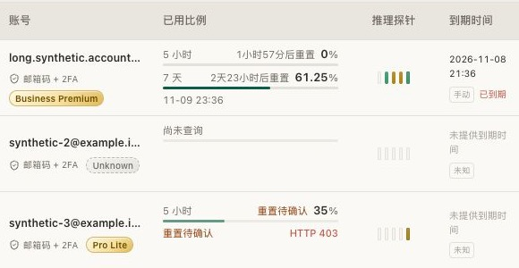
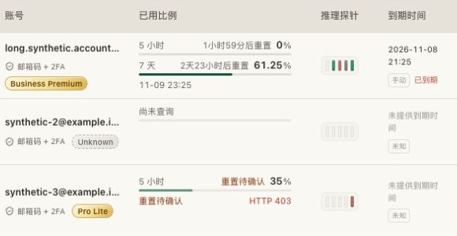
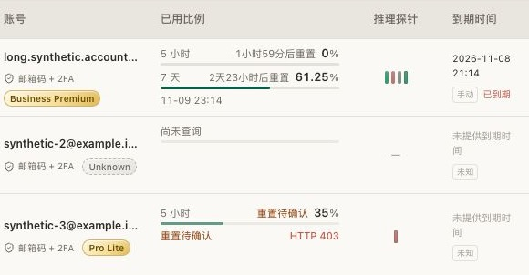
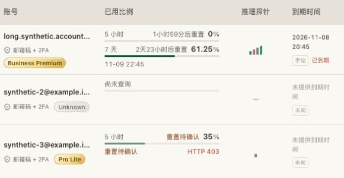
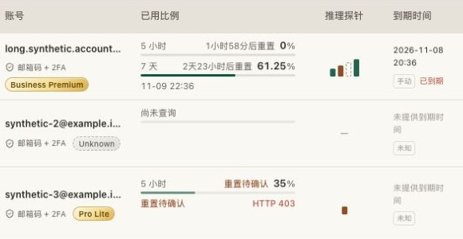
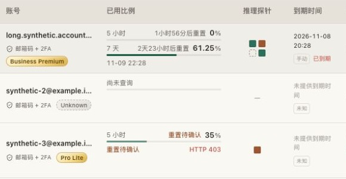
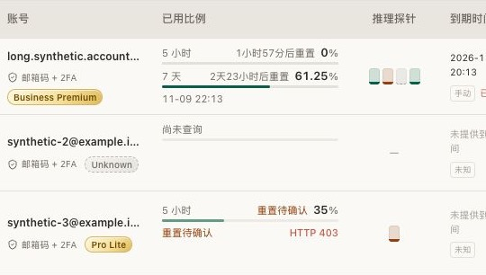
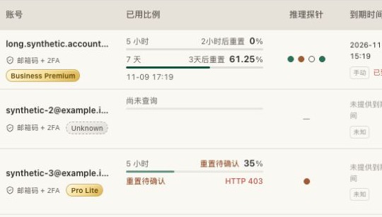

# 4401 糖果题探针修复部署记录

## 默认更新约定

用户于本会话明确要求“默认更新4401”：后续修改验证通过后，默认同步更新此项目的本地4401实例，无需重复询问部署许可。此约定不授权发起真实账号登录、2FA修改或模型探针；如果切换将中断尚未结束的账号操作，应先等待结束，或取得对取消该操作的明确指示。

## 最新部署：无外框五条探针

按用户反馈去掉五槽的外层底托、背景、内边和包裹式间距，五个 4×14px 等高细条直接排列，间隔 4px。通过使用绿色，其余已有但未取得通过结果的记录使用黄色；空槽保持原浅色空白轮廓。保留最近一条的轻微内侧强调。同步或保存未确认的提示改用底部细虚线，不再环绕整组。

- 仅修改展示样式，原始结果、判定和详细提示不变；未知、取消和限流不会被改写成确定失败。一条真实记录仍代表一次糖果探针，固定五槽、左旧右新。
- 旧 PID `51410` 退出，新 PID `59438`；程序 SHA-256：`09a7fbeccd22bee247a33e01eaed09d9ea1b5c9ba2cb9cf6a461ddd70da2983a`。
- 空闲时切换；13 个账号与 63 份账号目录文件摘要不变，4 份实际 HTTP 前端资源匹配构建，健康检查通过。原巡检已恢复，launchd、账号查询配置、工作区旧二进制和 HAR 摘要不变。
- 相关控制台回归通过（1.122s），前端与 Go 构建、diff 检查通过。合成浏览器核对浅深色、透明无边外层、五槽数量、逐次真实记录数及 4×14px 尺寸，未发现浏览器错误；探针 POST 为零。
- 没有取消任务或主动操作真实账号。只备份旧程序，未复制业务或认证材料；候选暂存与本轮合成夹具进程已清理。状态记录：`/tmp/tosub2-4401-bare-update-state.json`。

## 前次部署：固定五槽记录带

按用户最新“默认5条”的要求，账号列表始终显示五个等高位置。保留 4×14px 细圆角记录条，间距调整为 4px，外侧加入 48×24px 的浅色圆角底托和轻微内边。真实记录靠右排列，最新记录固定在最右侧；不足五条的前部位置显示浅底轮廓空槽。空槽明确表示“暂无可显示记录”，不代表未执行过检测，不具有探针标识、结果或时间，也不计入真实记录数。已执行但结果未知的记录仍为实灰条。

- 当前排队、运行、同步未知和保存未知提示继续独立保留；没有记录时显示五个空槽，运行中显示状态文字。空槽与记录均可查看提示，键盘聚焦空记录也可读到空槽含义。
- 旧 PID `49219` 退出，新 PID `51410`；程序 SHA-256：`84bd76aa3ec2a3ada7624b74a7a45f390dbe90a7c623c4f52aa0cac34227b2e5`。
- 空闲时切换；13 个账号与 63 份账号目录文件摘要不变，4 份实际 HTTP 前端资源匹配构建，健康检查通过。原巡检恢复，launchd、账号查询配置、工作区旧二进制和 HAR 摘要不变。
- 相关控制台回归通过（1.004s），新增固定五槽、空槽不伪造记录、真实结果靠右及最新标识断言；前端与 Go 构建、diff 检查通过。浏览器验证空记录、单条及多条均有五槽、空槽与未知结果区分、浅深色、390px 窄屏及键盘提示，无浏览器错误或探针 POST。
- 没有取消任务或主动操作真实账号。只备份旧程序，未复制业务或认证材料；候选暂存与合成夹具进程已清理。状态记录：`/tmp/tosub2-4401-five-update-state.json`。

## 前次部署：等高记录条细节打磨

保留用户已认可的 4×14px 等高细条、3px 间距和配色，增加很淡的顶部高光与内侧层次。实际历史最后一条使用同尺寸的轻微内边强调，并在提示中标明“最近一条”；不增加额外记录图形，不宣称历史记录代表当前操作成功。提示分行显示结果、时间及必要的不确定说明，支持键盘聚焦与回车打开详情。保留减少动画及高对比度模式支持。

- 旧 PID `47588` 退出，新 PID `49219`；程序 SHA-256：`f94b64bc29ed388fc834cab903f9a62208ce046833ea207f4ff8da140bea5b2a`。
- 空闲时更新；13 个账号与 63 份账号目录文件摘要不变，4 份实际 HTTP 前端资源匹配构建，健康检查通过。
- 原巡检已恢复，launchd、账号查询配置、工作区旧二进制和 HAR 摘要不变，没有取消任务或主动操作真实账号。
- 相关控制台回归通过（1.050s），前端与 Go 构建、diff 检查通过。浏览器核对等高尺寸、逐次记录数量及结果颜色、实际末条标识、浅深色、提示可见及键盘详情入口；无浏览器错误或探针 POST。
- 只备份旧程序，未复制业务或认证材料；候选暂存与本轮合成夹具进程已清理。状态记录：`/tmp/tosub2-4401-polish-update-state.json`。

## 前次部署：等高细记录条

用户明确要求去掉“左下右上”的信号轮廓。账号列表现采用等高细圆角条：每条 4×14px、间距 3px、圆角 2px，整组垂直居中。删除所有按位置递增的高度规则；每条对应一次真实糖果探针，左旧右新，颜色独立表示结果。保留上一版柔和绿、低饱和红和中性灰及各主题适配，简化说明，移除柱高相关文字。

- 旧 PID `45571` 退出，新 PID `47588`；程序 SHA-256：`b92d4acbe5115b4e93a5ca4833ff677881fac9ccba560909ab0ee291e9244272`。
- 空闲时切换；13 个账号、63 份账号目录文件摘要不变，4 份实际 HTTP 前端资源匹配构建，健康检查通过。
- launchd、账号查询配置、工作区旧二进制及 HAR 摘要不变，原巡检已恢复。没有取消任务或主动操作真实账号。
- 相关控制台回归通过（1.190s），前端与 Go 构建、diff 检查通过。浏览器核实每条 4×14px、顶端及底端一致、单条/多条真实记录数与独立结果颜色，浅深色显示正常；无浏览器错误或探针 POST。
- 只备份旧程序，未复制业务或认证材料；候选暂存和合成夹具进程已清理。状态记录：`/tmp/tosub2-4401-level-update-state.json`。

## 前次部署：细信号柱与柔和配色

根据“太粗了配色也不对”的反馈，仅调整探针样式：柱宽从 7px 收至 4px，间距从 3px 收至 2px，高度改为 6/9/12/15/18px；五柱总宽 28px。通过用柔和绿，答案不符或失败用低饱和红，未知用中性灰，去掉普通模式下的未知虚线和悬停加粗。深色及跟随系统深色有独立配色，高对比度模式保留未知细边。每柱一次、时间顺序、结果判定和交互保持不变。

- 旧 PID `42559` 退出，新 PID `45571`；程序 SHA-256：`eb3343eefeb75c595c3ea48dc67eeb11d74847515393b0b39775ba7120bf3fd5`。
- 空闲时更新；13 个账号及 63 份账号目录文件摘要不变，4 份实际 HTTP 前端资源匹配构建，健康检查通过。13 个账号、63 份文件为本轮实际基线。
- 原巡检恢复，launchd、账号查询配置、工作区旧二进制和 HAR 摘要不变；没有取消任务或主动操作真实账号。
- 相关控制台回归通过（1.008s），前端与 Go 构建、diff 检查通过；浏览器核对实际 4px 柱宽、高度、共同底线、每条颜色及浅深色显示，无浏览器错误、探针 POST。
- 只备份旧程序，未复制业务或认证材料；未使用的中间候选、最终候选暂存以及合成夹具进程均已清理。状态记录：`/tmp/tosub2-4401-slim-update-state.json`。

## 前次部署：逐次递增信号柱

用户进一步明确需要“类似信号强度”的轮廓。账号列表改为底部对齐、从左到右逐根升高的细柱，每根仍对应一次真实糖果探针，各自独立表示结果。柱宽 7px、间距 3px、高度依次为 10/14/18/22/26px，整组高度固定 26px。绿色表示该次通过；没有记录不补柱，单次只显示一根。时间左旧右新，高度仅用于外观排列，不作为得分或通过率。

- 旧 PID `40185` 退出，新 PID `42559`；程序 SHA-256：`02333c49eb7bb779f65ec6404bd82dbaa53213fd6529f5e4573edff47dd6db90`。
- 初次准备时有账号任务运行，未停止服务或取消任务。任务自行结束后丢弃未使用候选，重新取得空闲基线，再更新；12 个账号、59 份账号目录文件摘要不变。该基线不同于上次更新时的 11 个账号、56 份文件。
- 4 份实际 HTTP 前端资源匹配最终构建，健康检查通过；launchd、账号查询配置、工作区旧二进制及 HAR 摘要不变，原巡检已恢复。
- 相关控制台回归通过（1.129s），`go vet ./internal/console`、前端和 Go 构建、diff 检查通过。合成浏览器核对逐根高度、共用底线、记录数与结果颜色，以及深浅色、390px 窄屏、键盘详情入口；无页面溢出、浏览器错误或探针 POST。
- 未主动操作真实账号，原巡检继续按配置运行。只备份旧程序，未复制业务或认证材料；候选暂存及本轮合成夹具进程已清理。状态记录：`/tmp/tosub2-4401-ascending-update-state.json`。

## 前次部署：自适应方格矩阵

按用户“参考网格样式”的反馈，账号列表改为等大方格组成的紧凑矩阵，移除浅底竖片及底部实色条。每格 12×12px、间距 4px、圆角 2px；四条记录排为 2×2，五条按三列换行，单条居中。整格绿色表示该次通过，其他结果保留独立颜色或中性空心边。每格对应一次真实糖果探针，从左到右逐行由旧到新，不填充缺失记录。

- 旧 PID `34153` 退出，新 PID `40185`；程序 SHA-256：`c86e721d4fd480c75b4d77acf010c0cab3d230c3de825a854c011094fbbb461f`。
- 更新前空闲；11 个账号、56 份账号目录文件摘要不变，4 份实际 HTTP 前端资源匹配最终构建，健康检查通过。
- 原巡检已恢复，launchd、账号查询配置、工作区旧二进制及 HAR 摘要不变。没有取消任务或主动操作真实账号；巡检继续按原配置运行。
- 最终相关控制台回归通过（0.855s）；`go vet ./internal/console`、前端与 Go 构建、diff 检查通过。合成浏览器验证 2×2 排列、逐次结果、深浅色、390px 窄屏、键盘打开及关闭详情；无页面溢出、浏览器错误或探针 POST。
- 只备份旧程序，未复制业务或认证材料；未安装的中间候选与最终候选暂存均已删除。状态记录：`/tmp/tosub2-4401-matrix-update-state.json`。

## 前次部署：逐次浅底色片

账号列表重新设计为居中排列的浅底小色片：每片 12×18px、圆角 3px、间距 3px，底部实色边标记结果。绿色表示该次通过，琥珀表示答案不符，红色表示失败，中性灰及虚线边表示未知。一条真实糖果探针记录对应一片，左旧右新，不补造记录；无记录显示横线。悬停显示简短结果和时间，完整说明与键盘详情入口保留。

- 旧 PID `27027` 退出，新 PID `34153`；程序 SHA-256：`3749469b9c04018987a5ed33cb98c995c983c8bf0ff1e3cc8279db5dc9421cad`。
- 切换时账号任务空闲；11 个账号、56 份账号目录文件摘要不变，4 份 HTTP 前端资源匹配构建，健康检查通过。56 份为此次准备阶段取得的实际基线。
- launchd、账号查询配置、工作区旧二进制及 HAR 摘要不变，原巡检已恢复。本轮未取消账号任务，没有主动发起真实登录、2FA、token 刷新或模型探针；巡检继续按原配置运行。
- 相关控制台回归通过（1.318s）、`go vet ./internal/console`、前端和 Go 构建及 diff 检查通过。合成浏览器验证暖灰、深色、390px 窄屏、逐次记录数量、键盘详情；没有页面溢出、浏览器错误或探针请求。
- 只备份旧程序，本轮候选暂存已删除。部署状态记录：`/tmp/tosub2-4401-tiles-update-state.json`。

## 前次部署：逐次圆点记录

按用户对外观的反馈，将逐次短条改为居中排列的 9px 圆点、6px 间距；去掉竖条、斜纹和底板，绿色表示该次通过。一个实际记录对应一个圆点，数量、时间顺序与判定规则保持不变；未知使用空心点，空记录不补点。

- 旧 PID `25031` 退出，新 PID `27027`；程序 SHA-256：`f6a0a880e2e1cc1b5e0cafb6c1f74ad61989f96963e21e9cbd8528bc934106c1`。
- 11 个账号、52 份账号目录文件摘要不变；4 份 HTTP 前端资源匹配构建，健康检查通过。原巡检已恢复，配置与 HAR 摘要不变。
- 相关控制台回归通过（1.208s）、`go vet ./internal/console`、前端和 Go 构建通过。浅色、深色、点击范围与键盘详情入口验证通过，合成浏览器零探针请求；没有主动操作真实账号。
- 只备份程序，本轮候选暂存和合成夹具已清理。状态记录：`/tmp/tosub2-4401-dots-update-state.json`。

## 前次部署：每条对应一次糖果探针

按用户明确的“一条代表一次探针”要求，4401 已更新为[逐次历史短条](candy-runs-2026-11-09.md)。只显示实际记录，一次一条，各自着色，左旧右新；原脉冲装饰已移除。

- 旧 PID `22663` 退出，新 PID `25031`；程序 SHA-256：`fa359796483007c865c2431bc8b9220c59f0c4c36bd89e80ba5582487c5873d2`。
- 切换前账号、探针、查询均空闲，回收站无在途及到期清理；未取消任何任务。
- 11 个账号保留，52 份账号目录文件摘要不变；4 份实际 HTTP 前端资源与构建逐字节一致，健康检查通过。
- launchd、账号查询、工作区旧二进制与 HAR 摘要不变；巡检原配置已恢复。仅备份旧程序，本轮候选暂存已删除，没有复制认证材料。
- 控制台全包测试通过（45.157s），相关历史回归、`go vet ./internal/console`、前端与 Go 构建及 diff 检查通过；合成浏览器探针请求为零。未主动操作真实账号，巡检按原配置继续运行。
- 私有部署摘要：`/tmp/tosub2-4401-runs-update-state.json`。

## 前次部署：重新设计的脉冲状态标记

用户要求将信号样式作为参考并重新美化。当前 4401 已更新为[脉冲状态标记](candy-pulse-2026-11-09.md)：对称短线、浅状态底色、细边框，探针列固定为 100px。此前五根递增手机信号柱已被替换。

- 旧 PID `14091` 退出，新 PID `22663`；程序 SHA-256：`bd4c8b6634e93fec8df557b1467c7de7c9225a441711082347cdef9fc5c80b9d`。
- 切换前确认账号任务、探针和账号查询均空闲，回收站无在途或到期清理；本次没有取消任何账号任务。
- 11 个账号保留，52 份账号目录文件摘要不变，其中包含 16 份凭据、13 份授权文件与 10 份 2FA 结果。
- 健康检查通过，实际 HTTP 提供的 4 份前端资源逐字节匹配本轮构建。launchd 配置、账号查询设置、工作区旧二进制及只读 HAR 摘要不变；原号池巡检已恢复。
- 仅保留旧程序回退副本，本轮候选暂存已删除；没有复制账号、Cookie 或会话材料。部署状态记录为 `/tmp/tosub2-4401-pulse-update-state.json`。
- 控制台全包测试、相关回归、静态检查、前端与 Go 构建通过；合成浏览器完成主题、布局与键盘验证。本次没有主动真实登录、2FA 修改、token 刷新或模型探针。恢复的巡检仍按原设置运行。

## 前次部署：信号式糖果探针与安全诊断

用户明确选择“取消这次等待并更新”，结束从当天04:55起等待邮箱验证码的自动重登任务。通过现有取消接口等待任务退出，确认账号操作、探针和账号查询的活动/队列均为零后停止旧进程。没有提交验证码、重新登录、刷新token或发起2FA修改。

- 已部署当前工作区的信号式糖果题UI与前序通过验证的JavaScript安全诊断、2FA后续授权失败提示修复。
- 旧PID `66018` 完全退出，新PID `14091` 监听 `127.0.0.1:4401`。
- 程序SHA-256：`d485db29e791821a138685bcfb5931bd05b8ce23fdb637b6d0290bc30c6b16bf`。
- 使用已通过检查的候选原子替换运行程序，`TOSUB2_LOCAL_REBUILD=0`启动。工作区旧二进制未替换，HAR未修改。
- 更新前后11个账号均保留；启动验收时活动和排队均为零。39份凭据、授权及2FA结果文件SHA-256全部不变。
- 本地健康检查通过；实际HTTP提供的HTML、JS、CSS、第三方声明共4份文件与构建逐字节一致。
- launchd配置不变；账号查询automatic原为false，配置不变。临时暂停的号池巡检已恢复原enabled=true及配置；恢复会继续原有后台巡检，验收空闲计数不代表未来无后台请求。
- 停服前回收站没有在途清理或已到期记录。只备份旧程序和已核对不含业务凭据的plist，不复制账号数据或认证会话。
- 临时候选目录已删除，非敏感路径、摘要及核验结果保存在 `/tmp/tosub2-4401-signal-update-state.json`（0600权限）。

验证复用本会话已完成的全仓测试、构建和静态检查，以及最终UI定向回归和浏览器验证；部署阶段未修改业务源码。

2026-11-09，依据用户“4401需要更新”的明确授权，将当前工作区已通过测试和单次真实调用验证的探针修复部署到 `http://127.0.0.1:4401`。这次授权仅用于更新该本地实例。

## 更新内容和版本

- 部署当前工作区的全部现有源码及嵌入前端，保留未提交修改，没有 reset、clean、整仓回退或提交。
- 包含糖果题 SSE 缺少 Content-Type、`response.metadata` 兼容修复，以及模型目录加载互斥、账号占用和响应错误分类优化；此前完成的 Cookie / 登录恢复清理一并进入运行版本。
- 原仓库参考仍为本地 `HEAD` / `origin/main` 的 `bb5259c2286556a6b827d2a68341b1f3d4ed43f4`，不是声称核实了远端最新版本。
- 候选程序使用 `CGO_ENABLED=0 go build -trimpath -ldflags='-s -w'` 构建，并通过本地 `--help` 检查。
- 新程序 SHA-256：`e9fa30abba31f5aa882a08cd087d6ce02290f268b63dc419bb96d3e9b4a547eb`。
- 旧 PID `6628` 完全退出后安装；新 PID 为 `52203`，监听 `127.0.0.1:4401`。

## 切换和数据保护

沿用 `scripts/local-legacy-macos.sh stop/start`、运行目录 `/Users/ceng/Library/Application Support/toSub2-local/6428e6fb3abbc4ae-legacy`、原数据目录及 Keychain namespace。停服前构建候选，停服后在 `bin` 内原子替换，启动时 `TOSUB2_LOCAL_REBUILD=0`。

更新前账号、探针和账号查询的活动数及队列数均为零，号池巡检和自动回收未在执行。账号查询的 automatic 原本为 false，保持原值；临时暂停原本启用的号池巡检，验收后已恢复 enabled=true，核对配置摘要一致。停服后再次确认持久化的 10 个账号任务均为 completed，没有待启动任务。

只备份旧程序和经检查不含业务凭据的 launchd plist，位置为运行目录下 `backups/program-before-candy-t4t94i21/`。没有为部署复制账号数据、日志、Cookie 或登录会话。旧程序回退副本保留，未执行回退。

## 验证结果

| 检查 | 结果 |
| --- | --- |
| 本地健康接口、监听进程、部署摘要 | 全部符合新程序 |
| 账号数量与任务状态 | 更新前后均为 10，全部 completed，活动和队列为零 |
| 探针及账号查询 | 活动和队列为零 |
| 当前数据目录的凭据 / 正常授权文件 | 21 份 SHA-256 全部不变 |
| 实际 HTTP 提供的 HTML、JS、CSS、第三方声明 | 4 个文件与构建资源逐字节一致 |
| launchd 完整配置及账号查询设置 | 摘要不变 |
| 号池巡检配置 | 恢复原 enabled，其他核对项不变 |
| 部署后会话只读扫描 | 运行目录及其备份中待清理项 0、未分类项 0，识别并保留 1,331 份正常凭据 / token 文件 |
| 工作区旧 `bin/tosub2`、只读 HAR | SHA-256 均未改变 |

复用部署前对同一源码已完成的整仓验证：`go test -count=1 ./...`、`go test -race -count=1 ./...`、`go vet ./...`、`go build ./...` 和前端构建均通过。部署过程没有更改业务源码，因此没有再次重复整仓测试。

本次部署验收只主动请求本地状态、设置和静态资源，没有额外发起真实登录、2FA、token 刷新、上传、模型目录查询或付费推理。修复后的真实糖果题 `1/1 normal` 属于[部署前实调](candy-probe-diagnostic-2026-11-09.md)，不是本次重启后的新推理记录。旧失败历史保持原样。

## 边界和记录

现有服务没有全局维护入队封锁接口；已观察的零计数并非原子排空证明，也不覆盖所有独立模型目录、套餐查询和手动回收请求。此次暂停自动来源、核对空闲后立即通过原生命周期脚本停止服务，并确认旧进程及监听退出，没有用临时会话恢复或维护框架代替。

工作区 `bin/tosub2` 和程序回退目录中的旧构建产物仍然保留，4401 已确认使用新版。其他实例不属于此次更新。自动巡检恢复后按原有配置继续运行，不将部署验收描述为所有未来后台请求均为零。

非敏感路径、摘要与验收状态记录在 `/tmp/tosub2-4401-candy-update-state.json`；只读扫描结果为 `/tmp/tosub2-4401-candy-update-session-scan.json`，均为私有权限文件，不含 Cookie、console token 或完整认证会话。

## 同日补充：账号列表探针网格

用户随后要求优化账号列表中的探针展示。`AccountQualityStatus` 改为当前状态、最近五次结果网格和顺序提示；通过、答案不符、绘图、限流、未知、失败、取消具有不同图标及说明。只使用实际完成记录，左旧右新；等待或运行不占历史格，旧结果明确标为历史，状态同步失败保留已有证据。点击保持原详情入口，不自动检测。详情弹窗和后端判定规则未调整。

- 修改 `web/src/components/account-quality.jsx`、`account-quality.css` 及对应现有测试；增加可选合成夹具 `qualityHistory=true`，默认夹具不变。
- 控制台全包测试通过（57.446s），最终状态展示定向测试通过（0.324s），夹具测试、相关 `go vet`、前端构建和 diff 检查通过。
- 浏览器验证 1440px 桌面和 390px 窄屏、暖灰和深色主题、键盘打开详情；五格总宽 116px，适配原 140px 列，无列内溢出、无浏览器错误。合成夹具记录零探针 POST。
- 按本会话更新 4401 的授权再次切换。切换前后均为 10 个账号、活动和队列为零；24 份当前凭据 / 正常授权文件 SHA-256 不变，完整 launchd 配置不变，号池巡检恢复原设置，实际 HTTP 提供的 4 个前端文件均与构建一致。24 份是此次切换前的实际基线，和前次更新的 21 份分别核验。
- 最新运行 PID `66018`，二进制 SHA-256 `3cb23b644241245d6cd0901cd7f5fa505c684ce180b8b603d8f2659fcc2d133c`。本次没有真实登录、2FA、刷新授权或付费探针验证。
- 仅保留程序和 plist 回退副本；临时候选已删除，工作区旧二进制未替换。详细非敏感部署记录：`/tmp/tosub2-4401-grid-update-state.json`。
