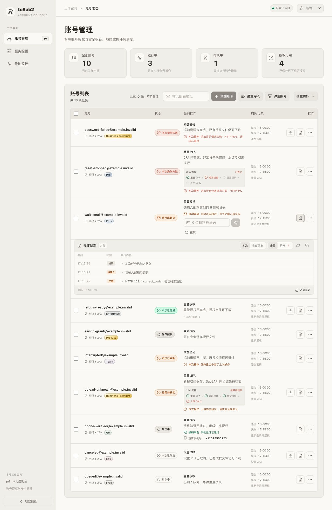

# 状态与日志统一

2026-10-12，对账号授权、重登、密码、2FA、验证码、上传和巡检的状态展示进行审查与调整。

## 修复的冲突

- 任务保留原授权时，本次添加密码或 2FA 操作失败仍可能显示“已完成”。新增独立的 `operationStatus`，界面优先展示本次排队、运行、等待、完成、失败、取消或中断；已有授权通过下载入口和“授权可用”统计表达。
- 协议提前报告完成时，授权文件可能仍在保存。管理器保存结束前保持“保存授权”，保存成功后才显示本次完成，凭据保存告警单独展示。
- 上一次 2FA、密码、邮件或短信错误可能与新操作成功结果一起出现。当前错误去重，旧提醒默认折叠；新操作不展示旧的 2FA 流程，终态清理验证码草稿和过期的密钥展示。
- 2FA 退出设备失败后，后续重登和上传显示“未执行”；上传响应超时显示“结果待核实”，同时说明新授权已保存。
- 状态连接失败、具体操作失败和日志读取失败分别显示。正常轮询只清除连接提醒；日志读取失败保留已加载内容。
- 上传部分失败及跳过使用提醒色，计数包含内外两层跳过；巡检运行时旧错误和结果明确标为“上次”。

## 日志组件

日志按时间、类别和中文摘要显示，支持本次操作/全部历史、全部/异常、原始详情、复制、刷新和跟随最新。查看历史或展开详情时暂停跟随，关闭后停止轮询。读取请求使用单飞、超时和代次隔离，防止迟到响应覆盖新任务。

后端保留原文本日志接口并返回结构化条目，包含操作时间、类型、阶段、状态和级别。连续重复去重，最多保留 200 条，并对敏感内容脱敏。没有操作标识的旧日志归入历史；失败、取消、中断优先于旧的成功事件。

## 验证

- `go test ./...`、`go vet ./...`、任务管理与控制台相关 race 检查通过；前端展示和日志使用 Go 构建及 JavaScript 引擎测试，不依赖 Node/Python。
- 隔离 Go 服务提供十类合成账号，检查旧授权下失败、2FA 流程停止、邮箱等待、历史提醒、保存中、重启中断、上传待核实、手机验证通过、取消和排队。
- 模拟操作 403、状态连接 503、日志读取 503 和部分上传失败，检查错误保留、独立恢复和计数。日志收起后请求计数不再增加。
- 暖灰桌面及深色窄屏检查通过；320px、390px 文档宽度与视口一致，表格仅在自身容器滚动，页面无 console error/warn。
- 实际账号只作读取检查；认证、重置、退出设备和上传交互使用合成服务，未对真实账号执行。

## 本地部署

本轮已更新 <http://127.0.0.1:4401/>，实际页面连接正常，两条账号均显示“本次已完成”，授权可用为 2。HTTP 返回的 HTML/JS/CSS 与构建产物逐字节一致，运行进程加载的新二进制与项目构建文件 SHA-256 一致：`41192cd1f0b459cb27c20a68f39fef6fd2a4838abbaf0aca5bf4210169551de0`。

重启前后保留 7 个 data 文件，5 个凭据和授权文件哈希未变；任务和监控元数据正常重写。监控保持关闭，未执行巡检。已清除隔离站点配置、关闭测试页、停止测试服务并删除临时文件，保留现有备份和合成预览。

预览使用合成账号：

