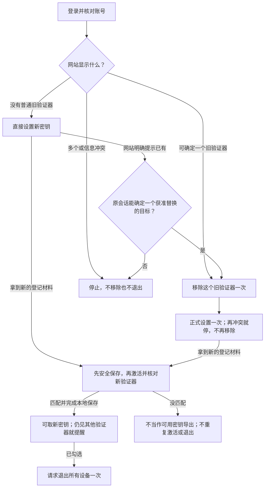

# 登录后重置 2FA：能否取到新密钥，旧验证器是否还可见

本次修改只影响**结果展示**。没有新增确认框、验证码输入、查询、重新登录、删除或退出动作。目标账号已核实、存储可用后，没有旧验证器就跳过移除而不是跳过设置。成功后私有的「账号信息 → 2FA 密钥」提供本轮密钥；日志不提供密钥。初次登记明确冲突，只有存在与本轮绑定相符的唯一普通旧目标才移除并正式登记一次；其他情况不猜 ID、不清空陌生验证器。



图中只画常见分支。状态缺少可选字段不等于没有旧验证器；原有只读复核预算、发送结果未知时不重发、正式登记冲突后的停止条件不变。[一页排障](totp-reset-support-2026-11-18.md)

## 修前 / 修后账本

请求数依次是 **状态查询 / 移除 / 登记总数 / 激活 / 退出**。来自回环假服务收件计数，不从日志推算；不含登录和用户读取控制台。下列在线流程在本地都只走了一次产品登录。F1、F2 是本轮代号，不是用户需要填写的数据。

| 场景 | 修前证据 → 修后行为 | 修后实收 | 用户复制日志的原文或字段 |
|---|---|---|---|
| 无旧验证器，勾选退出 | 修前入口已能保存并发送退出请求，但中文终态没说退出结果；不改动作。 | `2/0/1/1/1` | “退出请求已接受，其他设备是否已退出未核实” |
| 无旧验证器，已保存，退出返回 503 | 修前两份记录分别写“结果待核实”和“退出所有设备未完成”。修后，任务末行也写结果待核实。已保存的新密钥仍可从私有账号信息取用。 | `2/0/1/1/1`，不重发退出 | “本轮结果：新密钥已核对并保存；未确认退出结果，不重发退出请求”；`last_write_issue=SERVER_ERROR` |
| 只有导入的旧密钥，无导入 ID；网站显示单个旧目标 | 修前修后都能更换；验证私有账号信息返回新密钥。 | `2/1/1/1/0` | “已收到旧验证器 F1 的移除回执；当时只看到新验证器，不能证明所有旧密钥已失效” |
| 初登明确冲突且旧目标已绑定；或正式登记又冲突 | 既有一次回退不变。第二次冲突时没有重复移除或激活。冲突是合成回包。 | `3/1/2/1/0`；再次冲突 `2/1/2/0/0` | 成功：`local_commit=committed`；失败：“旧因子移除已有证据，新因子尚未确认。” |
| 移除前见多个；或初登冲突后见多个 | 都未取得唯一可移除目标。勾选退出也不会在这里发退出；目标与既有绑定不符同样不删。 | 初见 `1/0/0/0/0`；冲突后 `2/0/1/0/0` | “无法确定普通旧因子；未发送移除”；不匹配为 `TARGET_NOT_AUTHORIZED` |
| 新旧同时可见，勾选退出 | 修前新密钥已能取到，终态却是 `success / RESET_COMPLETE / none`；修后仍提交，终态改为警告并保留退出回执。 | `2/1/1/1/1` | “新密钥已核对并保存；已收到旧验证器 F1 的移除回执；核对新密钥时仍能看到 F1，不能确认它已失效；退出请求已接受，其他设备是否已退出未核实” |
| 新验证器与另一个非 F1 验证器同时可见 | 修前的终态丢了列表数量，显示无须处理；修后保留本轮核对时的普通验证器数量，不把另一项指认为 F1。 | `2/1/1/1/0` | “核对新密钥时还看到其他验证器，本次没有移除它们” |
| 新旧同时可见，退出返回 503 | 原有不重发逻辑不变；新密钥仍可取到，即使整个含退出的任务未成功。 | `2/1/1/1/1` | “未确认退出结果，不重发退出请求”；`local_commit=committed`、`logout=unknown` |
| 远端匹配，但本地提交失败；重启只补本地 | 修前本地补存成功后丢了“还见其他验证器”的提醒。修后恢复时沿用那次读数，不推断网站现状。 | 原轮 `2/1/1/1/0`；恢复轮**全部网络 0** | 原轮 `LOCAL_COMMIT_REQUIRED`；恢复轮“本轮只补本地保存，未联网”，仍是同一操作号 |
| 旧结构化记录只有本地提交、未记录因子匹配或退出回执 | 函数级与归档读页均复现误报“新密钥已核对”“未执行退出”。修后不从缺字段推断结论；公开页的文本与结构化摘要一致，原始归档及其校验名不变。 | 仅读本地合成归档；不是一次重置 | “本地提交已完成；未记录退出回执，不能确定是否已发送” |

[修前四个对照样例的界面复制终态](totp-reset-visibility-evidence-2026-11-18/before-clipboard-terminals.txt) · [上一轮 37 个视图的复制终态](totp-reset-visibility-evidence-2026-11-18/clipboard-terminals.txt) · [新旧同时可见的复制样例](totp-reset-visibility-evidence-2026-11-18/clipboard-warning.txt) · [本轮无旧验证器、退出 503 的复制样例](totp-reset-visibility-evidence-2026-11-18/clipboard-logout-unconfirmed.txt)。后两份是「本次 → 异常」的实际复制文本，条数受筛选限制，不能用来推算请求次数。

## 实现、证据边界与复验

- **当前代码：** [复用核对时的读数](../../internal/protocol/totp_reset_continue.go)、[终态及仅本地恢复](../../internal/protocol/totp_reset_log.go)、[白名单、级别和文案](../../internal/resetlog/detail.go)、[原有确认框](../../web/src/components/accounts.jsx)。新字段只用于展示，不参与提交授权或选择删除目标。旧 journal 没有读数就留空；有旧因子仍可见的肯定记录则沿用。不迁移或改写历史日志。没有把并发驱动加进产品。
- **先红后绿：** 修前正常入口及复制测试抓到了 `old_also_visible=true` 却是 `next_action=none`，恢复测试还原了丢失的列表信息，原弹窗测试抓到了“旧验证器随即失效”。修后，[控制台入口](../../cmd/tosub2/totp_reset_acceptance_test.go) 用签发的合成密钥校验激活码、断言实际请求次数、检查私有账号信息能否取到新密钥；不以单个 HTTP 200 代替这些证据。无匹配时私有查看返回 409，日志中没有密钥。
- **旧数据与退出：** [已存日志的只读展示](../../internal/jobs/log_archive.go)与[格式化器](../../internal/resetlog/detail.go)只用已记录的因子匹配和退出回执；`not_performed` 不是 `proven_unsent`。不解析旧自由文本来补证据，不改写归档。[工作流末行](../../internal/application/totp_workflow.go)保留退出拒绝与未确认之别。旧记录的两个反例先失败，随后专门用 503 在正常入口和界面复制复现了末行歧义，再跑通两端的回归。
- **历史而非本轮线上实测：** [并发报告](totp-concurrency-final-2026-11-18.md) 的 S1～S3 共 10 次登记、10 次激活均为 200；未观测到“已存在”。[双密钥报告](totp-dual-key-login-verification-2026-11-18.md) 记录了两份密钥分别用自己的验证器登录而状态可能只展示一个。本轮未重新登录真实账号，不能据此判断今天任何特定账号的旧密钥是否有效。两份 HAR 只沿用[已有脱敏字段结论](totp-reset-baseline-2026-11-18.md)，未读取身份材料或重放请求。原先 `request_id` 冲突分类和空 `MailHeaders` 的 JSON 往返属已有函数级回归，本次没有重写。
- **通过：** 29 个控制台入口场景，另测存储故障、仅补本地和取消／中断恢复；38 个 API 视图经真实日志组件执行复制，另用临时配置的无头 Chrome 对比三例（未匹配新因子的全量视图、新旧同时可见及退出 503 的异常视图），复制文本逐字一致。没有读写系统剪贴板，没有独立人工盲评。前端资源 `-check`、受影响包回归及下列定向 `-race` 已通过；`internal/resetlog` 无独立测试文件，由 jobs 和入口回归覆盖。
- **未做：** 线上复验、使用真实 Keychain/用户凭据、历史在线并发驱动、原生控制台及凭据导入进程、部署和全仓 race。没有删除锁文件。没有证明“所有旧密钥失效”或“所有设备已经下线”。

在项目根目录可复现（使用本地 Go 缓存和合成材料）：

```sh
export GOTOOLCHAIN=local GOPROXY=off TOSUB2_KEYCHAIN_TEST=0 TOSUB2_LEGACY_RUNTIME_TEST=0
go run ./cmd/build-web
go run ./cmd/build-web -check
P=$(mktemp -d /tmp/totp-protection.XXXXXX)
go test -count=1 ./internal/jobs -run '^Test(ResetSavedWithOtherVisibleNeedsBoundEvidence|LegacyResetLogoutPageKeepsArchiveButDoesNotInventEvidence|ResetLogBoundaryAcceptsOnlyTypedEvidence)$'
go test -count=1 ./internal/protocol ./cmd/tosub2 -run '^Test(TOTPEnrollmentConflictRecognizesExplicitRefusal|TOTPEnrollmentConflictNeverPromotesAmbiguousResponse|ReceiptProjectionRetainsOutcomeAndContradictionSemantics|BoundCredentialReadbackJSONEquivalence|ResetTOTPCompleteReceiptsSurviveLateTransportError)$'
go test -count=1 ./cmd/tosub2 -v -run '^Test(ResetConsoleRequestLedger|ResetStorageCheckpointsAndOfflineContinuation|ResetCancellationAndInterruptedRestore)$' -args -reset-public-pages "$P"
go test -count=1 ./internal/console -run '^TestFrontendResetClipboard$' -args -reset-public-pages "$P"
go test -count=1 ./internal/console -run '^TestFrontendResetClipboardInBrowser$' -args -reset-public-pages "$P" -reset-browser '/Applications/Google Chrome.app/Contents/MacOS/Google Chrome'
go test -count=1 -p 2 ./internal/resetlog ./internal/protocol ./internal/jobs ./internal/credentials ./internal/transport ./internal/accountlock ./internal/console ./cmd/tosub2 -skip 'ConsoleProcess|ConsoleShutdown|ConsoleLongSub2API|ConsoleDefaultFiveMinute|ConsoleFailedRestore|ConsoleCancellation|OfflineCredentialImportProcess|ResetConsoleRequestLedger|ResetStorageCheckpointsAndOfflineContinuation|ResetCancellationAndInterruptedRestore'
go test -count=1 ./internal/application
go test -race -p 1 -count=1 ./internal/protocol ./internal/jobs ./internal/console ./cmd/tosub2 -run '^Test(TOTPVector|ResetConsoleRequestLedger|ResetStorageCheckpointsAndOfflineContinuation|ResetCancellationAndInterruptedRestore|RunnerUsesAndLearnsVerifiedFactorBinding|ResetConcurrentSuccessfulRemovalsContinueThenCheckOwnFactor|ResetMultiFactorVisibilityIsNotRemovalAuthority|InterruptedResetLogDoesNotInventReceipts|ResetSavedWithOtherVisibleNeedsBoundEvidence|LegacyResetLogoutPageKeepsArchiveButDoesNotInventEvidence|ResetLogBoundaryAcceptsOnlyTypedEvidence|LogArchiveRetainsBeyondSummaryAndPagesAfterTrashRestart|BoundCredentialReadbackJSONEquivalence|FrontendResetDialogPromisesOnlyNewKeyAndLogoutReceipt|FrontendResetClipboard|TOTPResetExportAndAccountInfoUseCommittedFactorAfterCompletionAndRestore|AccountInfoIsExplicitPrivateAndUsesOnlyCurrentSavedCredentials)$'
go test -race -p 1 -count=1 ./internal/application ./cmd/tosub2 -run '^Test(TOTPWorkflowReloginErrorPreservesCompletedReset|TOTPWorkflowReloginErrorContextRequiresCompletedSave|TOTPWorkflowPanicNeverConfirmsSelectedSteps|ResetConsoleRequestLedger)$'
```
