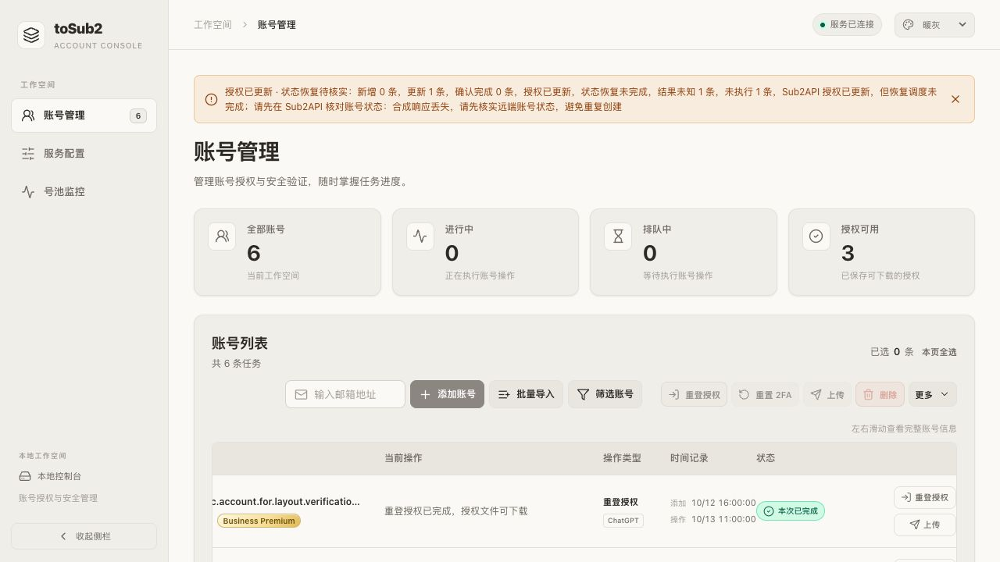

# 重新授权上传后的 Sub2API 错误状态恢复

## 问题与根因

手动“重登授权并上传”、手动上传及 2FA 后的上传共用 `sub2api.Client.Upload`。已有远端账号原先只更新 `credentials` 和 `extra`，没有执行巡检修复路径中的清错和恢复调度。因而凭据已经更新时，Sub2API 的旧 401 错误标记仍可能保留，控制台却按一次 PUT 的成功显示同步完成。

本轮以现有工作区和全部未提交修改为基线，仅修正这一生命周期缺口，不改变 Free 等套餐排除规则、授权方式偏好或自动重登资格。

## 实际行为

1. 沿用完整查询、邮箱去重和详情身份核对，已有账号仍更新原 ID。
2. 合并并提交授权字段，保留既有分组、代理、模型、计费、BPS 配置及请求时区规则。
3. 仅对详情中 `status=error` 的账号，在确认凭据更新成功后调用 `clear-error`，随后调用 `schedulable=true`。采用现有 Sub2API 状态及巡检接口契约，不解析可能包含私密内容的自由格式错误正文来猜测 HTTP 401。
4. `disabled`、健康但手动暂停调度、缺少状态或其他状态的账号仅更新授权，不自动启用。
5. 所有需要的步骤完成才计为 `success`。凭据 PUT 已成功时立即保留 `updated` 和账号 ID；随后步骤失败时报告部分完成，丢响应或 5xx 等结果未知继续单独标记。
6. 新授权文件与本地授权成功状态保留。失败不会重新创建账号、重做 OAuth 或自动重放已发出的生命周期请求；取消阻止后续步骤。

## 失败后如何处理

- **凭据更新未确认**：按界面错误核对 Sub2API 中的授权状态。结果未知时先核实，避免重复提交。
- **授权已更新，清错未完成**：错误明确标注清错阶段。确认远端仍为错误状态后，可手动上传已保存的新授权，无需仅为清错重新登录。
- **授权已更新，恢复调度未完成**：先到 Sub2API 核对错误是否已清除，再按实际状态恢复调度。如果清错后账号已经是健康但暂停调度，普通上传会尊重该暂停状态，不会把它当作错误账号强制启用。
- **清错或恢复调度结果未知**：先在 Sub2API 确认实际状态，不根据本地超时猜测远端失败。

本次不引入持久化格式迁移或新的恢复队列。远端管理员并发修改仍受上游 API 缺少条件写入的限制；本地规则以查询到的账号详情为依据。

## 回归与交付

新增合成服务回归先复现旧路径只 PUT、错误报告成功，再验证完整生命周期。测试覆盖 ChatGPT/BPS、手动停用保护、失败边界、取消、结果未知、凭据保留、禁止自动重放、HTTP 部分完成及前端状态文案。所有测试均使用合成账号和独立目录，不执行真实登录、2FA、退出设备或上传。

2026-10-17 使用固定 Go 1.27.2 执行以下验证，全部通过：

- `gofmt -l cmd internal scripts` 无输出，`git diff --check` 通过。
- `go test -count=1 ./...`。
- `go test -count=1 -race ./...`。
- `go vet ./...`。
- `TOSUB2_LEGACY_RUNTIME_TEST=1 go test -count=1 -race ./internal/jshost ./internal/legacyruntime ./cmd/tosub2`，显式覆盖认证 worker 和恢复夹具。
- `./scripts/build.sh`：Go esbuild 前端、`CGO_ENABLED=0` 生产程序。
- `./scripts/build-cross.sh`：darwin/arm64、darwin/amd64、linux/amd64、windows/amd64 构建。
- 实际浏览器在隔离 Go fixture 点击合成账号上传：显示“授权已更新 · 状态恢复待核实”、更新 1 条而确认完成 0 条、具体失败阶段和核实提示；没有误报成功，浏览器 error/warn 为空。合成网页配置与临时服务在验收后清理。

本轮不涉及性能优化，未做性能提升声明；未更新依赖，未重复漏洞数据库扫描或模糊测试。非当前平台只有交叉构建，不代表 Windows/Linux/macOS amd64 原生系统功能验收；真实上游 401 账号不在自动验收范围。

默认门禁中的可选项目单独列为未执行，不能计为通过：真实 macOS Keychain 集成/原生导入/跨进程 Keychain 读取（`TOSUB2_KEYCHAIN_TEST` 未启用）、外部匿名 SDK 夹具（`TOSUB2_PUBLIC_SDK_FIXTURE` 未配置）、真实 65 秒响应（`TOSUB2_SLOW_HTTP_TEST` 未启用）、31 秒传输预算测试（`TOSUB2_LONG_TRANSPORT_TEST` 未启用）、五分钟监控耐久测试（`TOSUB2_LONG_MONITOR_TEST` 未启用）。认证 host 的默认跳过项已由本轮显式 `TOSUB2_LEGACY_RUNTIME_TEST=1` 命令补跑。

## 本地部署与回退

2026-10-17 10:55（Asia/Shanghai）在再次确认 0 运行、0 排队、巡检未运行后，通过原生命周期脚本更新 4401。部署前后 2 条账号、5 个私有数据文件的指纹以及账号稳定状态、监控稳定配置一致；监控保持原有启用设置，没有修改账号、凭据或套餐配置。metadata 与巡检动态时间戳不作为稳定文件比较，账号状态和监控配置另按稳定字段核对。

- 服务健康，仅监听 `127.0.0.1:4401`；实际 PID 为 `92749`。
- `ps` / `lsof` 确认实际运行路径仍为原运行目录 `bin/tosub2`，与验证后项目产物逐字节一致，SHA-256 为 `2be2839fe32629d8a271e354e747c3c190f27c3f74edc7eae85442e201e21514`。
- 在线 HTML、JS、CSS 与两份 dist 一致；JS 为 `index-0777f2076b1d.js`，CSS 为 `index-98f65c0d4904.css`。
- 已刷新原控制台标签以重新取得进程会话，确认“服务已连接”、无遗留 token 错误和浏览器 error/warn。
- 回退副本：运行目录 `bin/tosub2.rollback-20261017-upload-recovery`，权限 `0700`、普通文件、单链接；SHA-256 为 `0c268314ae8826abc110bbdf5b8b61de97791021dcd50a7a977dcc875f986085`。原有回退副本保留。

回退需先 `./scripts/local-legacy-macos.sh stop`，确认服务和 worker 退出，再把上述副本普通复制到原运行目录 `bin/` 的私有临时文件并原子替换 `bin/tosub2`，最后 `TOSUB2_LOCAL_REBUILD=0 TOSUB2_LOCAL_PORT=4401 ./scripts/local-legacy-macos.sh start`。不得使用硬链接或 `clean`，无需迁移或回滚数据。

本轮没有删除业务代码。Go 构建器替换旧 hash 的前端生成文件，旧部署资源随独立回退二进制保留。构建、运行、升级与彻底卸载沿用 [Go 部署说明](go-deployment.md) 和 [本地生命周期说明](local-macos.md)；真实实例没有执行卸载或数据清理。未提交或推送 Git，未发布外部服务。
